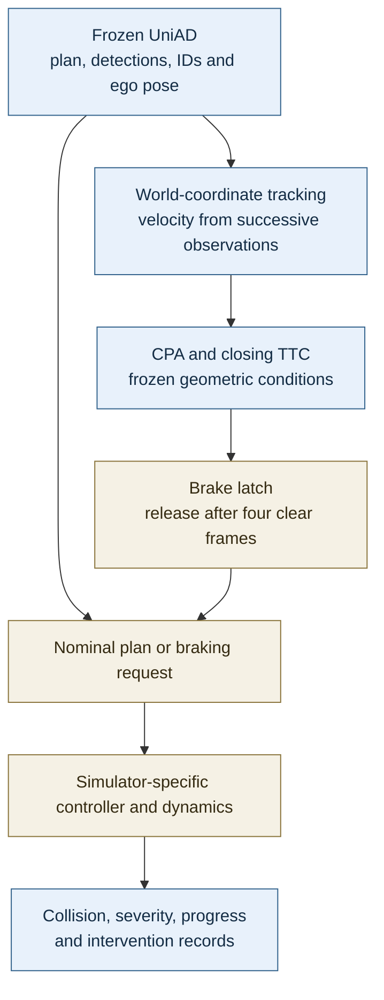
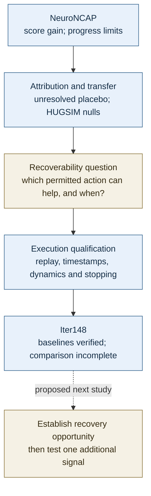

# Sentinel

**Runtime monitoring for a frozen driving planner: what can still be prevented,
what information makes prevention possible, and what it costs to keep driving.**

I am building Sentinel to make those questions measurable. A monitor must do more than
recognize a dangerous plan. Its intervention must arrive while it can still help, avoid
creating another failure, and leave the vehicle able to make useful progress.

The work began with a small geometric monitor around UniAD. It improved the planner's
NeuroNCAP score. The subsequent tests exposed the harder questions: braking can improve a
collision score while sacrificing progress; a benefit can fail to transfer; and a plausible
warning does not establish that the monitor identified the actor responsible for the collision.
Those findings now determine the research direction.

[Results](#measured-results) · [Monitor](#what-the-monitor-actually-uses) ·
[Research history](#how-the-question-changed) · [Current study](#current-study-iteration-148) ·
[Next steps](#the-next-scientific-test) · [Reproduce](#reproduce-and-inspect) ·
[Experiment index](#complete-experiment-index)

## Current position — 11 October 2026

The NeuroNCAP score improvement is supported on the evaluated suite. Its semantic
attribution remains unresolved. Both registered HUGSIM transfer tests returned null results.
The current development program asks whether an allowed intervention can produce useful
recovery before investing in a new information channel.

**Iteration 148 is inconclusive.** Four baseline episodes completed and passed replay;
the first braking-pulse episode was interrupted after an observation-transport failure.
There is no complete four-arm comparison. Both owned VM starts are confirmed terminated,
and the study has no automatic restart. [Execution report](experiments/iter148_recovery_study/RESULT.md).

This page covers research evidence through Iteration 148 on
[research/iter148-recovery-study](https://github.com/manfromnowhere143/sentinel/tree/research/iter148-recovery-study).
The accepted master mission snapshot is **current through iteration 134**, with verdict
`PLACEBO_HARM_OR_NULL`; [MISSION_STATE.json](MISSION_STATE.json) retains that historical
publication contract. Iteration 135 is deferred and unrun. The [current handoff](HANDOFF.md)
states the exact next task and acceptance criteria. The
[publication review](docs/publication/2026-10-11/REVIEW.md) separates research-branch publication
from master integration and records the remaining validation limits.

## Measured results

### NeuroNCAP: a score gain with specific costs

The principal comparison uses the same frozen UniAD planner with and without Sentinel's
released union monitor, on all 14 official NeuroNCAP scenes. The power run measured **799 of
800 planned episodes**, targeting 20 seed-paired runs per scenario pair. One OFF episode is
missing after repeated host freezes; its pair is reported at 19 runs.
[Protocol, raw evidence and analysis](experiments/full14_power/RESULT.md).

| Outcome | UniAD without monitor | UniAD with released union |
|---|---:|---:|
| NeuroNCAP score, 0–5 | 2.12 | **2.91** |
| Side-impact collision rate | 74% | **44%** |
| Stationary collision rate | 29% | **18%** |
| Frontal collision rate | 78% | **90%** |
| Frontal score, reflecting impact severity | 1.24 | 1.78 |

The pooled score difference is **+0.783**, with the registered run-index bootstrap 95% interval
**[+0.605, +0.928]**. The safe-progress difference is **−0.032 [−0.127, +0.065]**. That interval
does not establish a progress benefit or equivalence. The frontal result is particularly
important: the score improves while collisions become more frequent. In frontal/0346,
collision rate rises from 50% to 100%. These costs belong beside the gain.

The release mechanism improved safe-progress over the permanently latched union by
**+0.246 [+0.206, +0.293]** on the earlier six-run comparison, with unchanged collision measures
on its registered cells. It remains the selected configuration from that campaign;
it is not a guarantee that stopping or releasing is safe in a new situation.
[Iteration 15](experiments/iter15_latch_release/RESULT.md).

### Attribution: the placebo test remains unresolved

Iteration 134 completed **1,200 episodes** across OFF, released union and a semantics-scrambled
braking schedule. The union's benefit over OFF reproduced. Against placebo, however, the
registered primary difference was **+0.3683 [−0.1901, +0.8866]**, using the 20-pair-clustered
bootstrap. The placebo realized only **859 of 1,205 scheduled brake frames**; the union
realized all 1,205. Episode termination affected the dose the control could deliver.

The registered verdict is **`PLACEBO_HARM_OR_NULL`**. Neither the semantic explanation nor
its absence is established. The alternative run-index analysis produced a narrower, positive
interval; it did not replace the preregistered primary after the outcomes were known.
Realized braking is a consequence of treatment and is not a covariate that can simply repair
this comparison. [Iteration 134](experiments/iter134_neuroncap_placebo_semantics_execution/RESULT.md).

### External validity: HUGSIM did not reproduce the gain

| Frozen transfer test | Episodes | Paired HD-Score difference | Registered 95% interval |
|---|---:|---:|---|
| Easy and medium scenarios | 104 | −0.017 | [−0.055, +0.026] |
| Hard and extreme scenarios | 104 | −0.0089 | [−0.0438, +0.0203] |

Both results are **`TRANSFER_NULL`**, with scenario-clustered intervals. The monitor fired,
braked and released under the unchanged NeuroNCAP parameters. The hard/extreme OFF arm had
collision opportunity in 51 of 52 episodes. Lack of opportunity therefore does not explain
away that transfer result. These intervals also do not establish equivalence or universal
failure. [Iteration 48](experiments/iter48_hugsim_transfer_gate/RESULT.md) ·
[Iteration 49](experiments/iter49_hugsim_hard_tier_gate/RESULT.md).

The VAD transfer test exposed a different limit: fewer collisions on the tested threat cases
came with severe over-braking and a safe-progress decline, from 2.30 to 0.75. The same monitor
depends on the quality of the object identities and motion estimates supplied by its planner.
[VAD comparison](experiments/vad_generalization/RESULT.md).

### Lead time and intervention burden

The power-run audit reconstructed lead time for **61 episodes** using the OFF arm's 2 m
center-distance contact crossing. Median lead time was **1.30 s**, with a 5th–95th percentile
range of **0.40–3.50 s**; negative values were retained. Across the 400 monitor episodes,
1,205 brake frames were recorded over 10.79 km, or **111.68 brake frames/km**. Of those frames,
533 occurred in episodes whose paired OFF run did not collide. These are simulation-time and
intervention-budget measurements, not wall-clock latency or passenger-comfort qualifications.
[Timing and cost audit](experiments/iter40_timing_cost_audit/RESULT.md).

## What the monitor actually uses

The released monitor reads UniAD's **decoded detections, confidence scores, track IDs, ego pose
and planned trajectory**. It estimates object velocity from successive positions in world
coordinates. Two geometric conditions can request braking:

1. The planned ego path approaches an object's projected path within **1.5 m**.
2. The tracked object's closing time-to-collision falls below **2.5 s**, subject to the
   frozen filtering and closing-speed conditions.

Either condition latches the stop. Four consecutive clear monitor frames release it.
The [released source](experiments/iter15_latch_release/server_patch_union_release.py)
defines the complete filters, coordinate transforms and state transitions.



This interface gives the monitor access to the planner's outputs. The current trigger does
not demonstrate a benefit from hidden learned representations or an independent perception
system. Predicted object trajectories are logged in the released implementation but do not
drive this trigger. Simulator collision labels support evaluation; they are not monitor inputs.

A missing or mistaken detection can affect both planner and monitor. Exact replay of decisions
conditional on logged objects does not certify that those objects were complete or correct.
Iteration 43 also found excess firing under **5 cm position jitter** in offline replay.
The frozen smoothing variants in Iteration 44 reduced excess firing but failed their retention
and repair criteria. Those are measured robustness limits, still unresolved.
[Perturbation test](experiments/iter43_object_stream_perturbation_gate/RESULT.md) ·
[Smoothing test](experiments/iter44_velocity_smoothing_gate/RESULT.md).

The [architecture](docs/ARCHITECTURE.md) describes the two simulator integrations, current
trajectory and controller contracts, evidence checks and measured timing boundaries.

## How the question changed

### 1. Detect danger, then account for driving

The initial shadow study found a risk signal with AUROC 0.83 on 40 episodes. Early TTC braking
reduced collisions, but the next experiment showed that it could freeze benign scenes.
Observed-velocity tracking, path-based closest approach and their union addressed different
failures. Safe-progress made the cost of intervention visible alongside collision outcomes.

Three steering/evasion designs failed their registered comparisons. A tested RSS-style
baseline achieved low collision rates with very little driving. The crawl and routing variants
improved some progress measurements but failed collision criteria. These findings constrain
the evaluated policies and cases; they do not establish a universal stopping floor or rule out
other control strategies.

The first pooled union claim was **withdrawn** when the verification audit found that repeated
run indices were deterministic replays, not independent episodes. A fresh measurement at
20 unique episodes per scene then found safe-progress **+0.398 [+0.133, +0.665]** on the small
verification suite. The larger benchmark's progress null remains a separate result.
[Verification and corrections](experiments/VERIFICATION.md).

### 2. Test whether the planner contains a useful alternative

Native candidate plans and the two tested learned candidate heads failed to provide enough
feasible escapes on the registered threat frames. Those failures do not prove that the
planner's representation contains no useful information.

The later trainval work established a diagnostic signal for the defined low-diversity target:
the internal bridge probe reached AUROC 0.950, above the registered metadata and ego-plan
controls. The tested activation interventions did not pass calibration. A predictive probe
and a useful causal intervention are different achievements.
[Localization](experiments/iter30_full_trainval_lowdiv_localization/RESULT.md) ·
[Calibration null](experiments/iter37_track_query_site_intervention/RESULT.md).

### 3. Follow the transfer failure to its evidence boundary

The HUGSIM audits examined collision timing, trigger channels and the relation between monitor
objects and collision actors. Missing actor provenance first required instrumentation.
Subsequent analyses used a specified geometric association rule; its matches are bounded
evidence, not ground-truth object identity or a causal explanation by themselves.

In the eight-row support-core study, selected first-fire objects were never associated with
the collision actor before collision under that rule. Other objects had support at different
times, then lost it or were replaced. This motivates tests of observation continuity and
timing. It does not establish prevalence beyond those selected rows, or prove that retaining
tracks would repair the monitor. [Support-core synthesis](experiments/iter121_hugsim_support_core_two_track_synthesis/RESULT.md).

### 4. Ask what information can change an effective action

The direction review after Iteration 135 shifted the priority from another score comparison
to **information and recoverability**. Iteration 135's clock-only dose-response control remains
an unrun, deferred protocol. Even a favorable result would not isolate the value of semantic
content from the advantage of responding to the current state.

The immediate question became whether a permitted action, at a specified time, can avoid
failure while preserving useful progress. Only then can a new signal be tested for helping
a responsive policy choose that action. The [research direction](docs/research/SENTINEL_INFORMATION_AND_RECOVERABILITY_RESEARCH_DIRECTION_2026-10-09.md)
sets out the mathematical target, relevant prior work and the proposed experimental sequence.



### 5. Establish what the controller actually executes

Iterations 136–148 exposed several prerequisites to an interpretable recovery test:

| Finding | Response and remaining limit |
|---|---|
| Equal seeds did not reproduce the original controller's first command. | Separate numerical repeatability from wall-clock stopping and log the actual stopping reason. |
| Early pulse experiments found no useful recovery. | Keep the Iter139 **0/6** and Iter142 **0/2** nulls; inspect contact, actuation and continued driving. |
| Trajectory timing and native coordinate conventions were ambiguous. | Introduce explicit timestamps, units, frames and source identities; reject stale or misaligned trajectories. |
| Repeatable optimization could still stop without convergence. | Qualify constrained execution against an independent stationarity check; retain failed solver attempts. |
| Short successful traces could hide eventual failure. | Qualify full-horizon execution and retain completion, collision, off-route and censoring separately. |
| A lost progress observation stopped a running episode. | Close Iter148 with missing outcomes intact; design bounded observation recovery prospectively. |

The new execution regime changes controller and actor-time semantics explicitly. Its outcomes
must not be pooled with the old HUGSIM transfer runs as though only the monitor changed.
The complete iteration record is below.

## Current study: Iteration 148

The registered development study contains **14 scenarios from three previously exposed source
scenes**, four arms and two replicas: **112 slots**. The arms are nominal, responsive monitor,
and one-second braking pulses beginning at 0 or 2.5 simulated seconds. Replicas test execution
agreement; they are not new independent scenes. There are no untouched holdouts.

Only `scene-0013-easy-00` began execution:

| Arm | Retained outcome |
|---|---|
| Nominal | Two admitted replicas; 92 actions each; source-defined completion. |
| Responsive monitor | Two admitted replicas; 92 actions each; source-defined completion; no monitor activation. |
| Pulse at 0 s | First replica recorded 88 actions without a terminal summary; paired admission invalid. Second replica uninitialized. |
| Pulse at 2.5 s | Neither replica initialized. |

The four admitted episodes contain **368 verified actions**, no recorded collision or off-route
event, and exact replica agreement within the declared tolerances. This easy case has no
configured dynamic actors. Completion follows the simulator's rule near 90% of sampled route
points; it does not mean the literal final route sample was reached. Since nominal already
completed and the monitor never intervened, this is integration evidence rather than a recovery
gain. Natural monitor release was not observed here.

The stopping event was a failed read-only IAP progress query. The supervisor's frozen response
terminated the block; the error does not establish a simulator failure. Evidence collection
subsequently recovered the partial trace without restarting any driving job.

**Accounting: four admitted, one incomplete, 107 uninitialized; zero complete four-arm
comparisons.** Recovery and harm rates remain unestimated. Missing terminal outcomes are not
successes, failures of the intervention, or zeros.

### Convergence and timing are separate results

| Quantity, admitted episodes only | Observation |
|---|---:|
| Largest independently checked stationarity residual | 9.759 × 10⁻⁷; bar 10⁻⁶ |
| Complete controller calls over 50 ms | **6 / 368** |
| Recorded loops over 250 ms | **368 / 368** |
| Loop duration, minimum / median / maximum | 1.712 / 1.792 / 24.608 s |

The simulator waits synchronously. These measurements do not establish 4 Hz operation or a
policy for handling late results. The loop timer includes the final guard and stop decision;
reset, summary serialization and worker cleanup are outside that scope. Model exchange time
also includes communication and cannot be read as isolated inference latency.

[Result and failure record](experiments/iter148_recovery_study/RESULT.md) ·
[Scoped metrics](experiments/iter148_recovery_study/proof/block_000_attempt_002/metrics.json) ·
[Aggregate accounting](experiments/iter148_recovery_study/proof/block_000_attempt_002/study_aggregate.json) ·
[Resource closure](experiments/iter148_recovery_study/proof/block_000_attempt_002/combined_resource_closure.json).

## The next scientific test

The intended contribution is a monitor and evaluation system that can show **which failures
remain preventable, which signal enables prevention, and the measured cost and limits**.
The following work is proposed; the interrupted study remains closed.

1. **Qualify observation recovery.** Distinguish an unavailable progress observation from a
   failed worker. Permit bounded read-only retries while preserving independent host deadlines,
   ownership checks and an immutable record of episode initialization. Demonstrate that an
   observation retry cannot duplicate execution.
2. **Establish constructive recovery.** Prospectively register the next finite comparison.
   Keep the action library, timing grid, outcomes and progress constraints explicit. Preserve
   initialized Iter148 slots and their missingness; do not silently rerun them. A successful
   branch establishes an opportunity only within that simulator, library and horizon.
3. **Test one information hypothesis against a responsive baseline.** Track continuity and
   uncertainty are motivated candidates. Include benign and stale-track cases, freeze the
   information interfaces, and measure intervention costs. Better offline prediction alone
   does not establish a prevention benefit.
4. **Evaluate generalization on genuinely new source scenes.** Reserve them before development
   continues. Measure joint planner/monitor failures, observation faults, timing faults and
   subgroup uncertainty before broadening to another planner or simulator.

Failure across a finite set of actions does not prove physical inevitability. Likewise, a weak
probe does not prove that the available observations lack information. If a representation is a
deterministic function of the same input history, its value may be computational access under
a time budget rather than new information. Those distinctions matter to both the mathematics
and the experiment.

## Reproduce and inspect

Start with the result for the claim being checked. Its hypothesis defines the population,
comparison, stopping rule and analysis; its proof directory contains the retained inputs and
outputs. Historical experiments have different environments. A green test run, a content hash
or a repeated seed is not sufficient evidence for a scientific claim.

Two small checks can run from the repository root without a GPU or dataset download:

```bash
python3 experiments/iter2_monitor/g1_auroc.py \
  experiments/iter2_monitor/proof/risk.jsonl.gz \
  experiments/iter2_monitor/proof/outcomes.tsv

python3 experiments/verification/audit_pooling.py
```

For the current execution, raw pairs were committed before admission. A separate implementation
checks dynamics, controller outputs, monitor decisions, route outcomes and replica agreement.
The [Iteration 148 replay entrypoint](experiments/iter148_recovery_study/replay.py) exposes these
checks; the [qualification record](experiments/iter148_recovery_study/QUALIFICATION.json) binds
the earlier evidence. **165 focused tests passed** before live execution, and qualification
replayed **1,104 earlier GPU actions**. This does not make the incomplete pulse an admitted result.

Fresh simulator execution also requires the licensed datasets, scene/model assets, pinned
runtime and a new bounded resource envelope. Some large assets remain on the stopped host
with retained hashes. The repository alone is sufficient for the two commands above; it is
not a complete distribution of every runtime asset.

| Guide | Scope |
|---|---|
| [Architecture](docs/ARCHITECTURE.md) | Implemented interfaces, simulator distinctions, evidence flow and timing. |
| [Original preregistration](PREREGISTRATION.md) | The initial benchmark question and decision rules. |
| [Research direction](docs/research/SENTINEL_INFORMATION_AND_RECOVERABILITY_RESEARCH_DIRECTION_2026-10-09.md) | The post-Iter135 question, mathematical formulation and dated literature review. |
| [Continuation](experiments/iter148_recovery_study/DECISION.md) | Current execution closure and the next operational prerequisites. |
| [Handoff](HANDOFF.md) | Exact next task, acceptance criteria, resource closure and recovery instructions. |
| [Continuity](CONTINUITY.md) and [next phase](docs/NEXT_PHASE.md) | Current state followed by retained historical decisions. |
| [Technical report](docs/REPORT.md) | Historical synthesis through Iter134; it predates the current execution program. |
| [Paper status](docs/paper/STATUS.md) | Archived manuscript and rewrite requirements; not submission-ready. |
| [Verification archive](experiments/verification/README.md) | Early audit scripts, raw logs and correction history. |
| [Editorial review](docs/editorial/2026-10-11/REVIEW.md) | Claim checks, diagram validation and preservation record for this update. |

## Complete experiment index

Every experiment with a `RESULT.md` is linked here, including failed gates, infrastructure
work, nulls and withdrawn claims. A completed audit is not an additional driving experiment.
Actor matches in the HUGSIM audit rows use the frozen geometric association rule; they
are not claims of ground-truth identity.
Repeated analyses of the same cases do not increase the number of independent cases.

<details>
<summary>Monitor, alternatives and verification: Iter1–21</summary>

| Record | Finding or scope |
|---|---|
| [1](experiments/iter1_reproduce) | Closed-loop stack smoke and baseline reproduction. |
| [1b](experiments/iter1b_partial_baseline/PARTIAL_BASELINE.md) | Partial baseline and collision corpus. |
| [2](experiments/iter2_monitor/RESULT.md) | Risk signal, TTC braking and early ablations; the selectivity claim was later corrected. |
| [3](experiments/iter3_progress/RESULT.md) | Safe-progress exposes over-braking on benign scenes. |
| [4](experiments/iter4_gated/RESULT.md) | Closing-speed gating improves selectivity on the tested cases. |
| [5](experiments/iter5_tracked/RESULT.md) | Observed velocity improves frontal response; side-impact failures remain. |
| [6](experiments/iter6_cpa/RESULT.md) | Path-based closest approach reduces side impacts with excess braking. |
| [7](experiments/iter7_margin/RESULT.md) | Margin sweep exposes the trade between selectivity and threat coverage. |
| [8](experiments/iter8_union/RESULT.md) | Union of CPA and tracked closing-TTC detectors; collision recount corrected by verification. |
| [9](experiments/iter9_evade/RESULT.md) | Steering evasion fails the registered comparison. |
| [10](experiments/iter10_brakevade/RESULT.md) | Combined braking and steering fails the registered comparison. |
| [11](experiments/iter11_early_evade/RESULT.md) | Early evasion fails and creates collisions in the clean test case. |
| [12](experiments/iter12_plan_selection/RESULT.md) | Native candidate plans fail the registered feasible-escape criterion. |
| [13](experiments/iter13_rss_baseline/RESULT.md) | Tested RSS-style envelope reduces collisions with severe progress cost. |
| [Full14](experiments/full14_benchmark/RESULT.md) | Six-run full-suite comparison; the later power run is the headline. |
| [15](experiments/iter15_latch_release/RESULT.md) | Four-clear-frame latch release improves progress over the latched union. |
| [Pooling](experiments/union_validation/RESULT.md) | WITHDRAWN: deterministic replays were counted as independent episodes. |
| [Power](experiments/full14_power/RESULT.md) | 799/800 episodes; benchmark gain with a safe-progress null. |
| [14 · VAD](experiments/vad_generalization/RESULT.md) | Transfer reduces tested collisions but substantially harms progress. |
| [Verification](experiments/verification/README.md) | Audit and fresh unique-episode remeasurement. |
| [16](experiments/iter16_soft_stop/RESULT.md) | Crawl gains progress but fails the collision criterion. |
| [17](experiments/iter17_threat_routing/RESULT.md) | Threat routing gains progress but fails its collision criterion. |
| [18](experiments/iter18_tracker/RESULT.md) | Offline tracking gate fails by one frame; no live run. |
| [19](experiments/iter19_diversity_head/RESULT.md) | Planning-query candidate head fails its escape gate; no general representation impossibility follows. |
| [20](experiments/iter20_vad_tracker_portability/RESULT.md) | Tracker defaults fail the VAD portability gate. |
| [21](experiments/iter21_bev_diversity_head/RESULT.md) | BEV candidate head fails feasibility and fidelity gates. |

</details>

<details>
<summary>Data, causal probes and robustness: Iter22–44</summary>

| Record | Finding or scope |
|---|---|
| [22](experiments/iter22_causal_planner_interpretability/RESULT.md) | Artifact join failure stops the causal test. |
| [23](experiments/iter23_s0_hardened_causal_localization/RESULT.md) | Join repair passes; insufficient target counts stop the causal test. |
| [24](experiments/iter24_risk_support_atlas/RESULT.md) | No eligible locally available scenes after the known-data exclusion. |
| [25](experiments/iter25_staged_data_inventory/RESULT.md) | Staged-data inventory confirms the availability blocker. |
| [26](experiments/iter26_data_staging_remedy/RESULT.md) | Capacity check fails before data movement. |
| [27](experiments/iter27_storage_provisioning/RESULT.md) | Persistent storage provisioned; infrastructure result. |
| [28](experiments/iter28_nuscenes_trainval_staging/RESULT.md) | Official trainval assets staged with inventory checks. |
| [29](experiments/iter29_trainval_risk_support_atlas/RESULT.md) | Low-diversity support atlas passes; strict-collapse support is insufficient. |
| [30](experiments/iter30_full_trainval_lowdiv_localization/RESULT.md) | Diagnostic localization passes against registered controls; no causal intervention result. |
| [31](experiments/iter31_full_trainval_bridge_intervention/RESULT.md) | Sham intervention fails baseline reproduction. |
| [32](experiments/iter32_prefix_replay_baseline_recovery/RESULT.md) | Full-prefix replay restores the frozen baseline. |
| [33](experiments/iter33_prefix_preserving_bridge_intervention/RESULT.md) | Bridge intervention fails calibration. |
| [34](experiments/iter34_direction_specificity_audit/RESULT.md) | Scale-only continuation fails its response-consistency criterion. |
| [35](experiments/iter35_response_heterogeneity_audit/RESULT.md) | Response heterogeneity yields no eligible registered stratum. |
| [36](experiments/iter36_bridge_site_decomposition/RESULT.md) | Subsite probes identify diagnostic targets for a later intervention. |
| [37](experiments/iter37_track_query_site_intervention/RESULT.md) | Track-query intervention fails calibration. |
| [38](experiments/iter38_track_query_opposite_direction/HYPOTHESIS.md) | Opposite-direction canary passes; calibration was not run. |
| [39](experiments/iter39_external_validity_claim_audit/RESULT.md) | Claim scope narrowed after external-validity audit. |
| [40](experiments/iter40_timing_cost_audit/RESULT.md) | Lead time and intervention burden measured on the power-run logs. |
| [41](experiments/iter41_sensor_input_degradation_gate/RESULT.md) | Missing exact pose support stops perturbation analysis. |
| [42](experiments/iter42_exact_trace_replay_support/RESULT.md) | Captured pose-aware trace supports exact decision replay. |
| [43](experiments/iter43_object_stream_perturbation_gate/RESULT.md) | Offline position jitter at 5 cm causes excess firing. |
| [44](experiments/iter44_velocity_smoothing_gate/RESULT.md) | Registered smoothing variants fail fidelity and repair criteria. |

</details>

<details>
<summary>HUGSIM transfer and mechanism audits: Iter45–100</summary>

| Record | Finding or scope |
|---|---|
| [45](experiments/iter45_hugsim_infra_gate/RESULT.md) | HUGSIM assets, environment and nominal smoke pass. |
| [46](experiments/iter46_hugsim_off_baseline/RESULT.md) | Baseline completion null: 38/52 episodes; map assets missing. |
| [47](experiments/iter47_map_staging_and_off_completion/RESULT.md) | Map staging completes the 52-episode baseline with carried evidence preserved. |
| [48](experiments/iter48_hugsim_transfer_gate/RESULT.md) | TRANSFER_NULL on easy/medium scenarios; monitor active, interval includes zero. |
| [49](experiments/iter49_hugsim_hard_tier_gate/RESULT.md) | TRANSFER_NULL on hard/extreme scenarios despite collision opportunity. |
| [50](experiments/iter50_collision_opportunity_audit/RESULT.md) | Collision-opportunity audit; opportunity scarcity does not rescue the transfer claim. |
| [51](experiments/iter51_hugsim_failure_taxonomy/RESULT.md) | Mixed failure taxonomy; no single mechanism explains all retained pairs. |
| [52](experiments/iter52_hugsim_on_collision_timing_audit/RESULT.md) | Timing audit finds both absent/late braking and persistent collisions after early braking. |
| [53](experiments/iter53_hugsim_first_fire_channel_audit/RESULT.md) | First-fire channels do not reduce the failure to one union branch. |
| [54](experiments/iter54_hugsim_provenance_support_audit/RESULT.md) | Missing collision-actor identity limits provenance attribution. |
| [55](experiments/iter55_hugsim_collision_instrumentation_source_audit/RESULT.md) | Source audit identifies instrumentation locations. |
| [56](experiments/iter56_hugsim_provenance_instrumentation_patch/RESULT.md) | Static guard rejects the first provenance patch design. |
| [57](experiments/iter57_hugsim_patch_guard_refinement/RESULT.md) | Refined guard accepts the same patch bytes; no driving result. |
| [58](experiments/iter58_hugsim_provenance_instrumented_canary/RESULT.md) | Instrumented canary records collision provenance. |
| [59](experiments/iter59_hugsim_actor_match_audit/RESULT.md) | Eight selected episodes; three foreground-classifiable rows mismatch under the frozen bridge. |
| [60](experiments/iter60_actor_bridge_sensitivity/RESULT.md) | Bridge sensitivity makes one row ambiguous; robust all-row mismatch unsupported. |
| [61](experiments/iter61_monitor_object_surface_audit/RESULT.md) | A non-trigger object matches in one case; two cases lack first-fire support. |
| [62](experiments/iter62_nontrigger_ranking_audit/RESULT.md) | The matched non-trigger object is outside the frozen hazard thresholds. |
| [63](experiments/iter63_temporal_emergence_audit/RESULT.md) | The matched object remains visible without reaching a hazard threshold before contact. |
| [64](experiments/iter64_unsupported_temporal_surface_audit/RESULT.md) | Both cases lacking first-fire support have earlier object matches under the frozen rule. |
| [65](experiments/iter65_temporal_alignment_audit/RESULT.md) | The earlier matched objects remain below the trigger thresholds at those times. |
| [66](experiments/iter66_matched_object_timeline_audit/RESULT.md) | One target becomes a TTC hazard; the other remains below threshold before contact. |
| [67](experiments/iter67_trigger_target_bridge_audit/RESULT.md) | Target and trigger coincide in one case and differ in the other. |
| [68](experiments/iter68_fire_time_bridge_decomposition/RESULT.md) | The best trigger-to-actor association occurs before firing in one case and after it in another. |
| [69](experiments/iter69_hugsim_mechanism_taxonomy/RESULT.md) | Synthesis classifies all eight selected cases within the available provenance. |
| [70](experiments/iter70_hugsim_structural_timing_audit/RESULT.md) | Five cases divide into silent, late-fire and background-only collision categories. |
| [71](experiments/iter71_hugsim_surface_silent_margin_audit/RESULT.md) | The two silent cases remain far from the trigger thresholds before contact. |
| [72](experiments/iter72_hugsim_late_fire_prefire_margin_audit/RESULT.md) | The two late-fire cases approach a threshold before contact without crossing it. |
| [73](experiments/iter73_hugsim_margin_transition_audit/RESULT.md) | Silent cases never activate; late-fire cases activate only after contact. |
| [74](experiments/iter74_hugsim_late_fire_delay_barrier/RESULT.md) | The near-threshold channel before contact differs from the channel firing after contact. |
| [75](experiments/iter75_hugsim_cross_channel_object_handoff/RESULT.md) | Both late-fire cases also switch the object responsible for the monitor signal. |
| [76](experiments/iter76_hugsim_switch_foreground_bridge/RESULT.md) | Neither selected object reaches the specified actor-association bands at the event. |
| [77](experiments/iter77_hugsim_event_object_set_bridge/RESULT.md) | Other objects in the full detection set supply some actor-association support. |
| [78](experiments/iter78_hugsim_support_object_ranking/RESULT.md) | Objects with actor support are unselected and below the monitor thresholds. |
| [79](experiments/iter79_hugsim_selected_surface_decomposition/RESULT.md) | Selected objects have stronger monitor signals than the actor-supported objects. |
| [80](experiments/iter80_hugsim_selected_all_provenance_bridge/RESULT.md) | Selected objects lack an association with any eligible recorded collision-provenance row. |
| [81](experiments/iter81_hugsim_support_object_temporal_surface/RESULT.md) | One supported object later reaches the monitor surface; another never does. |
| [82](experiments/iter82_hugsim_support_surface_bridge_cooccurrence/RESULT.md) | Actor association coincides only with a borderline signal in one case and none in another. |
| [83](experiments/iter83_hugsim_bridge_supported_surface_miss_decomposition/RESULT.md) | Supported objects remain outside active TTC/CPA conditions at the examined times. |
| [84](experiments/iter84_hugsim_selected_support_arbitration/RESULT.md) | Objects favoured by monitor geometry differ from those supported by actor provenance. |
| [85](experiments/iter85_hugsim_path_horizon_bridge_timing/RESULT.md) | Path horizon and provenance timing preserve the selected/support-object distinction. |
| [86](experiments/iter86_hugsim_bridge_time_surface_replay/RESULT.md) | Exact replay classifies two rows; a missing 6.0 s decision row blocks the third. |
| [87](experiments/iter87_hugsim_interval_bridge_time_surface_replay/RESULT.md) | Interval replay finds one borderline supported object and another below threshold. |
| [88](experiments/iter88_hugsim_bridge_surface_margin_residual/RESULT.md) | Residual margins distinguish two ways that supported objects miss the trigger. |
| [89](experiments/iter89_hugsim_joint_bridge_surface_candidate_audit/RESULT.md) | No object in the examined replay rows is both active and actor-supported. |
| [90](experiments/iter90_hugsim_active_surface_provenance_gap/RESULT.md) | The only active replay object lacks actor support; supported objects are inactive. |
| [91](experiments/iter91_hugsim_active_gap_geometry_decomposition/RESULT.md) | Path proximity and actor-provenance proximity favour different objects. |
| [92](experiments/iter92_hugsim_path_proximity_arbitration/RESULT.md) | The closest path object differs from the closest provenance object in each examined row. |
| [93](experiments/iter93_hugsim_surface_winner_alignment/RESULT.md) | Surface selection follows path proximity in two rows and provenance proximity in one. |
| [94](experiments/iter94_hugsim_active_row_surface_margin_arbitration/RESULT.md) | The active row selects its only active CPA candidate; supported candidates remain distant. |
| [95](experiments/iter95_hugsim_nonactive_surface_branch_arbitration/RESULT.md) | Inactive rows separate a borderline TTC choice from a path/CPA choice. |
| [96](experiments/iter96_hugsim_branch_outcome_bridge/RESULT.md) | Different signal branches lead to the same recorded late-fire outcome category. |
| [97](experiments/iter97_hugsim_surface_silent_outcome_margin_bridge/RESULT.md) | Silent cases approach a threshold only after foreground contact. |
| [98](experiments/iter98_hugsim_background_only_outcome_bridge/RESULT.md) | The background-only case retains a TTC fire without foreground-actor support. |
| [99](experiments/iter99_hugsim_structural_bridge_coverage_audit/RESULT.md) | The five fixed structural cases are covered once each by the preceding audits. |
| [100](experiments/iter100_hugsim_structural_expansion_support_audit/RESULT.md) | Existing transfer reports lack collision-actor support for expanding the structural analysis. |

</details>

<details>
<summary>Provenance, scenario design and placebo: Iter101–134</summary>

| Record | Finding or scope |
|---|---|
| [101](experiments/iter101_hugsim_provenance_batch_candidate_design/RESULT.md) | Designed a 13-slot provenance batch, including one carried reference. |
| [102](experiments/iter102_hugsim_provenance_batch_launch_manifest/RESULT.md) | Bound the 13 batch slots to their sources; duplicate scenarios retained distinct identities. |
| [103](experiments/iter103_hugsim_provenance_batch_execution/RESULT.md) | Executed all 13 slots; retained 217 collision-provenance rows. |
| [104](experiments/iter104_hugsim_provenance_batch_actor_match_audit/RESULT.md) | Only 1/13 slots met foreground classification requirements; the registered bar was four. |
| [105](experiments/iter105_hugsim_timing_aware_provenance_batch_design/RESULT.md) | Selected 13 slots using timing eligibility and prior-instrumentation exclusions. |
| [106](experiments/iter106_hugsim_timing_aware_launch_manifest/RESULT.md) | Prepared the timing-aware batch with source and runtime checks. |
| [107](experiments/iter107_hugsim_timing_aware_batch_execution/RESULT.md) | Executed all 13 slots; retained 252 collision-provenance rows. |
| [108](experiments/iter108_hugsim_timing_aware_batch_actor_match_audit/RESULT.md) | Only 2/13 slots met foreground classification requirements; the bar remained four. |
| [109](experiments/iter109_hugsim_timing_aware_support_yield_decomposition/RESULT.md) | Remaining classification failures split between absent foreground actors and late firing. |
| [110](experiments/iter110_hugsim_support_preserving_candidate_design/RESULT.md) | Identified an eight-row core with suitable support; a clean 13-slot schedule was unavailable. |
| [111](experiments/iter111_hugsim_support_core_launch_manifest/RESULT.md) | Bound the eight-row core schedule to source identities. |
| [112](experiments/iter112_hugsim_support_core_batch_execution/RESULT.md) | Executed all eight core slots; retained 44 collision-provenance rows. |
| [113](experiments/iter113_hugsim_support_core_actor_match_audit/RESULT.md) | All eight cases were classifiable; all mismatched under the frozen association rule. |
| [114](experiments/iter114_hugsim_support_core_mismatch_geometry_decomposition/RESULT.md) | Mismatch vectors were predominantly longitudinal; seven monitor objects lay behind the actor. |
| [115](experiments/iter115_hugsim_support_core_monitor_set_ordering/RESULT.md) | No first-fire object set contained a close actor candidate under the frozen rule. |
| [116](experiments/iter116_hugsim_support_core_collision_actor_timeline/RESULT.md) | Seven cases had pre-collision support, with different timing relative to first fire. |
| [117](experiments/iter117_hugsim_support_core_event_window_decomposition/RESULT.md) | Initially supported objects differed from the selected objects at first fire. |
| [118](experiments/iter118_hugsim_support_core_object_lifecycle/RESULT.md) | Initially supported objects no longer had support at fire; later support used other objects. |
| [119](experiments/iter119_hugsim_support_core_loss_replacement_audit/RESULT.md) | Measured support gaps were 1–6 s; nearest first-fire replacements remained outside support. |
| [120](experiments/iter120_hugsim_support_core_selected_fire_object_lifecycle/RESULT.md) | Selected first-fire objects never acquired pre-collision support in these eight cases. |
| [121](experiments/iter121_hugsim_support_core_two_track_synthesis/RESULT.md) | Synthesis retains the distinction between supported objects and selected trigger objects. |
| [122](experiments/iter122_support_core_taxonomy_documentation/RESULT.md) | Integrated the bounded mechanism synthesis into the historical research documents. |
| [123](experiments/iter123_mission_evidence_alignment_audit/RESULT.md) | Mission and evidence alignment review; historical documentation update. |
| [124](experiments/iter124_manuscript_report_freshness/RESULT.md) | Historical manuscript/report freshness update. |
| [125](experiments/iter125_support_core_blind_spot_scenario_design/RESULT.md) | Five proposed scenario archetypes derived from the support-core cases. |
| [126](experiments/iter126_support_core_candidate_manifest_preflight/RESULT.md) | Ten symbolic candidate specifications; no generated-scene outcome. |
| [127](experiments/iter127_post_iter126_mission_alignment_audit/RESULT.md) | Mission alignment review after candidate design. |
| [128](experiments/iter128_support_core_source_pool_mutation_preflight/RESULT.md) | Source pools and mutation operators specified before generation. |
| [129](experiments/iter129_support_core_artifact_naming_preflight/RESULT.md) | Future artifact names reserved; no generated-scene outcome. |
| [130](experiments/iter130_support_core_artifact_schema_preflight/RESULT.md) | Artifact schemas specified; no generated-scene outcome. |
| [131](experiments/iter131_post_iter130_mission_alignment_audit/RESULT.md) | Mission alignment review after schema design. |
| [132](experiments/iter132_support_core_schema_instance_creation_preflight/RESULT.md) | Inert templates and validator contract prepared. |
| [133](experiments/iter133_neuroncap_placebo_semantics_control_design/RESULT.md) | Placebo comparison preregistered before execution. |
| [134](experiments/iter134_neuroncap_placebo_semantics_execution/RESULT.md) | PLACEBO_HARM_OR_NULL; gain over OFF reproduced, attribution unresolved. |

</details>

<details>
<summary>Information, recoverability and execution: Iter135–148</summary>

| Record | Finding or scope |
|---|---|
| [135](experiments/iter135_neuroncap_blind_braking_dose_response/HYPOTHESIS.md) | Preregistered dose-response protocol; deferred and unrun. |
| [136](experiments/iter136_hugsim_recoverability_canary/RESULT.md) | REPLAY_DIVERGED: equal seeds and initial plans do not reproduce controller output. |
| [137](experiments/iter137_controller_execution_contract/RESULT.md) | Numerical repeatability and stopping reasons qualified separately from deadlines. |
| [138](experiments/iter138_numerical_live_replay/RESULT.md) | Live numerical replay qualified; timing remains a separate constraint. |
| [139](experiments/iter139_finite_pulse_recoverability/RESULT.md) | Null: 0/6 useful recoveries in the registered finite-pulse cases. |
| [140](experiments/iter140_contact_actuation/RESULT.md) | Contact and applied-control reconstruction; prior recovery null unchanged. |
| [141](experiments/iter141_nominal_continuation/RESULT.md) | Nominal continuation design and execution contract; no recovery gain established. |
| [142](experiments/iter142_nominal_continuation_completion/RESULT.md) | Null: 0/2 useful recoveries under the continuation experiment. |
| [143](experiments/iter143_model_contract/RESULT.md) | Actor time, coordinates and ego dynamics audited before a new execution regime. |
| [144](experiments/iter144_timed_trajectory/RESULT.md) | Explicit trajectory timestamps qualified locally; from-rest convergence still failed. |
| [145](experiments/iter145_constrained_execution/RESULT.md) | Constrained controller and bounded GPU smoke qualified; no full-route recovery result. |
| [146](experiments/iter146_route_outcome_contract/RESULT.md) | Route outcomes and missingness corrected; short GPU qualification remains censored. |
| [147](experiments/iter147_full_horizon_execution/RESULT.md) | Full-horizon qualification: 912 GPU actions; diagnostic holds and natural-actor collisions. |
| [148](experiments/iter148_recovery_study/RESULT.md) | Inconclusive: four admitted baseline episodes; pulse interrupted; no complete comparison. |

</details>


## Data, attribution and historical record

Sentinel is Daniel Wahnich's independent research project. The experiments use public research
benchmarks and datasets, including nuScenes, NeuroNCAP/NeuRAD and HUGSIM, with frozen UniAD
and, in a separate transfer test, VAD. Their source, data and model terms remain applicable;
this repository does not grant rights to upstream assets.

The measured comparisons are against the named experimental baselines. They establish neither
real-world safety nor production readiness, and provide no comparison with private industrial
systems. A leading benchmark score, industrial adoption and a new theorem each require their
own evidence. They remain ambitions, not descriptions of the current result.

The [previous README](docs/history/README_through_iter134.snapshot.txt) is retained byte for byte
as a historical snapshot. It contains superseded status and wording, including claims narrowed
on this page. Original results, protocols, raw evidence and accepted Git history remain intact.
The archive preserves what was written; the current page states what the evidence supports.
