# Sentinel

**Runtime monitoring and recovery for learned driving systems.**

A driving planner can produce a dangerous trajectory even when its perception and planning
outputs appear plausible. An intervention is useful only if it arrives while a better outcome
is still possible, avoids creating another failure, and leaves the vehicle able to make progress.

Sentinel studies that decision around a frozen planner. Its implemented monitor uses the
planner's decoded objects and planned path to request and release braking. Closed-loop
experiments measure the resulting collisions, severity, progress and intervention burden;
separate replay checks whether the recorded execution supports the reported result.

I am building Sentinel to determine which failures remain preventable, what information helps
choose an effective action in time, and what that intervention costs. The ambition extends
beyond the current geometric monitor. Each extension must demonstrate a useful improvement
against a competent responsive baseline, with information access, permitted actions and
resource budgets stated explicitly.

[System](#what-sentinel-does) · [Results](#measured-results) ·
[Research history](#how-the-question-changed) · [Latest result](#iteration-191-stop-wait-release-qualifies-inside-the-connector) ·
[Next test](#the-next-scientific-test) · [Reproduce](#reproduce-and-inspect) ·
[Repository status](#repository-status--28-october-2026) · [Experiment index](#complete-experiment-index)

## Reading the evidence

The full record below follows the changes in the scientific question. Start with
the system interface, then the measured gains and costs, then the current
qualification gap. Every experiment result remains indexed at the end.

| Stage | Retained finding | What it does not establish |
|---|---|---|
| Released monitor | NeuroNCAP score improves; frontal collisions increase and progress benefit is unestablished. | General safety or transfer. |
| Attribution and transfer | Placebo attribution remains unresolved; HUGSIM comparisons are null. | Semantic information value. |
| Execution and geometry | Controller, clocks and background masks have separately checked contracts. | Physical scene fidelity. |
| Recovery search | A fixed path completes native runs from reset; actual first-fire searches miss. | Useful monitor-time intervention. |
| Integrated development | Best is 3/4; a selection change lost a success before eligibility restored it. | All-four qualification or source-comparison readiness. |
| Continuation audit | One discarded prefix has a full-route continuation; two probes remain bounded misses. | Success of an online retention policy. |
| Integrated retention trial | Right bend gained, left bend lost; both chicanes complete. All registered branch masks replay. | All-four qualification, useful actual-history intervention or superiority. |
| Early timing audit | Two early endpoints excluded; 34 have retained completion suffixes; 219 remain unknown. | A repaired planner, causal explanation of the loss, or feasibility of unknown states. |
| Uniform timing trial | Same three successes; 96 left-bend evaluations meet early exclusions; tree reaches frame 26. | All-four qualification or a proven explanation of the remaining miss. |
| Late continuation audit | All four left-bend late nodes can finish within the original remaining budgets; three received no request. | A repaired integrated planner or isolated causal explanation. |
| Connector feedback qualification | Original-request completions rise 1/23 → 8/23, with no lost completion; two left requests finish in eight attempts. | An integrated all-four success or unseen-case advantage. |

The [next decision](experiments/iter191_stop_wait_release/DECISION.md)
is a separately frozen all-four integrated trial of the qualified stop/wait/release
proposal, under unchanged budgets and allocation. The [paired qualification](experiments/iter191_stop_wait_release/RESULT.md)
reproduces all 23 original baseline requests and admits seven new completions.
Integrated credit remains 3/4. The [research rationale](experiments/iter191_stop_wait_release/RESEARCH.md)
separates a finite-budget connector improvement from an integrated or physical guarantee.

## What Sentinel does

The implemented monitor runs alongside a frozen planner in closed-loop simulation. It can
request braking and later release that request; the surrounding simulator and controller
determine the applied motion. The released monitor reads UniAD's **decoded detections,
confidence scores, track IDs, ego pose and planned trajectory**. It estimates object velocity
from successive positions in world coordinates. Closest point of approach (CPA) and time to collision (TTC) supply two geometric
conditions that can request braking:

1. The planned ego path approaches an object's projected path within **1.5 m**.
2. The tracked object's closing time-to-collision falls below **2.5 s**, subject to the
   frozen filtering and closing-speed conditions.

Either condition latches the stop. Four consecutive clear monitor frames release it.
The [released source](experiments/iter15_latch_release/server_patch_union_release.py)
defines the complete filters, coordinate transforms and state transitions.

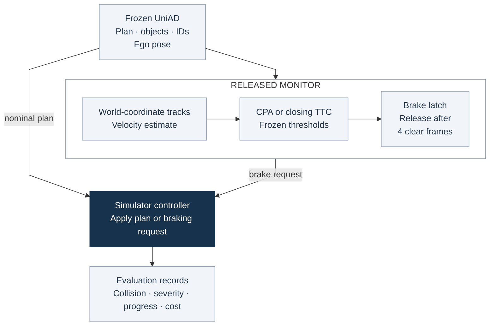

This interface gives the monitor access to the planner's outputs. The current trigger does
not demonstrate a benefit from hidden learned representations or an independent perception
system. Predicted object trajectories are logged in the released implementation but do not
drive this trigger. Simulator collision labels support evaluation; they are not monitor inputs.

A missing or mistaken detection can affect both planner and monitor. Exact replay of decisions
conditional on logged objects does not certify that those objects were complete or correct.
Iteration 43 also found excess firing under **5 cm position jitter** in offline replay.
The frozen smoothing variants in Iteration 44 reduced excess firing but failed their retention
and repair criteria. Those are measured robustness limits, still unresolved.
[Perturbation test](experiments/iter43_object_stream_perturbation_gate/RESULT.md) ·
[Smoothing test](experiments/iter44_velocity_smoothing_gate/RESULT.md).

The [architecture](docs/ARCHITECTURE.md) describes the two simulator integrations, current
trajectory and controller contracts, evidence checks and measured timing boundaries.

### The recovery research engine

The current research engine asks which actions remain possible under explicit
scene and timing constraints. Its diagnostic search can access retained scene
geometry unavailable to the released monitor. Native control-RRT, a bounded
connector and exact branch identities produce inspectable candidate paths;
separate replay decides which recorded properties are admitted.

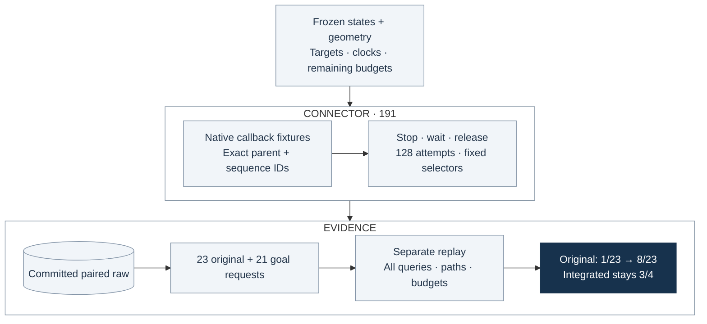

The [native interface](experiments/iter186_native_branch/RESULT.md),
[integrated trial](experiments/iter187_integrated_branch_retention/RESULT.md) and
[timing audit](experiments/iter188_early_timing_feasibility/RESULT.md) have separate
contracts. [Iter189](experiments/iter189_uniform_timing_eligibility/RESULT.md) applies uniform timing
eligibility in a new integrated trial: the same three cases complete. Iter188 remains
a retained-endpoint audit. [Iter190](experiments/iter190_late_continuation_audit/RESULT.md) verifies budgeted full
continuations from every left-bend late node, including three without requests.
[Iter191](experiments/iter191_stop_wait_release/RESULT.md) qualifies a feedback proposal
inside the same connector: original requests improve 1/23 → 8/23 and synthetic
goal requests 5/21 → 13/21, with no lost completion. A new integrated trial is next.
Conditional witnesses add no integrated credit; no result establishes live control.
A verified model path is not yet a useful intervention at the monitor's decision time.

## What a useful intervention must establish

The central question is whether a monitor can help select an action that improves the outcome
under the information and time actually available to it. Three questions have different tests:

| Question | Required evidence |
|---|---|
| Can an allowed action still help? | A closed-loop recovery with useful progress, under a declared action library, horizon and decision time. |
| Does the proposed signal help choose that action? | A frozen information ablation against a competent responsive policy, holding other inputs and actuator limits fixed. |
| Where does the benefit hold, and at what cost? | New source scenes, benign cases, joint planner/monitor failures, intervention burden and measured execution time. |

A simulator's collision label belongs to the evaluator. Giving it to a diagnostic search can
establish a conditional action candidate, but cannot establish what a monitor could infer from
its own observations. Likewise, a successful maneuver chosen from reset does not establish
that the same maneuver remains available when the monitor first detects a hazard.

The results below retain that distinction. NeuroNCAP supports a score improvement with specific
costs; semantic attribution is unresolved and HUGSIM transfer is null. A fixed path now
completes one native scene from reset; useful recovery at the actual monitor decision
time remains unestablished.

## Measured results

### NeuroNCAP: a score gain with specific costs

The principal comparison uses the same frozen UniAD planner with and without Sentinel's
released union monitor, on all 14 official NeuroNCAP scenes. The power run measured **799 of
800 planned episodes**, targeting 20 seed-paired runs per scenario pair. One OFF episode is
missing after repeated host freezes; its pair is reported at 19 runs.
[Protocol, raw evidence and analysis](experiments/full14_power/RESULT.md).

| Outcome | UniAD without monitor | UniAD with released union |
|---|---:|---:|
| NeuroNCAP score, 0–5 | 2.12 | **2.91** |
| Side-impact collision rate | 74% | **44%** |
| Stationary collision rate | 29% | **18%** |
| Frontal collision rate | 78% | **90%** |
| Frontal score, reflecting impact severity | 1.24 | 1.78 |

The pooled score difference is **+0.783**, with the registered run-index bootstrap 95% interval
**[+0.605, +0.928]**. The safe-progress difference is **−0.032 [−0.127, +0.065]**. That interval
does not establish a progress benefit or equivalence. The frontal result is particularly
important: the score improves while collisions become more frequent. In frontal/0346,
collision rate rises from 50% to 100%. These costs belong beside the gain.

The release mechanism improved safe-progress over the permanently latched union by
**+0.246 [+0.206, +0.293]** on the earlier six-run comparison, with unchanged collision measures
on its registered cells. It remains the selected configuration from that campaign;
it is not a guarantee that stopping or releasing is safe in a new situation.
[Iteration 15](experiments/iter15_latch_release/RESULT.md).

### Attribution: the placebo test remains unresolved

Iteration 134 completed **1,200 episodes** across OFF, released union and a semantics-scrambled
braking schedule. The union's benefit over OFF reproduced. Against placebo, however, the
registered primary difference was **+0.3683 [−0.1901, +0.8866]**, using the 20-pair-clustered
bootstrap. The placebo realized only **859 of 1,205 scheduled brake frames**; the union
realized all 1,205. Episode termination affected the dose the control could deliver.

The registered verdict is **`PLACEBO_HARM_OR_NULL`**. Neither the semantic explanation nor
its absence is established. The alternative run-index analysis produced a narrower, positive
interval; it did not replace the preregistered primary after the outcomes were known.
Realized braking is a consequence of treatment and is not a covariate that can simply repair
this comparison. [Iteration 134](experiments/iter134_neuroncap_placebo_semantics_execution/RESULT.md).

### External validity: HUGSIM did not reproduce the gain

| Frozen transfer test | Episodes | Paired HD-Score difference | Registered 95% interval |
|---|---:|---:|---|
| Easy and medium scenarios | 104 | −0.017 | [−0.055, +0.026] |
| Hard and extreme scenarios | 104 | −0.0089 | [−0.0438, +0.0203] |

Both results are **`TRANSFER_NULL`**, with scenario-clustered intervals. The monitor fired,
braked and released under the unchanged NeuroNCAP parameters. The hard/extreme OFF arm had
collision opportunity in 51 of 52 episodes. Lack of opportunity therefore does not explain
away that transfer result. These intervals also do not establish equivalence or universal
failure. [Iteration 48](experiments/iter48_hugsim_transfer_gate/RESULT.md) ·
[Iteration 49](experiments/iter49_hugsim_hard_tier_gate/RESULT.md).

The VAD transfer test exposed a different limit: fewer collisions on the tested threat cases
came with severe over-braking and a safe-progress decline, from 2.30 to 0.75. The same monitor
depends on the quality of the object identities and motion estimates supplied by its planner.
[VAD comparison](experiments/vad_generalization/RESULT.md).

### Lead time and intervention burden

The power-run audit reconstructed lead time for **61 episodes** using the OFF arm's 2 m
center-distance contact crossing. Median lead time was **1.30 s**, with a 5th–95th percentile
range of **0.40–3.50 s**; negative values were retained. Across the 400 monitor episodes,
1,205 brake frames were recorded over 10.79 km, or **111.68 brake frames/km**. Of those frames,
533 occurred in episodes whose paired OFF run did not collide. These are simulation-time and
intervention-budget measurements, not wall-clock latency or passenger-comfort qualifications.
[Timing and cost audit](experiments/iter40_timing_cost_audit/RESULT.md).

## How the question changed

### 1. Detect danger, then account for driving

The initial shadow study found a risk signal with AUROC 0.83 on 40 episodes. Early TTC braking
reduced collisions, but the next experiment showed that it could freeze benign scenes.
Observed-velocity tracking, path-based closest approach and their union addressed different
failures. Safe-progress made the cost of intervention visible alongside collision outcomes.

Three steering/evasion designs failed their registered comparisons. A tested RSS-style
baseline achieved low collision rates with very little driving. The crawl and routing variants
improved some progress measurements but failed collision criteria. These findings constrain
the evaluated policies and cases; they do not establish a universal stopping floor or rule out
other control strategies.

The first pooled union claim was **withdrawn** when the verification audit found that repeated
run indices were deterministic replays, not independent episodes. A fresh measurement at
20 unique episodes per scene then found safe-progress **+0.398 [+0.133, +0.665]** on the small
verification suite. The larger benchmark's progress null remains a separate result.
[Verification and corrections](experiments/VERIFICATION.md).

### 2. Test whether the planner contains a useful alternative

Native candidate plans and the two tested learned candidate heads failed to provide enough
feasible escapes on the registered threat frames. Those failures do not prove that the
planner's representation contains no useful information.

The later trainval work established a diagnostic signal for the defined low-diversity target:
the internal bridge probe reached AUROC 0.950, above the registered metadata and ego-plan
controls. The tested activation interventions did not pass calibration. A predictive probe
and a useful causal intervention are different achievements.
[Localization](experiments/iter30_full_trainval_lowdiv_localization/RESULT.md) ·
[Calibration null](experiments/iter37_track_query_site_intervention/RESULT.md).

### 3. Follow the transfer failure to its evidence boundary

The HUGSIM audits examined collision timing, trigger channels and the relation between monitor
objects and collision actors. Missing actor provenance first required instrumentation.
Subsequent analyses used a specified geometric association rule; its matches are bounded
evidence, not ground-truth object identity or a causal explanation by themselves.

In the eight-row support-core study, selected first-fire objects were never associated with
the collision actor before collision under that rule. Other objects had support at different
times, then lost it or were replaced. This motivates tests of observation continuity and
timing. It does not establish prevalence beyond those selected rows, or prove that retaining
tracks would repair the monitor. [Support-core synthesis](experiments/iter121_hugsim_support_core_two_track_synthesis/RESULT.md).

### 4. Ask what information can change an effective action

The review of the unrun Iteration 135 protocol shifted the priority from another score comparison
to **information and recoverability**. Iteration 135's clock-only dose-response control remains
an unrun, deferred protocol. Even a favorable result would not isolate the value of semantic
content from the advantage of responding to the current state.

The immediate question became whether a permitted action, at a specified time, can avoid
failure while preserving useful progress. Only then can a new signal be tested for helping
a responsive policy choose that action. The [research direction](docs/research/SENTINEL_INFORMATION_AND_RECOVERABILITY_RESEARCH_DIRECTION_2026-10-09.md)
sets out the mathematical target, relevant prior work and the proposed experimental sequence.

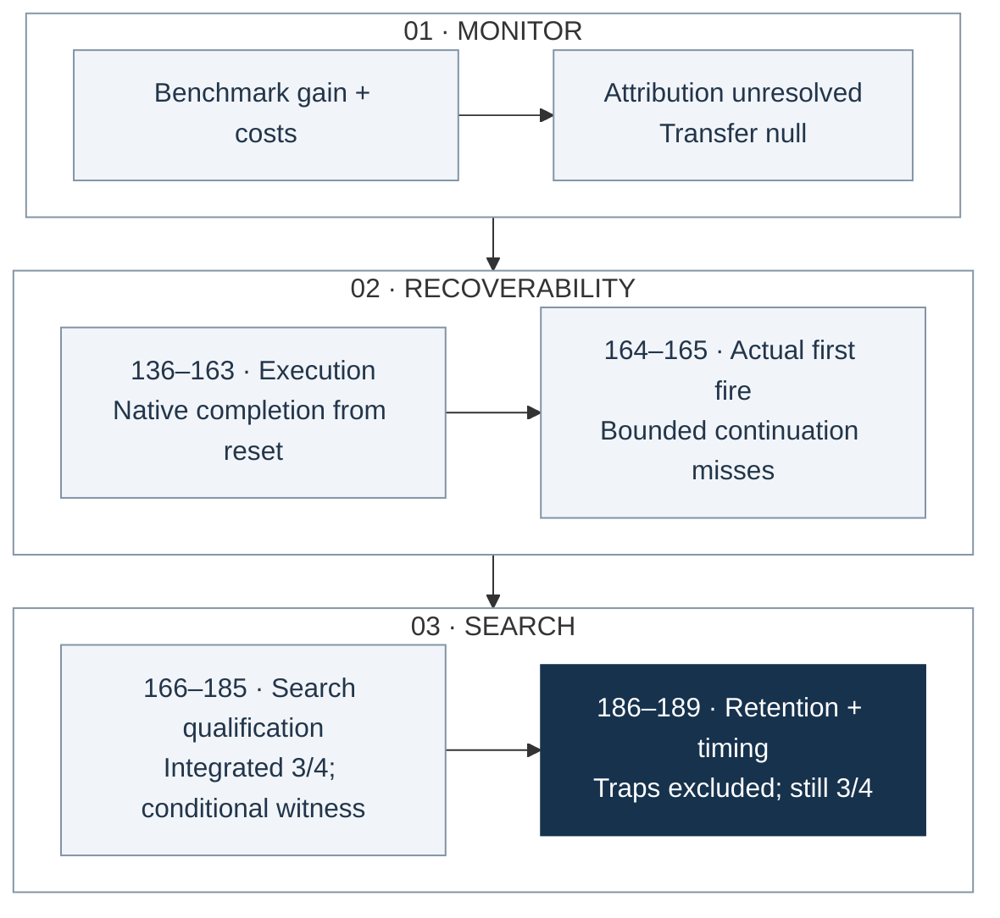

### 5. Establish what the controller actually executes

Iterations 136–148 exposed several prerequisites to an interpretable recovery test:

| Finding | Response and remaining limit |
|---|---|
| Equal seeds did not reproduce the original controller's first command. | Separate numerical repeatability from wall-clock stopping and log the actual stopping reason. |
| Early pulse experiments found no useful recovery. | Keep the Iter139 **0/6** and Iter142 **0/2** nulls; inspect contact, actuation and continued driving. |
| Trajectory timing and native coordinate conventions were ambiguous. | Introduce explicit timestamps, units, frames and source identities; reject stale or misaligned trajectories. |
| Repeatable optimization could still stop without convergence. | Qualify constrained execution against an independent stationarity check; retain failed solver attempts. |
| Short successful traces could hide eventual failure. | Qualify full-horizon execution and retain completion, collision, off-route and censoring separately. |
| A lost progress observation stopped a running episode. | Close Iter148 with missing outcomes intact; design bounded observation recovery prospectively. |

The new execution regime changes controller and actor-time semantics explicitly. Its outcomes
must not be pooled with the old HUGSIM transfer runs as though only the monitor changed.
The complete iteration record is below.

## Iteration 148: interrupted recovery study

The registered development study contains **14 scenarios from three previously exposed source
scenes**, four arms and two replicas: **112 slots**. The arms are nominal, responsive monitor,
and one-second braking pulses beginning at 0 or 2.5 simulated seconds. Replicas test execution
agreement; they are not new independent scenes. There are no untouched holdouts.

Only `scene-0013-easy-00` began execution:

| Arm | Retained outcome |
|---|---|
| Nominal | Two admitted replicas; 92 actions each; source-defined completion. |
| Responsive monitor | Two admitted replicas; 92 actions each; source-defined completion; no monitor activation. |
| Pulse at 0 s | First replica recorded 88 actions without a terminal summary; paired admission invalid. Second replica uninitialized. |
| Pulse at 2.5 s | Neither replica initialized. |

The four admitted episodes contain **368 verified actions**, no recorded collision or off-route
event, and exact replica agreement within the declared tolerances. This easy case has no
configured dynamic actors. Completion follows the simulator's rule near 90% of sampled route
points; it does not mean the literal final route sample was reached. Since nominal already
completed and the monitor never intervened, this is integration evidence rather than a recovery
gain. Natural monitor release was not observed here.

The stopping event was a failed read-only IAP progress query. The supervisor's frozen response
terminated the block; the error does not establish a simulator failure. Evidence collection
subsequently recovered the partial trace without restarting any driving job.

**Accounting: four admitted, one incomplete, 107 uninitialized; zero complete four-arm
comparisons.** Recovery and harm rates remain unestimated. Missing terminal outcomes are not
successes, failures of the intervention, or zeros.

### Convergence and timing are separate results

| Quantity, admitted episodes only | Observation |
|---|---:|
| Largest independently checked stationarity residual | 9.759 × 10⁻⁷; bar 10⁻⁶ |
| Complete controller calls over 50 ms | **6 / 368** |
| Recorded loops over 250 ms | **368 / 368** |
| Loop duration, minimum / median / maximum | 1.712 / 1.792 / 24.608 s |

The simulator waits synchronously. These measurements do not establish 4 Hz operation or a
policy for handling late results. The loop timer includes the final guard and stop decision;
reset, summary serialization and worker cleanup are outside that scope. Model exchange time
also includes communication and cannot be read as isolated inference latency.

[Result and failure record](experiments/iter148_recovery_study/RESULT.md) ·
[Scoped metrics](experiments/iter148_recovery_study/proof/block_000_attempt_002/metrics.json) ·
[Aggregate accounting](experiments/iter148_recovery_study/proof/block_000_attempt_002/study_aggregate.json) ·
[Resource closure](experiments/iter148_recovery_study/proof/block_000_attempt_002/combined_resource_closure.json).

## Iteration 151: nominal baseline and interrupted comparison

The fresh canary fixed two exposed scenarios, four arms and two replicas. Only the first nominal
pair ran: both replicas passed independent replay and recorded a collision at 7.75 s, with 31
actions each. Maximum stationarity residual was 9.8156e-7 against the fixed 1e-6 bar. One of 62
controller calls exceeded 50 ms; all 62 full loops exceeded 250 ms. Real-time operation remains
unestablished.

A local commit check rejected trailing whitespace in unchanged captured client source. The
supervisor stopped the schedule and verified shutdown. Raw was then committed without changing
its bytes, before scientific replay. Totals are 2 admitted and 14 uninitialized; monitor/pulse
comparisons, recovery and harm remain unestimated. The locally corrected retention pipeline now
passes a complete archive-to-Git-to-replay rehearsal. The corrected path subsequently ran under
the separate Iter152 protocol; Iter151 itself remains closed and was not retried.
[Result, failure and closure](experiments/iter151_recovery_canary/RESULT.md).

## Iteration 152: complete comparison, no recovery witness

The continuation fixed fourteen new slots before execution and bound the two Iter151 nominal
episodes as historical evidence. It retained raw bytes in Git before independent replay for
each pair. All new slots passed, with zero incomplete or uninitialized slots; the two historical
episodes and their 62 actions are excluded from the 1,420-new-action total.

| Arm, two replicas each | Collision case: scene-0013-medium-00 | Benign case: scene-0038-easy-00 |
|---|---|---|
| Nominal | Collision at 7.75 s; retained Iter151 pair | Completion at 34.0 s |
| Released monitor | Collision at 9.0 s | Completion at 47.0 s |
| One-second pulse at 0 s | Collision at 9.0 s | Completion at 34.75 s |
| One-second pulse at 2.5 s | Collision at 8.5 s | Completion at 35.25 s |

Neither pulse meets the progress-preserving recovery criterion against nominal or the monitor.
Delay alone does not establish recovery. In the benign case neither pulse produces the
registered binary harm outcome, but the additional travel time remains visible. Numerical
replicas do not create independent scenes or justify a population rate.

Actual applied controls confirm the early pulse brought speed to zero before returning to the
nominal policy. The later collision motivates testing whether a different allowed maneuver can
make useful progress around the obstacle. Logged source actor states remain stationary in the
inspected collision-case pulse traces; this is exploratory evidence, not a physical theorem.

All checked stationarity residuals passed the fixed 1e-6 bar. Nevertheless, 37/1,420 controller
calls exceeded 50 ms and all 1,420 full loops exceeded 250 ms; full-loop median was 1.890 s.
Both compute envelopes closed with unchanged source bindings and no remaining owned job.
[Complete result and limits](experiments/iter152_recovery_continuation/RESULT.md) ·
[per-episode evidence](experiments/iter152_recovery_continuation/proof/analysis.json) ·
[resource closure](experiments/iter152_recovery_continuation/proof/resource_closure.json).

## Iteration 153: a model maneuver candidate

The registered local search contains 75 fixed route-reference maneuvers, each with two replicas.
It uses privileged retained route/obstacle geometry and a diagnostic pure-pursuit controller,
with separately checked source-matched dynamics, applied-control limits, source route outcomes
and conservative between-sample foreground clearance. It neither runs UniAD nor observes the
full scene's background collision or drivable road boundaries.

The complete library yielded 38 foreground contacts, 26 model completions, two off-route stops
and nine control-screen violations. Fourteen completions also passed both progress conditions.
The prospective ranking selects a −2 m route-normal offset at 6 m/s, shifting out over 10 m and
returning after station 40 m. It reaches model completion at 16.25 s; maximum source-route
distance is 2.302 m. That distance is not a road-compliance result.

The 150 trials contain 10,012 independently replayed model actions. The local search took
6.254 s without new packages or provider access; it omits rendering and inference and therefore
supports no real-time-driving comparison. The search supplied a precise candidate for the subsequent
full-scene test; Iter154 rejected that candidate. [Result, complete accounting and figure](experiments/iter153_action_feasibility/RESULT.md) ·
[bound action packet](experiments/iter153_action_feasibility/SELECTED_MANEUVER.json).

## Iteration 154: the full scene rejects the model candidate

The exact selected 65-action sequence was prospectively bound and run in two fresh replicas
with native rendering, actor updates and foreground/background collision checks. Privileged fixed
controls bypassed UniAD and monitor inference. Both episodes terminate after 13 actions at 3.25 s
on background collision, with foreground and off-route false. Source route fraction is 0.166844;
distance to the sampled route is 2.301770 m. Route proximity is not road compliance.

All 26 actions passed separate replay, including the source-matched kinematic prefix, actor state
and route/outcome consistency. The maximum prefix error is 4.44e-16. Native background collision
was observed, but Iter154 did not retain the enclosed point count or mask. Iter155 subsequently
reconstructed and independently replayed those two historical frames, as reported below.
The full-scene result still contradicts useful recovery by this exact maneuver. It does not prove physical collision or that another maneuver cannot recover the scene.

No alternative candidate was tried. The capacity-refused first start and one prospectively amended
retry are retained. The VM is terminated, all 11,715 source/asset bindings are unchanged, and the
combined conservative compute allowance is $0.346 within $3. Road compliance and information
benefit remain unknown. [Result and figure](experiments/iter154_full_scene_maneuver/RESULT.md) ·
[per-episode analysis](experiments/iter154_full_scene_maneuver/proof/analysis.json) ·
[resource closure](experiments/iter154_full_scene_maneuver/proof/resource_closure.json).

## Iteration 155: the background witness replays exactly

A bounded source/asset extraction reconstructs the last clear and first collision boxes from
Iter154, without rerunning a driving policy. The retained 1,345,702 pre-selection points include
all semantic features and opacities. Independent filtering recovers all 276,519 selected centers
in the native order; independent geometry checks the vehicle boxes and ground height.

At 3.00 s the source CUDA and scalar counts are both zero. At 3.25 s both count 273, exceeding
the unchanged threshold of 100. Every mask entry agrees, with zero ambiguous classifications
under the declared numerical diagnostic band. Four historical replica/frame bindings describe
two unique poses. This supports the finite source predicate witness; it does not validate the
reconstruction against physical occupancy, road boundaries or future trajectories.

All 396 bound source/asset files remained unchanged. The VM is terminated, no owned job remains,
and conservative compute was $0.229 within $1.50. No new driving episode, rendering or inference
ran. [Result and figure](experiments/iter155_background_witness/RESULT.md) ·
[independent admission](experiments/iter155_background_witness/proof/admission.json) ·
[resource closure](experiments/iter155_background_witness/proof/resource_closure.json).

## Iteration 156: complete background calibration

The background-aware model now preserves the complete selected population and agrees with
independent scalar replay on **115 full masks**, covering **300 historical step bindings**.
It matches 26 directly recorded background labels and 266 negative implications from
collision-free records. Eight older collision-positive records do not identify their
background component and remain unknown. These are development prefixes from one exposed
scene; native CUDA full masks remain the two Iter155 witnesses.

The exact failed maneuver is rejected at 3.25 s with 273 centers. Median local query time
was **16.6 ms**, compared with **1.46 s** for the separate scalar checker. This is exploratory
local cost, not a real-time or end-to-end planner guarantee. The producer completed in
2.83 s, and all 151 focused checks passed. No new drive, provider task or maneuver search
occurred. Useful recovery, road compliance, physical occupancy and information value remain
unestablished. [Result and figure](experiments/iter156_background_calibration/RESULT.md) ·
[independent admission](experiments/iter156_background_calibration/proof/admission.json) ·
[frontier review](docs/research/SENTINEL_FRONTIER_ENGINE_REVIEW_2026-10-12.md).

## Iteration 157: the fixed action library is null

Adding the complete background condition rejects all **14** maneuvers that passed
Iter153's other constraints. The remaining **61** retain their prior failures:
**0 of 75 candidates qualify** under the declared library and sampled conditions.
Both fixed rankings therefore have no selected action. No new native run is warranted
for this library, and no physical-unavoidability conclusion follows.

The producer retained 221 state bindings, representing 172 distinct model states.
Independent scalar replay checks every rejection witness and the failed maneuver's
full sampled prefix: 27 complete masks, all agreeing. All 150 earlier model traces
and 10,012 actions replay again. Background is unevaluated for the 61 prior failures;
it is never imputed clear. No new driving episode, provider task or GPU use occurred.

The first admission failed on two nonexistent extra source references. A disclosed
post-evidence inventory correction preserves the original plan, code, raw and failure;
the corrected check retains the same scientific algorithm. That correction belongs
with the result. Useful recovery and added information value remain unestablished.
[Result and figure](experiments/iter157_constrained_action_library/RESULT.md) ·
[independent admission](experiments/iter157_constrained_action_library/proof/admission.json) ·
[correction](experiments/iter157_constrained_action_library/ADMISSION_CORRECTION.md).

## Iteration 158: the search remains inconclusive

A bounded actuator search applies the complete hard constraints while constructing
paths. It attempts **10,633 transitions** and finds no complete trajectory. The beam
empties at the first progress checkpoint. This is an incomplete search, so it does
not prove that the source task is infeasible.

Separate scalar replay confirms the retained **19-state / 18-action prefix** and
all its background masks. It ends at 4.5 s, before either progress checkpoint,
with source progress 0.1588569400. The other search branches are producer evidence;
no native recovery or information advantage follows. The next dependency is
route-aware guidance and constructive coverage controls, before another native run.
[Result and figure](experiments/iter158_constraint_aware_search/RESULT.md) ·
[independent admission](experiments/iter158_constraint_aware_search/proof/admission.json) ·
[decision and primary research](experiments/iter158_constraint_aware_search/DECISION_PACKET.md).

## Iteration 159: known feasible, still missed by search

Four constructed cases have complete independently verified witness paths. Their
commands belong to the existing proposal alphabet. A fixed-budget comparison
crosses endpoint/route guidance with ordinary/speed-group pruning: **11 of 16
runs complete; five miss a known feasible opportunity**.

The proposed route/speed-group arm completes **3/4**, failing its registered
four-case bar. The older endpoint/speed-group arm also completes 3/4, with a
different failure. The factorial isolates the changes without establishing an
overall coverage gain. Separate scalar admission verifies **580 states** and all
full masks. Every reference witness is discarded through cell replacement after
one or two steps; eleven searches still find another solution, so this is a
localization result, not a complete causal explanation of failure.

These are disclosed development fixtures. Their routes mirror, but a foreground
placement error prevents full-scene reflection; no directional conclusion follows.
The next test asks whether a retained cell representative preserves the same
feasible continuation as the state it replaces. Native recovery remains unknown.
[Result and figure](experiments/iter159_route_search_qualification/RESULT.md) ·
[independent admission](experiments/iter159_route_search_qualification/proof/admission.json) ·
[decision and primary research](experiments/iter159_route_search_qualification/DECISION_PACKET.md).

## Iteration 160: the first replacement is not the whole explanation

Ten fixed-command replays test five discarded-state/representative pairs from
Iter159. All five original witnesses complete. Four representatives also complete;
one ends at **0.998703 progress against a 1.0 completion threshold**. All ten pass
every observed hard constraint. The same command suffix therefore does not preserve
completion for every pair, but the differing outcome is a small terminal shortfall,
not a collision or proof that the retained state has no useful alternative.

Separate scalar admission verifies **546 states and 4,081,572 point checks**,
including the actual histories and absolute checkpoint times. The failed
route/speed-group candidate's first representative still completes this suffix,
so its whole-search failure remains unexplained. A post-result log audit separates
cell selection from beam retention: four of sixteen cell winners were also lost
to width. [That qualification](experiments/iter160_continuation_preservation/POST_RESULT_RETENTION.md)
preserves the original protocol and outcomes. It motivated the fixed-budget
retention ablation below, with corrected full-scene reflections.
[Result and figure](experiments/iter160_continuation_preservation/RESULT.md) ·
[independent admission](experiments/iter160_continuation_preservation/proof/admission.json) ·
[decision](experiments/iter160_continuation_preservation/DECISION.md).

## Iteration 161: grouping and width have different effects

At the same **18,000-transition cap per run**, exact state grouping at width 24
completes **4/4** disclosed controls; quantized grouping completes **3/4**.
At width 48, both complete **2/4**. The guide, proposals, constraints and stopping
rules stay fixed. Wider chicane searches exhaust their budget after only 25–26
full layers; exact/24 completes at layer 29. More width is not a monotonic gain
under this budget.

Exact/24 takes **33,494 total attempts**, versus 53,286 for quantized/24, across
all four controls. Both deletion stages are explicitly replayed. All supplied
witness prefixes are eventually pruned, including those in the successful exact
runs; other complete paths remain discoverable. Independent admission checks
**643 states and every full mask** across four witnesses and sixteen selected
paths. The corrected scene reflections preserve the historical fixtures/results.

This qualified a candidate on two constructed scene families. It did not establish
native recovery or an information advantage. The matched source-model test below
carries the unchanged candidate to the full retained geometry.
[Result and figure](experiments/iter161_grouping_width_ablation/RESULT.md) ·
[independent admission](experiments/iter161_grouping_width_ablation/proof/admission.json) ·
[next decision](experiments/iter161_grouping_width_ablation/DECISION.md).

## Iteration 162: both grouping rules complete the source model

Both frozen width24 arms now produce **complete independently admitted paths** on
the retained source model. Each takes 66 actions, or 16.5 seconds of modeled time,
and passes both original progress checkpoints. Scalar replay checks **134 full masks**
over all **276,519 selected points**: 37,053,546 point-state classifications.

Exact grouping qualifies, but uses **25,441 attempts** versus **24,764** for
quantized grouping. Both complete; the synthetic efficiency advantage does not
carry over to this comparison. Search takes roughly seven minutes per arm on the
local CPU. This establishes an offline model action opportunity on one exposed
scene. Iter163 below tests the admitted candidate in the native environment; actual
decision-time availability and information benefit remain unknown.
[Result and figure](experiments/iter162_source_grouping_qualification/RESULT.md) ·
[independent admission](experiments/iter162_source_grouping_qualification/proof/admission.json) ·
[next decision](experiments/iter162_source_grouping_qualification/DECISION.md) ·
[2026 primary-source review](experiments/iter162_source_grouping_qualification/RESEARCH_UPDATE.md).

## Iteration 163: the admitted path completes the native scene

The preselected exact/24 path completes **both fresh native replicas** in 66 actions
and 16.5 simulation seconds each, without a recorded collision or off-route event.
Both original progress checkpoints pass. Independent replay checks all **132 full
background masks**: **36,500,508 point-state classifications**, with zero disagreement.


This is a complete native path **from reset in one exposed scene**, using privileged
controls computed offline and bypassing inference. Native completion follows the
source sampled-route rule, rather than reaching its literal final sample. All
132 measured loops exceed 250 ms; median time is 552.8 ms before adding inference
or online search. Real-time operation and recovery from the actual monitor history
remain unproved. The successful path changes steering at 0.25 seconds; the retained
monitor first fires at 6.25 seconds. Iter164 below tests that changed initial condition.

[Result and limits](experiments/iter163_native_path_replay/RESULT.md) ·
[independent admission](experiments/iter163_native_path_replay/proof/admissions/pair_000.json) ·
[next decision](experiments/iter163_native_path_replay/DECISION.md) ·
[verified resource closure](experiments/iter163_native_path_replay/proof/resource_closure.json).

## Iteration 164: the same search misses from the monitor's actual history

The historical prefix now passes independent qualification: **25 applied controls**
through first fire at **6.25 seconds**, preserved in both retained records. One
exact/24 search from that state finds **no complete continuation**. Its beam empties
at 7.75 seconds after 1,778 attempts, without exhausting either budget. Exact
state grouping removes no candidates; width pruning removes 822. That count does
not prove pruning caused the miss.


Independent replay admits the selected partial path: four new controls, ending
at 7.25 seconds, with all **30 joined states and full masks** checked. Neither
original checkpoint is reached. Both historical prefixes separately pass 52 state
checks. The search failure is valid; **source-model impossibility remains unknown**.
No new native episode or spending. Next, qualify an independent control-search
method on retained feasible controls before testing this unchanged decision state.
[Result and limits](experiments/iter164_monitor_time_continuation/RESULT.md) ·
[independent admission](experiments/iter164_monitor_time_continuation/proof/admission.json) ·
[next decision](experiments/iter164_monitor_time_continuation/DECISION.md).

## Iterations 165–167: discarded braking and an independent planner

Iter165 tests **all 25 discarded maximum-braking prefixes and all 24 retained
prefixes** at frame 27. Each receives the same exact/24 continuation budget, original
geometry and absolute deadlines. **None completes; all 49 beams empty.** This is
84,018 attempted transitions across the full schedule. The separately checked
selected paths remain valid. These finite misses do not prove the discarded
states infeasible or identify the cause of the original search failure.

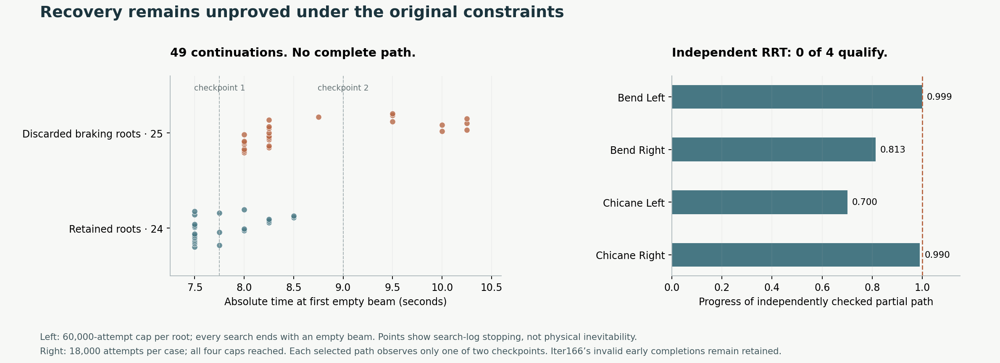

Iter166 introduces released OMPL control RRT with Sentinel's physical callbacks.
Independent admission catches a terminal-condition defect: two producer-reported
completions occur before the final required checkpoint. That qualification is
**invalid**, and its raw results remain intact. Iter167 corrects only that condition
and repeats the same four exposed development cases, seeds and budgets. It
completes **0/4**; all four searches exhaust 18,000 attempts. Independent replay
checks **97 partial-path states and full masks**, including 706,398 scalar
point-state classifications.

The independent planner is **not qualified for the source comparison**. Passing
adapter tests did not establish search competence. Next, isolate its directed
control sampler using known executable continuations before another source run.
No new native driving, provider use or spending; no superiority claim.

[Braking continuation result](experiments/iter165_discarded_braking/RESULT.md) ·
[invalid first qualification](experiments/iter166_independent_planner/RESULT.md) ·
[corrected qualification](experiments/iter167_planner_terminal_contract/RESULT.md) ·
[next decision](experiments/iter167_planner_terminal_contract/DECISION.md).

## Iteration 168: stopping and waiting pass; longer turning does not

A local connector must select executable controls before its parent planner can
support a source comparison. Iter168 adds exact bounded braking at fractional
speeds and isolates one-step from two-step lookahead on twelve constructed tasks.
Both variants pass all stopping, waiting and restart cases. Two-step lookahead
also passes the short left/right turns: **10/12 completions**, compared with **8/12**
for one step. **Both miss the longer turns.** All twelve constructive witnesses pass.

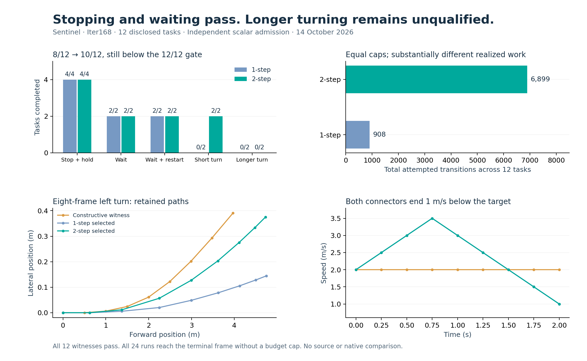

The extra completions cost more work: **6,899 attempted transitions versus 908**,
under the same caps. No run exhausts a cap. Independent replay checks **213 states
and full masks**, with 206,184 scalar point-state classifications, and checks motion,
constraints and accounting for all 7,807 attempts. These exposed model cases
establish a local capability boundary, not road performance or superiority.

The all-task qualification claim is **contradicted**. Next, qualify steering and
speed selection over the full maneuver horizon. The independent RRT still needs
its separate four-case qualification before any new source comparison.
[Result and limits](experiments/iter168_control_connector/RESULT.md) ·
[independent admission](experiments/iter168_control_connector/proof/admission.json) ·
[next decision](experiments/iter168_control_connector/DECISION.md).

## Iterations 169–171: full-horizon control qualifies

The local controller now completes **all twelve constructed tasks**, including
both longer left/right turns. Steering and speed are selected across the full
maneuver; every intermediate constraint and terminal tolerance remains unchanged.
This is local qualification. The independent RRT remains unqualified.

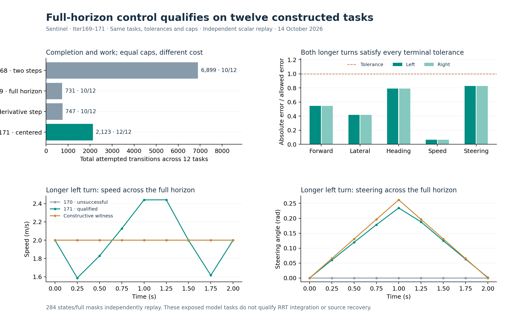

The path to this result includes two retained failures. Iter169's full-horizon
shooting completes 10/12; its relative derivative step loses sensitivity near
tiny nonzero controls. Iter170 changes that step alone and still completes 10/12:
the optimizer's initial search radius remains tiny. Iter171 optimizes increments
around the same physical starting controls, with translated bounds, and completes
12/12. Analytic known-bads expose both numerical problems. The coordinate change
also changes derivative probe placement; the maneuver result does not isolate
search radius as the sole causal mechanism.

Iter171 uses **2,123 attempted transitions** across twelve cases, including every
numerical-derivative and line-search propagation. Each longer turn uses 960 within
the same 8,192-transition/30-second cap. Independent admission checks all attempts
and reconstructs **284 states with full masks**: **274,912 scalar point-state
classifications** across witnesses, new selected paths and two retained comparator
sets. Unselected background labels remain producer evidence.

The all-task claim is **supported for these twelve exposed deterministic cases**.
No holdout generalization, source recovery, road safety, real-time response or
competitive superiority is established. Before another source comparison, the
integrated RRT must pass its original four-case qualification under unchanged
constraints and full work accounting.
[First failure](experiments/iter169_full_horizon_control/RESULT.md) ·
[insufficient derivative correction](experiments/iter170_derivative_step/RESULT.md) ·
[qualified local control](experiments/iter171_centered_shooting/RESULT.md) ·
[next decision](experiments/iter171_centered_shooting/DECISION.md).

## Iteration 172: integrated RRT does not qualify

The qualified local controller is now connected to released OMPL control-RRT
through a sequence-token bridge. The integrated planner completes **0/4 original
cases** under the same seeds, physical constraints, timed checkpoints and
18,000-transition/120-second/96-action caps. Independent admission accepts the
four bounded misses; the all-four qualification claim is **contradicted**.

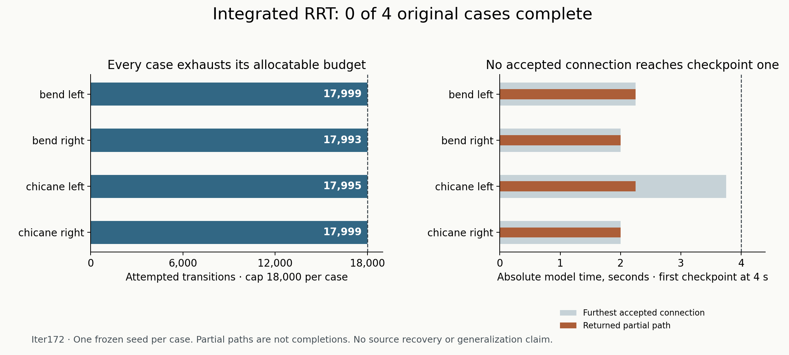

All **71,986 attempted transitions** are charged, including numerical derivatives
and rejected rollouts. The planner makes 84 directed requests and accepts 24
partial connections. No accepted branch reaches the first four-second checkpoint.
Each run exhausts its allocatable transition budget in 8.54–15.65 seconds; wall
clock is not the binding limit. Returned approximate paths are not completions.
Independent scalar replay checks **38 selected states and full masks**, covering
**275,880 point-state classifications**, alongside all-attempt motion and accounting.

A labelled post-outcome audit finds 58/80 executed local solves target states
outside necessary horizon-dependent endpoint bounds. Most trial trajectories have
background collision as their first producer-recorded rejection. These observations
motivate a matched-cost expansion test; they do not prove a cause or a repair.
An unreachable target can still guide a useful partial extension. Unselected
background labels and native tree/RNG remain producer evidence.

The twelve-task local result remains valid in its own scope. This integration
failure keeps source comparison closed. No source recovery, transfer, real-time
response or competitive superiority follows, and finite failure does not prove
unrecoverability. [Result and diagnostic](experiments/iter172_integrated_rrt/RESULT.md) ·
[independent admission](experiments/iter172_integrated_rrt/proof/admission.json) ·
[next decision](experiments/iter172_integrated_rrt/DECISION.md).

## Iteration 173: forward proposals pass the connector comparison

At the same available per-request caps, bounded forward controls improve target
distance on **16/80** retained requests versus **15/80** for centered shooting.
Both return admissible motion on the same 24 requests; neither crosses a timed
checkpoint. Forward completes all **14 constructed tasks**; shooting completes
12 and misses both new obstacle detours. This meets the frozen criterion for a
new integrated trial. The earlier integrated RRT result remains **0/4**.

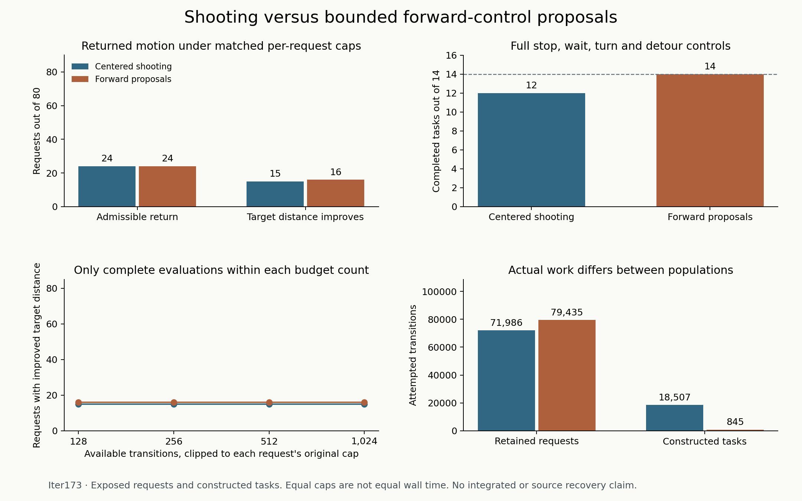

The request gain is one additional improving return, with more request work:
79,435 transitions versus 71,986. Forward uses fewer constructive-task transitions,
845 versus 18,507. Equal caps are not equal used work or wall time. The new detours
use a four-phase pattern represented in the forward proposal family; they are
capability controls, not holdouts. Requests are exposed outputs of the previous
tree. No claim of general or competitive superiority follows.

Both arms retain the same physical seed, evaluator, hard predicates and ranking.
One schedule contains 188 fresh-process runs. Separate replay checks every attempt
and proposal/accounting rule; full scalar masks cover 668 selected/witness/control
states and 2,710,158 point-state classifications. Unselected background labels
retain producer provenance. Source comparison stays closed until the forward
connector qualifies inside RRT on **all four original cases** under unchanged
constraints and budgets. [Result and paired gains](experiments/iter173_matched_connector_cost/RESULT.md) ·
[independent admission](experiments/iter173_matched_connector_cost/proof/admission.json) ·
[next decision](experiments/iter173_matched_connector_cost/DECISION.md).

## Iteration 174: one integrated completion, three misses

The forward connector completes **1/4 original integrated cases**, compared with
Iter172's 0/4 shooting integration. Independent replay confirms **chicane_left**
reaches completion at **8 seconds**, passing both timed checkpoints. The other
three exhaust their transition allocations. **The all-four qualification remains
contradicted; source comparison stays closed.**

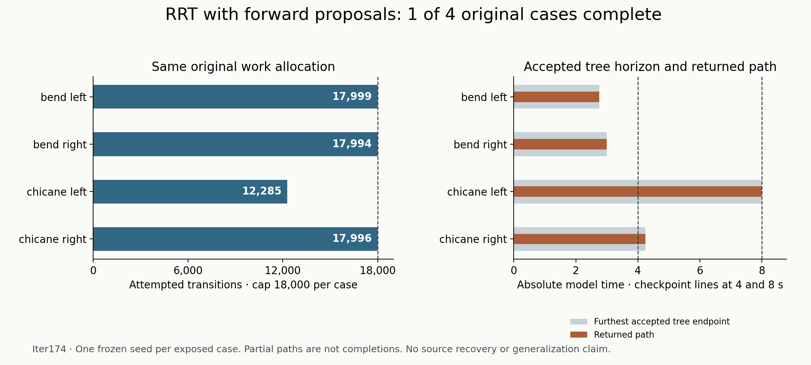

Only the connector changes. Cases, seeds, released RRT, native transport, target
sampler, metric, evaluator, checkpoints and original budgets stay fixed. The four
runs use 66,274 transitions, make 70 directed calls and accept 42 connections.
The returned paths end at 2.75, 3.00, 8.00 and 4.25 seconds; the right chicane passes
checkpoint one but does not complete. This is one seed per exposed case, not an
estimate of general success or a source-recovery result.

Separate replay checks all attempted motion, proposals and accounting. Full scalar
masks cover 76 returned states and 570,636 point-state classifications. Unselected
background labels and native tree/RNG retain producer provenance.

A post-outcome audit motivates testing work allocation: 31/42 eventual selected
edges appear within 128 transitions, while ordinary connections receive up to
1,024. Yet two edges on the completed path need later proposals. Reducing the
inner cap could gain tree opportunities or lose the successful branch; that
tradeoff remains untested. [Result and limits](experiments/iter174_forward_integrated_rrt/RESULT.md) ·
[independent admission](experiments/iter174_forward_integrated_rrt/proof/admission.json) ·
[next decision](experiments/iter174_forward_integrated_rrt/DECISION.md).

## Iteration 175: shorter connections complete two of four

Reducing the inner allowance from 1,024 to 128 transitions admits **2/4 original
completions**, up from 1/4. `bend_left` is gained and `chicane_left` is retained.
Both right-hand cases still exhaust their work allocations. The original total
budgets, seeds, cases and other mechanics are unchanged; no reference run is
repeated. **All-four qualification remains contradicted; source comparison stays closed.**

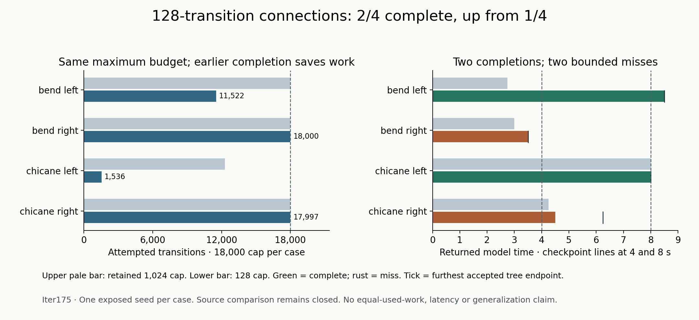

Calls rise from 70 to 387 and accepted connections from 42 to 241. Actual work
falls from 66,274 to 49,055 attempted transitions because completions stop early.
Independent replay checks all attempted motion/accounting and 102 returned states
with full scalar masks. This is one seed per exposed case, not an estimate of
population success, equal-used-work efficiency or response latency.

No eight-step solve reaches the later Halton proposal family under the shorter
cap. The trial therefore changes proposal coverage as well as tree opportunities.
The remaining misses also differ: bend_right has no reported valid prefix beyond
frame 14; chicane_right has four discarded prefixes through frame 32 but only
0.623–0.640 route progress. They are not completions. Iter176 below closes their
full scalar background replay and audits matched nominal coverage. Cap tuning
remains closed. Keep the actual-history, deadline-aware information comparison
as the mission dependency.
[Result and limits](experiments/iter175_connection_allocation/RESULT.md) ·
[independent admission](experiments/iter175_connection_allocation/proof/admission.json) ·
[next decision](experiments/iter175_connection_allocation/DECISION.md).

## Iteration 176: coverage audit and four incomplete paths

An exploratory audit of all 386 executed retained requests finds **327 nominal
program sets preserve reflected coverage; 59 do not**. The one unexecuted request
is excluded. Independent reconstruction checks proposal order, exact cache and
budget accounting. No new integrated search is run; qualification remains **2/4**
and source comparison stays closed.

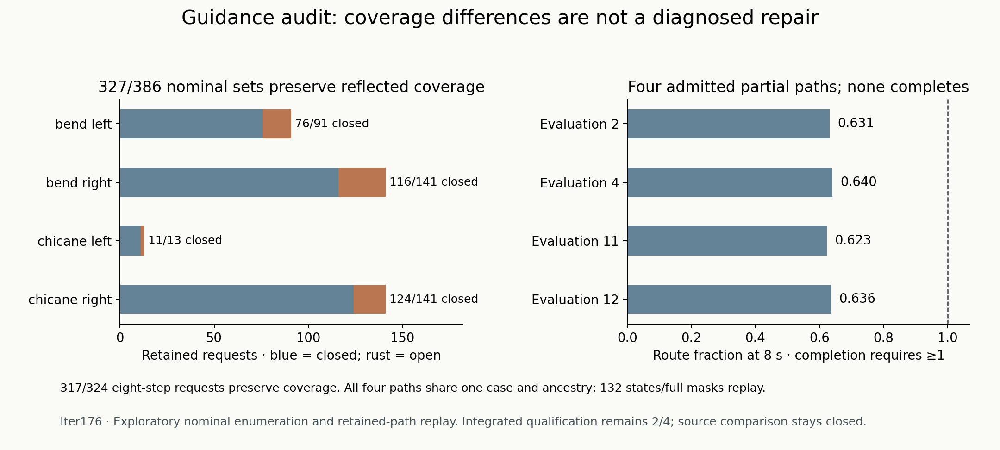

Coverage holds for 317/324 eight-step requests. Five of the seven differences
follow an initial cache reuse; two occur under final outer-budget remainders.
Cache hits correctly save work. No charged signed-zero duplicates occur. Nominal
full-rollout enumeration does not reproduce actual solver stopping or subsequent
trees, so these results do not diagnose a directional bug or a working repair.

The four discarded chicane_right paths pass full scalar replay: 132 state records
and 1,054,152 point-state classifications, including their shared ancestry. Each
passes both checkpoints through 8 seconds, with only 62–64% route progress. None
completes. Greater simulated time alone does not justify changing prefix ranking.

The subsequent Iter177 trial replaces only the initial program with a pose-aware
analytic guess after constructed positive/adverse controls. It stops invalid on
a numerical interface boundary, as documented below; no new qualification follows.
[Result and limits](experiments/iter176_connector_guidance_audit/RESULT.md) ·
[independent admission](experiments/iter176_connector_guidance_audit/proof/admission.json) ·
[next decision](experiments/iter176_connector_guidance_audit/DECISION.md).

## Iteration 177: initial-proposal trial stops on a root boundary

**The pose-aware trial is invalid.** Chicane_right's worker stops when an accepted
state fails the next connector's strict starting-state bound. No retry is made.
Three earlier result files remain producer evidence; no new complete-case count
is admitted. Retained qualification remains **2/4**, and source comparison stays closed.

Five acceleration updates from speed 4 produce `6.000000000000002`. This passes the
existing motion tolerance of `6 + 1e-12` but exceeds the next-root constructor's
strict upper bound of 6 by two floating-point steps. A separately frozen diagnostic
checks 125 attempted transitions and all six selected states/full scalar masks
(47,916 point-state classifications). The next native callback input was not logged;
its exact replay is not claimed.

The correction must make those adjacent contracts agree while preserving state
values, physical limits, existing tolerances and budgets. Boundary controls must
reject real excess before a distinct corrected qualification is frozen. Keep the
invalid schedule and its partial evidence; successful diagnosis is not successful
intervention. [Result and limits](experiments/iter177_pose_aware_seed/RESULT.md) ·
[independent failure admission](experiments/iter177_pose_aware_seed/proof/admission.json) ·
[next decision](experiments/iter177_pose_aware_seed/DECISION.md).

## Iteration 178: corrected interface completes three of four

**Independent admission confirms 3/4 completions**, up from Iter175's retained
2/4 under unchanged maximum budgets. Chicane_right completes; both previous
successes remain. Bend_right still exhausts its 18,000-transition allowance.
The all-four claim is contradicted, so **source comparison remains closed**.

The next-root constructor now accepts exactly the numerical domain already used
by the motion predicate. States are preserved; physical limits and tolerances do
not change. The corrected candidate retains Iter177's pose-aware initial proposal,
fallback programs, cases/seeds, native runtime, metric, sampler and prefix rules.
Iter177 stays invalid and its partial results are not pooled into this trial.

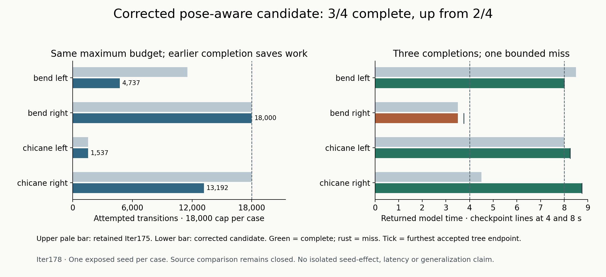

The candidate uses 37,466 attempted transitions, 296 calls and 203 accepted edges.
Independent scalar replay checks all 118 returned states and 872,652 point-state
classifications. Earlier completion reduces used work; this is not a general
efficiency estimate or an isolated seed-effect claim. The remaining returned path
already has substantial progress at frame 14 but no continuation through the first
checkpoint at frame 16 in that integrated run. Iter179 below audits the retained
late frontier before another planner change.
[Result and limits](experiments/iter178_root_domain_consistency/RESULT.md) ·
[independent admission](experiments/iter178_root_domain_consistency/proof/admission.json) ·
[next decision](experiments/iter178_root_domain_consistency/DECISION.md).

## Iteration 179: the retained frontier is not uniformly infeasible

**Three of 16 distinct late states have verified continuations through frame 16;
two are excluded by a necessary progress bound; eleven remain unresolved.** The
audit retains all 19 late endpoint records, including duplicates, and all 2,609
evaluations from 76 late requests. No probe is time-censored. Integrated
qualification stays **3/4**, and source comparison remains closed.

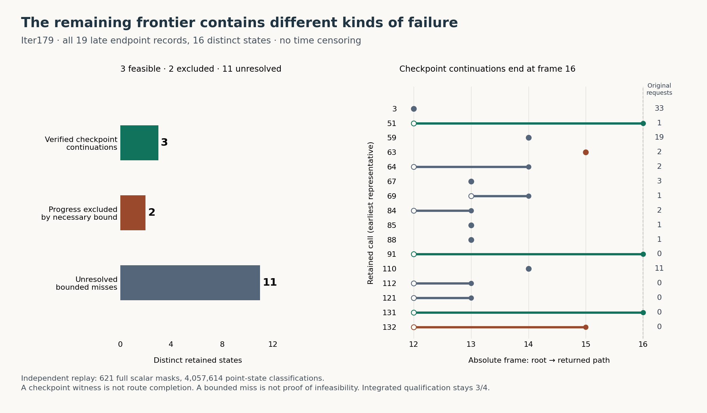

Independent replay checks 621 full scalar masks and 4,057,614 point-state
classifications, motion, clocks, checkpoint rules, proposal order and accounting.
An independent corner formulation confirms both progress exclusions within the
declared numerical model. Bounded misses do not prove continuous-control
infeasibility or collision inevitability. The three witnesses pass only the first
checkpoint, not the later checkpoint or full route completion.

Two viable states received no original outgoing request. However, the diagnostic
witnesses took 495–510 attempts, above the integrated connector's 128 allowance.
Expansion allocation and useful local control under equal work remain distinct
questions. Next, compare the retained program generator and stepwise beam search on the complete retained
root population at the same 128-transition allowance before selecting one
integrated change. No planner modification or source comparison occurred here.
[Result and limits](experiments/iter179_frontier_continuation_audit/RESULT.md) ·
[independent admission](experiments/iter179_frontier_continuation_audit/proof/admission.json) ·
[next decision](experiments/iter179_frontier_continuation_audit/DECISION.md).

## Iteration 180: equal ceilings find the same three witnesses

**Null comparison: the retained program generator and width-two beam each find
checkpoint continuations from the same three of 16 roots.** There are no gains,
losses or censored pairs. Each run receives 128 transitions and three seconds;
the common checkpoint objective differs from original sampled-target matching.
Integrated qualification remains **3/4**, and source comparison stays closed.

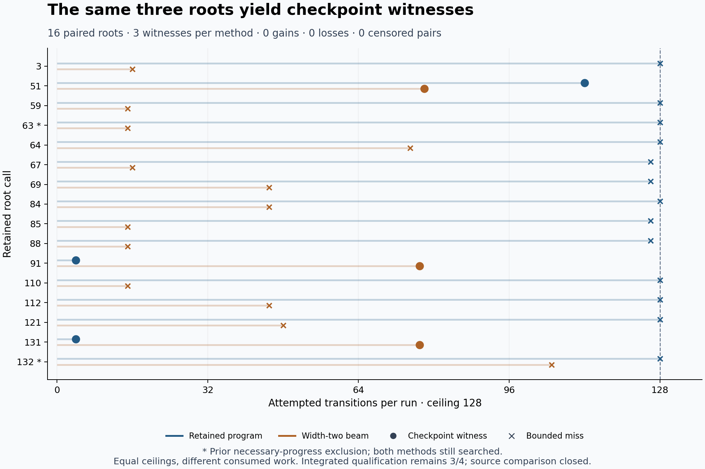

Independent replay checks all queried states: 1,502 full scalar masks and
9,814,068 point-state classifications. The program uses 1,776 transitions and
the beam 702. Equal ceilings do not mean equal consumed work. The thirteen paired
misses include the two prior progress exclusions; the other eleven remain
unresolved. Witnesses pass frame 16, not full route completion.

A read-only trace of the original integrated record reveals a specific selection
loss: call 67 already generated the same valid checkpoint program within 128
attempts, but sampled-target ranking returned frame 13 from another evaluation.
Iter181 below tests checkpoint-aware prefix selection while retaining proposals,
total budgets and all four cases; it loses a current success.
[Result and limits](experiments/iter180_equal_work_continuation/RESULT.md) ·
[independent admission](experiments/iter180_equal_work_continuation/proof/admission.json) ·
[next decision](experiments/iter180_equal_work_continuation/DECISION.md).

## Iteration 181: checkpoint preference loses a success

**The candidate completes 2/4 against Iter178's retained 3/4: zero gains and one
lost success, bend_left.** Both chicanes still complete; bend_right still misses.
The sole change prioritizes valid prefixes that cross existing checkpoint times
before applying the old target-distance ranking. Total budgets, proposals and
physical/scene predicates remain unchanged. Source comparison stays closed.

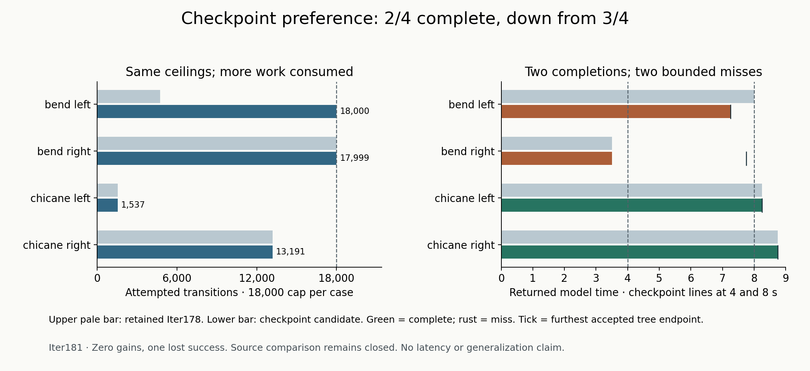

Independent replay verifies 115 returned-path states and 853,050 point-state
classifications, with complete masks, motion, clocks, selection and accounting.
The candidate uses 50,727 transitions and 400 directed calls. Bend_right's tree
reaches frame 31 while its returned path remains at frame 14; more elapsed model
time does not establish sufficient progress. Bend_left approaches completion at
frame 29, then repeatedly rejects outgoing programs as premature completion.

Seven late accepted endpoints remain across the two missed cases; four received
no outgoing request. Iter182 below audits their progress deadlines, premature-completion
constraints and feasible continuations before another integrated change. These
recorded signatures do not prove continuous-control infeasibility. The candidate
is not promoted over the retained 3/4 baseline.
[Result and limits](experiments/iter181_checkpoint_prefix_selection/RESULT.md) ·
[independent admission](experiments/iter181_checkpoint_prefix_selection/proof/admission.json) ·
[next decision](experiments/iter181_checkpoint_prefix_selection/DECISION.md).

## Iteration 182: four continuations, three timing constraints

**The seven-endpoint audit separates four verified checkpoint continuations,
one premature-completion exclusion and two progress exclusions.** There are no
unresolved or censored probes in this fixed population. Complete scalar replay
covers every queried state: 3,969 states / 25,933,446 point-state classifications.
The bounds did not prune the diagnostic search.

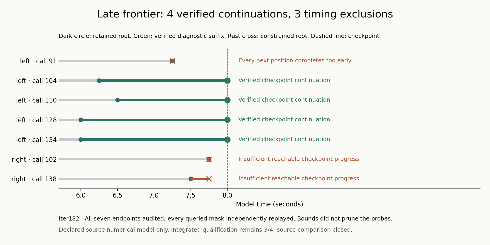

Three feasible roots received no original expansion. Their diagnostic witnesses
use 966–1,499 transitions and a different search procedure, so this does not prove
that one original 128-transition connection would have found them. All four paths
reach checkpoint frame 32; **none completes the route** under the source rule.
The three exclusions apply within the declared numerical source model.

Next test a necessary-constraint eligibility filter on the failed Iter181
experimental parent, preserving the retained Iter178 3/4 comparator and every
integrated budget. Reject only proven timing exclusions; retain uncertified states
and measure losses. No planner changes or new integrated runs occurred in this
audit. Source comparison remains closed.
[Result and scope](experiments/iter182_late_frontier_timing/RESULT.md) ·
[independent admission](experiments/iter182_late_frontier_timing/proof/admission.json) ·
[next decision](experiments/iter182_late_frontier_timing/DECISION.md).

## Iteration 183: timing eligibility restores three of four

**The left bend and both chicanes complete; the right bend still misses.**
The necessary-constraint filter repairs the lost success against Iter181, with
no losses, and ties retained Iter178's 3/4. It does not improve the best outcome.
All original budgets remain fixed; source comparison stays closed.

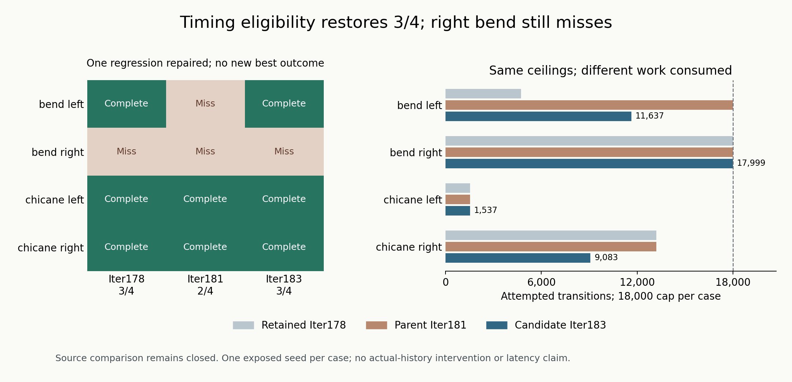

Independent replay admits 115 returned states / 848,694 point-state classifications.
A directly matched left-bend request has the same 16 physical program evaluations;
removing a certified premature-completion trap changes selection, and the next
connection completes. The right bend remains limited by allocatable transitions.

That failed run generated 15 recorded-valid eligible prefixes beyond every retained
tree endpoint's route index, across three connections. None was retained on its
selected edge. Their additional masks and onward feasibility remain unverified.
Next audit every such prefix, then test three fixed full-route continuations under
the work remaining at discovery. Higher progress alone is not an admissible opportunity.
[Result and scope](experiments/iter183_timing_eligibility/RESULT.md) ·
[independent admission](experiments/iter183_timing_eligibility/proof/admission.json) ·
[next decision](experiments/iter183_timing_eligibility/DECISION.md).

## Iteration 184: discarded-prefix audit invalid before admission

**Fifteen prefix paths and 82 masks were collected, but no independent feasibility
or continuation result is admitted.** The checker rejected the copied runtime
manifest's historical JSON formatting before scalar replay. The three fixed
conditional continuation searches remain unrun.

An earlier initialization stopped before any query on the historical plan format.
One pre-evidence mechanical amendment corrected that reader without changing roots,
seeds or budgets. The second failure stops the amended study; both failures and
all raw data remain retained. Passing constructed controls did not cover this
actual metadata-reader boundary. Integrated qualification remains 3/4 and source
comparison stays closed.

Next qualify a corrected validator against the actual bound manifest formats and
replay the existing raw paths. Do not repeat acquisition. Successful prefix
admission must precede the unchanged three-root continuation schedule.
[Result and failure scope](experiments/iter184_discarded_progress/RESULT.md) ·
[invalid admission record](experiments/iter184_discarded_progress/proof/admission.json) ·
[next decision](experiments/iter184_discarded_progress/DECISION.md).

## Iteration 185: one discarded full-route opportunity

**One of three fixed conditional continuations completes the route; two remain
unresolved bounded misses.** Independent replay finds no timing exclusion for
these roots and no time censoring. The successful prefix was generated but
not retained by the original right-bend tree. Integrated qualification remains
3/4; source comparison stays closed.

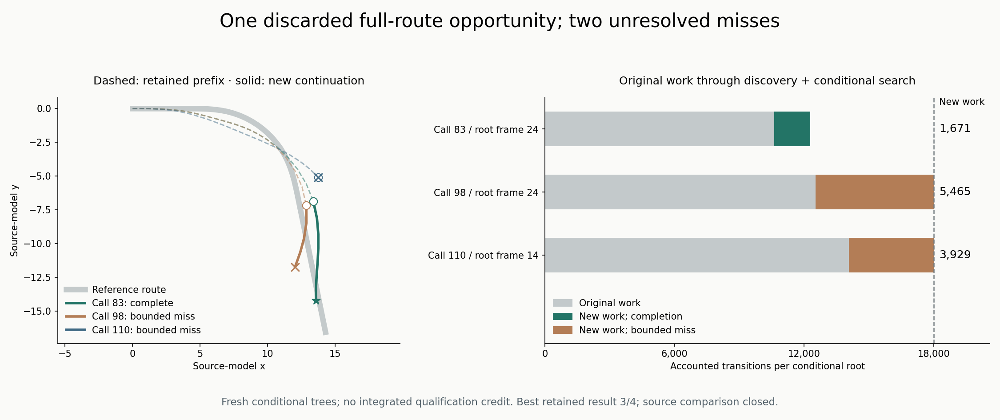

The witness preserves its complete prefix and passes both absolute checkpoints,
finishing at frame 33. Its conditional search uses 1,671 of 7,385 remaining
transitions. Original work through discovery plus this continuation is 12,286
of 18,000; conservative charged search wall is 14.999 seconds. Fresh conditional
tree/RNG semantics prevent treating this as an integrated win or measured latency.

All queried masks replay independently: 1,827 state checks / 11,937,618 point-state
classifications, with 1,808 globally distinct states. Corrected metadata admission
first verified all fifteen retained prefixes without recollection; Iter184's
invalid result remains visible. Twelve prefix records remain unprobed.

Next qualify one deterministic alternative-branch retention mechanism, then test
all four cases under unchanged budgets with explicit lost-success accounting.
A uniform illustrative rule would act much earlier than the known witness and
on all four cases; its performance is unknown.
[Result and scope](experiments/iter185_retained_prefix_admission/RESULT.md) ·
[independent admission](experiments/iter185_retained_prefix_admission/proof/admission.json) ·
[next decision](experiments/iter185_retained_prefix_admission/DECISION.md).

## Iteration 186: native branch-retention interface qualified

**The extra-branch interface passes its frozen qualification; the integrated
result remains 3/4.** Three constructed comparisons match all 410 ordinary
callbacks and returned paths when no extra branch is supplied. Nine corrupted
native submissions are rejected, and six deadline positions return no admitted
post-deadline path.

The new interface assigns exact native parent and node IDs to sequence tokens.
All fifteen previously admitted paths pass through it with 350 state, control and
clock records preserved. Separate replay checks all 82 retained collision masks
and 535,788 point-state classifications. It also rejects changed parent, token,
duration and control records. These fixture IDs do not resolve the old tree's
numeric-join ambiguities.

All 37 native processes exited and were reaped. No new motion search, collision
query or integrated case ran. The next trial must still establish whether
retaining an additional already evaluated branch repairs the remaining miss
without losing an existing success, under the same total budgets.
[Result and scope](experiments/iter186_native_branch/RESULT.md) ·
[independent admission](experiments/iter186_native_branch/proof/admission.json) ·
[next decision](experiments/iter186_native_branch/DECISION.md).

## Iteration 187: one gained case and one lost case

**The integrated retention trial stays at 3/4.** The right bend now completes,
but the left bend loses its prior success. Both chicanes complete: one gain and
one loss against both Iter178 and Iter183. All original cases, seeds and budgets
remain fixed; the all-four claim is contradicted and source comparison stays closed.

The modified planner preserves each request's primary selection and retains at
most one already evaluated eligible advancing alternative. Separate replay checks
45,632 attempted transitions, exact native ancestry, online selection and accounting.
All 251 registered branches, including 16 extras, are covered by 483 distinct scalar
masks / 3,530,538 point-state classifications. All four processes exited and were reaped.
No new simulator driving or provider spending occurred.

On the lost left bend, no registered node advances beyond frame 21, although the
best-progress endpoint is nearly complete before the required frame-32 checkpoint.
This motivates a necessary timing-feasibility audit across all four retained cases;
it is not yet a causal explanation or a global impossibility result. The next
change must preserve the right-bend witness and make any new lost success visible.
[Result](experiments/iter187_integrated_branch_retention/RESULT.md) ·
[independent admission](experiments/iter187_integrated_branch_retention/proof/admission.json) ·
[next decision](experiments/iter187_integrated_branch_retention/DECISION.md).

## Iteration 188: two early timing traps

**Two early extra-branch endpoints cannot reach the required final checkpoint.**
Both occur on the lost left bend, at frames 19 and 21; the latter is its returned
endpoint. Under the declared source model, every allowed next action completes
at frame 20 or 22, before completion is permitted at frame 32. The previously
qualified late-window filter began at frame 24.

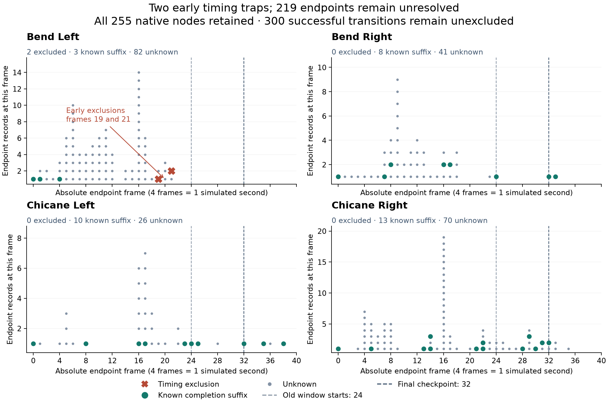

The preregistered audit covers **all 255 native endpoints** across all four cases.
Separate interval and exact-rational checks admit two exclusions; 34 endpoints
have retained complete suffixes and **219 remain unknown**. All 300 transitions
from nine retained successful paths remain unexcluded. Independent scalar replay
checks 555 certificates and 9,925 probes. A noncompleting next step alone does
not establish a collision-free full continuation.

This supports a specific next test: apply the necessary rule consistently before
primary and extra selection, preserve unknowns, and measure gains and losses
under unchanged budgets. It does not establish the cause of the whole search
loss or a repaired planner. No planner changed and no new integrated search or
simulator episode ran. Qualification remains **3/4**; source comparison stays closed.
[Result and numerical scope](experiments/iter188_early_timing_feasibility/RESULT.md) ·
[independent admission](experiments/iter188_early_timing_feasibility/proof/admission.json) ·
[next decision](experiments/iter188_early_timing_feasibility/DECISION.md).

## Iteration 189: uniform timing preserves three successes

**The same three cases complete; the left bend still misses.** The necessary timing
rule now applies before both primary and extra selection. Independent replay admits
45,638 attempted transitions and every registered branch mask: 483 distinct states /
3,530,538 scalar classifications. All cases retain their original budgets and seeds.
Against Iter187 there are zero gains and zero losses; against Iter183 there is one
of each. The all-four hypothesis is **contradicted**, and source comparison stays closed.

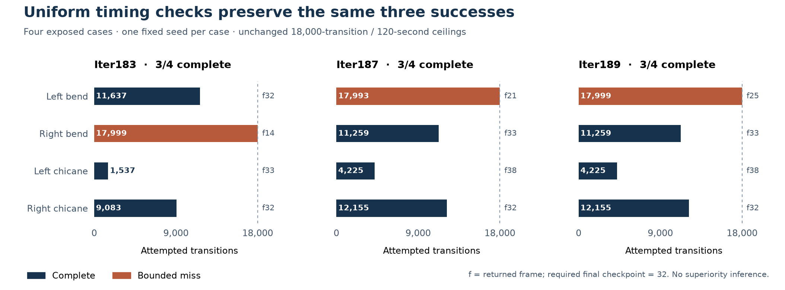

The new rule excludes a prefix in 96 left-bend evaluations. Its tree now reaches
frame 26 rather than 21, yet no complete path is found. Three frame-26 nodes receive
no outgoing request. Their continuation feasibility remains unknown. This separates
correct local exclusion from successful budgeted exploration; another ranking
change needs evidence about what can actually be completed from those states.

Qualification preserved all nine successful paths / 300 transitions and rejected
exactly the two retained traps. **274 focused tests pass without skips.** No new
simulator driving, cloud/GPU use or spending occurred. These four exposed development
cases provide no population or competitor-superiority claim.
[Result](experiments/iter189_uniform_timing_eligibility/RESULT.md) ·
[independent admission](experiments/iter189_uniform_timing_eligibility/proof/admission.json) ·
[next decision](experiments/iter189_uniform_timing_eligibility/DECISION.md).

## Iteration 190: late states have unexploited full continuations

**All four left-bend late node records can finish at frame 33 within their original
remaining budgets. Three received no outgoing request.** The first fixed stop/wait/
route program needs only 7–8 attempted transitions. Node 62 did receive requests;
its original evaluations match one step, but never generate the full continuation.

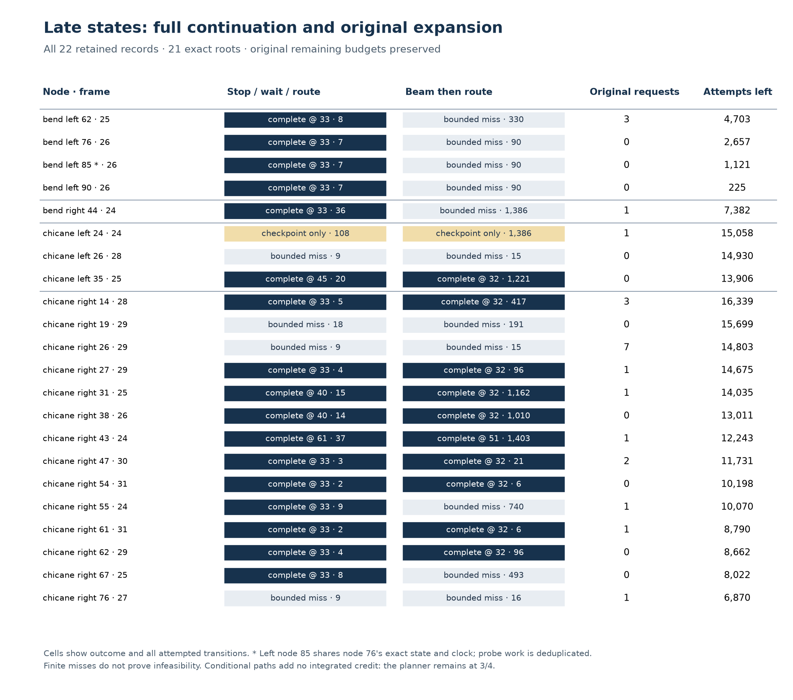

The prospective audit covers all 22 records / 21 exact roots across four cases.
Independent replay admits **16 full-route roots, one checkpoint-only root and four
bounded misses**, with no censoring or necessary-bound exclusion. Eight complete
node records received no original request. Missing expansion alone would not prove
feasibility; these admitted joined paths now supply that evidence.

A state-dependent braking step lands at zero speed, waits through frame 32, then
releases. At 0.125 m/s, the needed acceleration is −0.5 m/s²; the old beam's
fixed grid and route commands do not supply it at these states. The next test
qualifies this proposal inside the current connector before changing allocation.
All 691 original outgoing evaluations and all queried masks replay: **7,172 distinct
states / 55,967,340 scalar classifications**. Integrated qualification remains
**3/4**; no new integrated search or driving episode ran.
[Result](experiments/iter190_late_continuation_audit/RESULT.md) ·
[admission](experiments/iter190_late_continuation_audit/proof/admission.json) ·
[next decision](experiments/iter190_late_continuation_audit/DECISION.md).

## Iteration 191: stop/wait/release qualifies inside the connector

**Original-request full completions improve from 1/23 to 8/23, with no lost
completion.** All 23 original baseline requests reproduce exactly. Independent
replay supports the preregistered qualification, with no censoring. Synthetic
goal requests improve separately from 5/21 to 13/21.


Two original left-bend requests now finish at frame 33 in eight attempts each.
The third has a seven-step horizon: it reaches the checkpoint at frame 32 but
cannot release within that call. No horizon, physical constraint, selector,
allocation or total budget is relaxed. The proposal computes braking from the
actual evaluated speed, holds through the scheduled checkpoint and then releases.

Original-request attempts fall 2,815 → 1,956 overall, but costs do not improve on
every request; the [complete paired table](experiments/iter191_stop_wait_release/PAIRS.md)
retains each cost and outcome. Six native constructed runs qualify dispatch and
transport. Replay checks 1,726 scalar-state records / 10,772,001 classifications,
including rejected and unselected evaluations. **85 new tests and 277 focused
regressions pass without skips.**

This is qualification on exposed inputs. Integrated credit remains **3/4** and
source comparison stays closed. The next step is a separately preregistered
all-four integrated trial against Iter189 and Iter183, under unchanged budgets.
[Result](experiments/iter191_stop_wait_release/RESULT.md) ·
[admission](experiments/iter191_stop_wait_release/proof/admission.json) ·
[next decision](experiments/iter191_stop_wait_release/DECISION.md).

## The next scientific test

The intended contribution is a monitor and evaluation system that can show **which failures
remain preventable, which signal enables prevention, and the measured cost and limits**.
The following work is proposed; all previous schedules retain their closed accounting.
The [current decision](experiments/iter191_stop_wait_release/DECISION.md)
freezes an unchanged-budget all-four integrated trial of the qualified feedback
proposal, retaining gains and losses against Iter189 and Iter183. Iter191 improves
original-request completions 1/23 → 8/23 without a lost completion; that local
qualification adds no integrated credit. Source comparison stays closed.

1. **Retain the finite-library null.** Iter157 rules out this fixed route-offset library
   under complete source-model constraints. Keep the counterexamples, the 61 prior
   failures, and the admitted correction. Physical occupancy and drivable boundaries
   still require separate evidence.
2. **Establish an admissible action opportunity.** Iter158 remains inconclusive.
   Iter159 rules out the proposed ranking as a qualified four-case baseline. Iter160
   finds one fixed-suffix terminal difference; it does not explain that candidate's
   miss. Iter161 separates grouping from width: exact/24 completes all four controls.
   Iter162 now admits complete paths from both matched grouping arms on the retained
   source model. Iter163 confirms the preselected path in two native executions from
   reset. Iter164 preserves the historical prefix and finds a bounded search miss
   from first fire at 6.25 seconds. Iter165 also finds no completion from any of
   the 25 discarded braking roots or 24 retained roots. The corrected independent
   RRT adapter fails all four development controls in Iter167. Iter168 qualifies
   stopping and waiting; Iter169–170 retain two failed full-horizon qualifications.
   Iter171 qualifies all twelve local tasks after a numerical coordinate correction.
   Iter172 integrates that controller but completes 0/4 original cases. Iter173
   passes a bounded forward-connector comparison on exposed requests and controls.
   Iter174 integrates it and completes 1/4. Iter175 shortens the connection allowance
   and admits 2/4 under the same total caps. Iter176 admits four incomplete paths
   and quantifies nominal coverage differences without diagnosing a repair. Iter177
   tests a pose-aware initial program but stops invalid when an accepted state fails
   the next-root bound. Iter178 corrects that interface at the existing tolerance
   and admits 3/4 with one gain and no lost successes. Iter179 separates three
   feasible checkpoint continuations, two progress exclusions and eleven unresolved
   misses. Iter180 finds the same three witnesses with both methods under equal
   128-transition ceilings. Original records expose a valid checkpoint path lost
   at prefix selection. Iter181 tests checkpoint-aware selection under unchanged
   budgets and loses one success, completing 2/4. Iter182 separates four verified
   checkpoint continuations from three demonstrated timing exclusions at its seven
   late endpoints. Iter183 applies necessary-constraint eligibility and restores 3/4,
   tying the retained best. Iter184 collects discarded prefixes but stops invalid
   before scalar admission on metadata formatting. Iter185 corrects admission without
   recollection and finds one full-route conditional witness plus two bounded misses.
   Iter187 tests alternative branch retention and retains one gain and one loss.
   Iter188 establishes two early timing exclusions while preserving all retained
   success controls. Iter189 applies the rule uniformly and retains the same 3/4.
   Iter190 verifies full continuations from 16/21 late roots, including every
   left-bend late node; three left nodes received no outgoing request. Iter191
   qualifies the feedback proposal on all original requests, improving 1/23 → 8/23
   without a lost completion. Next test all four integrated cases before changing
   expansion allocation.
   Source comparison remains closed until all four cases pass.
   Offline cost is not a response-time result.
3. **After establishing useful recovery, test one information hypothesis against a responsive baseline.**
   Track continuity and uncertainty are motivated candidates. Include benign and stale-track cases, freeze the
   information interfaces, and measure intervention costs. Better offline prediction alone
   does not establish a prevention benefit.
4. **Evaluate generalization on genuinely new source scenes.** Reserve them before development
   continues. Measure joint planner/monitor failures, observation faults, timing faults and
   subgroup uncertainty before broadening to another planner or simulator.

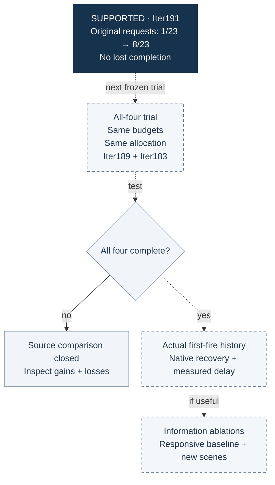

The development sequence retains Iter178's 3/4 and Iter181's adverse 2/4 candidate.
Iter176, Iter179 and Iter180 are diagnostics; Iter177 remains invalid and is not counted. Successful all-four qualification
and subsequent source comparison remain unestablished. No native monitor-time recovery or information
advantage has been established.

Failure across a finite set of actions does not prove physical inevitability. Likewise, a weak
probe does not prove that the available observations lack information. If a representation is a
deterministic function of the same input history, its value may be computational access under
a time budget rather than new information. Those distinctions matter to both the mathematics
and the experiment.

<a id="reproduce--repository-map"></a>

## Reproduce and inspect

Start with the result for the claim being checked. Its hypothesis defines the population,
comparison, stopping rule and analysis; its proof directory contains the retained inputs and
outputs. Historical experiments have different environments. A green test run, a content hash
or a repeated seed is not sufficient evidence for a scientific claim.

Two small checks can run from the repository root without a GPU or dataset download:

```bash
python3 experiments/iter2_monitor/g1_auroc.py \
  experiments/iter2_monitor/proof/risk.jsonl.gz \
  experiments/iter2_monitor/proof/outcomes.tsv

python3 experiments/verification/audit_pooling.py
```

In the recovery studies, raw pairs were committed before admission. A separate implementation
checks dynamics, controller outputs, monitor decisions, route outcomes and replica agreement.
The historical [Iteration 148 replay entrypoint](experiments/iter148_recovery_study/replay.py) exposes these
checks; the [qualification record](experiments/iter148_recovery_study/QUALIFICATION.json) binds
the earlier evidence. **165 focused tests passed** before live execution, and qualification
replayed **1,104 earlier GPU actions**. This does not make the incomplete pulse an admitted result.

The [Iter155 checker](experiments/iter155_background_witness/check.py) independently
reconstructs selection, geometry and collision masks from the retained source-point witness.
Its [result](experiments/iter155_background_witness/RESULT.md) records the environment and scope:
239 local regression checks, including 75 focused checks. A replay of those two poses does not extend the result to an untested trajectory.

The [Iter156 checker](experiments/iter156_background_calibration/check.py) extends complete
scalar-mask comparison to all 115 registered states and retains the distinct native-label
coverage. Its [result](experiments/iter156_background_calibration/RESULT.md) records the frozen
source, committed raw, local environment and exploratory timing.

Fresh simulator execution also requires the licensed datasets, scene/model assets, pinned
runtime and a new bounded resource envelope. Some large assets remain on the stopped host
with retained hashes. The repository alone is sufficient for the two commands above; it is
not a complete distribution of every runtime asset.

| Guide | Scope |
|---|---|
| [Architecture](docs/ARCHITECTURE.md) | Implemented interfaces, simulator distinctions, evidence flow and timing. |
| [Original preregistration](PREREGISTRATION.md) | The initial benchmark question and decision rules. |
| [Research direction](docs/research/SENTINEL_INFORMATION_AND_RECOVERABILITY_RESEARCH_DIRECTION_2026-10-09.md) | Information and recoverability: mathematical formulation and dated literature review. |
| [Next scientific decision](experiments/iter191_stop_wait_release/DECISION.md) | Test the qualified feedback proposal in all four integrated cases under unchanged budgets and allocation. |
| [Handoff](HANDOFF.md) | Exact next task, acceptance criteria, resource closure and recovery instructions. |
| [Continuity](CONTINUITY.md) and [next phase](docs/NEXT_PHASE.md) | Current state followed by retained historical decisions. |
| [Technical report](docs/REPORT.md) | Historical synthesis through Iter134; it predates the current execution program. |
| [Paper status](docs/paper/STATUS.md) | Archived manuscript and rewrite requirements; not submission-ready. |
| [Verification archive](experiments/verification/README.md) | Early audit scripts, raw logs and correction history. |
| [Diagram review](docs/editorial/2026-10-28/REVIEW.md) | Current engine, research history, claim boundaries and light/dark visual validation. |
| [Integration review](docs/editorial/2026-10-16/REVIEW.md) | Retained default-branch integration and evidence scope through Iter185. |

The [Iter157 result](experiments/iter157_constrained_action_library/RESULT.md) binds the
original producer/raw, failed admission, correction source and successful scalar
exclusion checks. Replaying the corrected checker requires its exact correction
checkout and environment variable described in the retained command receipt.

The [public instrument](https://sentinel.danielwahnich.dev/) now consumes a
[validated evidence channel](instrument/README.md). Closed findings and archive
records update after exact-source CI and source validation. Its historical replay
and native witness keep their own identities; automatic delivery does not grant a
scientific claim or reinterpret the archived mission state.

## Repository status — 28 October 2026

**Current through Iter191: connector qualification improves original requests 1/23 → 8/23 without lost completions; integrated qualification remains 3/4.**
The preselected path completes two native replicas from reset. The same exact/24
method then misses after preserving the actual first-fire history. All 49 subsequent discarded/retained
continuations also miss. An independent RRT adapter remains unqualified after a
retained terminal-contract correction. Local stopping, waiting and full-horizon
turning pass all twelve constructed tasks, but the shooting integration completes 0/4
original cases under unchanged budgets. Bounded forward proposals pass the subsequent
local connector comparison. Forward integration completes 1/4, then the fixed-budget
allocation trial completes 2/4. The all-four qualification still fails. Iter176 audits nominal coverage and admits
four incomplete paths. Iter177 stops invalid at a numerical next-root boundary;
its partial results remain unadmitted. Iter178 corrects that interface under unchanged
physical tolerances and budgets and admits 3/4, with one gain and no losses versus
Iter175. Iter179 then verifies three checkpoint continuations, two progress
exclusions and eleven unresolved misses in the remaining late frontier. It adds no
integrated completion and does not establish continuous-control infeasibility.
Iter180 finds the same three witnesses with both methods at equal ceilings, then
traces a valid original program discarded by prefix selection. No new integrated
outcome is inferred from that diagnostic. Iter181 tests the selection preference
and admits 2/4: one lost success and no gains. Iter182 audits all seven late
endpoints, admitting four checkpoint continuations and three timing exclusions.
No audit witness completes the full route. Iter183 applies necessary-constraint
eligibility, restoring 3/4 without exceeding the best retained outcome. Fifteen
discarded advancing prefix records motivate the next continuation audit; source
comparison stays closed. Iter184 collects those prefixes but its checker stops on
runtime metadata formatting before scalar replay. No conditional search ran; the
next task was corrected admission against retained raw. Iter185 completes that
admission and verifies one full-route conditional opportunity; two probes remain
bounded misses. It adds no integrated qualification credit. Iter186 qualifies
explicit native branch identity, transport and deadlines on constructed controls
and retained paths. Iter187 then runs the integrated mechanism once: the right bend
completes, the left bend loses its success, and both chicanes complete. Every
registered branch mask replays; the all-four gate remains closed. Iter188 audits
all 255 endpoints: two early extra-branch exclusions on the lost left bend,
34 retained completion suffixes and 219 unknowns. All 300 successful transitions
remain unexcluded; no new integrated run or planner change occurred in that audit.
Iter189 applies the rule uniformly: 96 evaluations hit early exclusions, the left
tree reaches frame 26, and the same three cases complete. No additional success
is established. Iter190 admits full continuations from 16/21 exact late roots,
including all four left-bend node records. Three left nodes received no request;
the fourth never generated the full admitted continuation. Proposal coverage now
has a concrete qualification target. Iter191 now supports that connector intervention:
original completions rise 1/23 → 8/23 and synthetic goal completions 5/21 → 13/21,
with no losses or censoring. The integrated all-four test has not run. These
qualifications add no integrated credit.
Monitor-time recovery, useful information and real-time operation remain unestablished.
Iteration 135's dose-response experiment remains **deferred and unrun**.

The research record through Iter191 preserves the
documentation and CI history of **`master`**, the repository's default branch. Integration preserves all original commits;
it does not promote a diagnostic result into a qualified intervention system.
GitHub language statistics exclude six archived Google Cloud pricing pages as
third-party evidence. Their bytes remain intact; the repository is classified as Python.
The [current handoff](HANDOFF.md) identifies the next task, and the
[integration review](docs/editorial/2026-10-16/REVIEW.md) records scope and validation.

The immutable code and mission snapshot at
[`8c118b7`](https://github.com/manfromnowhere143/sentinel/tree/8c118b74c699bf0f139f9bd659192bad06b895f8)
remains **current through iteration 134**. [MISSION_STATE.json](MISSION_STATE.json)
retains that historical contract byte-for-byte. Current research state lives in
each experiment's protocol, raw evidence, admission and result. The historical
validator runs at its declared revision; current source, links, diagrams and
result coverage are checked in the present checkout. This distinction prevents
an old control contract from silently acquiring new scientific meaning.

The public [instrument](https://sentinel.danielwahnich.dev/) follows validated
closed-result packets. Publication, hosted software tests and scientific admission
remain separately identified observations.

Validation remains scoped. Iter155's original hosted Ruff failures remain in the
[retained outcome](experiments/iter155_background_witness/proof/hosted_ci_outcome.json).
The subsequent [CI repair](docs/CI_CONTRACT.md) checks immutable historical contracts at their
actual revision and validates current maintained source separately; the repaired research
baseline passed 3,555 tests on both Python 3.10 and 3.11. Iter156 adds 151 focused local checks,
including 76 new checks. Research source `5e3ea82` subsequently passed hosted CI and
automatic evidence publication. Iter157 adds 47 library checks and eight correction
controls; its closure passed 3,703 tests on both hosted Python versions. Iter158 adds
22 constructed controls and 196 focused/retained local checks. Its exact hosted checks
are recorded separately; no local whole-suite pass is claimed. No historical source,
receipt or mission contract was rewritten. Iter159 adds 22 controls and 128 focused/retained
checks; its closure passed 3,747 tests on both hosted Python versions. Iter160 adds
35 controls and 198 focused/retained checks; its final hosted revision passes
3,787 tests with two skips on both versions. Iter161 adds 26 checks and 224
focused/retained tests; its closure passed 3,813 hosted tests per version. Iter162
adds 36 checks and 260 focused/retained tests. Its frozen source passed 3,849
hosted tests with two skips on each version. Iter163 adds 103 successor checks; its
corrected frozen source passes 3,952 hosted tests with two skips per version. The
retained first source failed three cross-version identity tests before any native
start; its pre-evidence amendment preserves the scientific plan. Iter164 passes 303
focused/retained checks, including 43 new controls. Exact-source hosted validation remains
a separate publication requirement; local tests do not substitute for it. Iter165
adds seven controls and 112 focused/retained checks. Iter166 adds ten adapter checks,
including native smoke and approximate-goal rejection; its scientific qualification
is invalid. Iter167 adds four terminal-contract regressions; 21 focused checks pass
with the installed native adapter. Hosted tests skip the two native-runtime checks
when that optional local library is absent. Iter168 adds twelve mechanical checks;
74 focused/retained tests pass with two optional native checks skipped. Its scientific
all-task qualification remains contradicted despite those passing software tests.
Iter169–171 add thirty numerical, accounting and contract regressions. The first
two scientific all-task claims remain contradicted; Iter171 passes only after
independent trajectory admission. Iter172 adds 21 integration checks, including
varying-control native transport, plus three post-outcome analytic diagnostic
checks. Its 0/4 scientific failure remains visible despite passing software tests.
Iter173 adds 22 proposal, budget, cache, population and scalar-mask checks. Its
finite positive connector result does not qualify the integrated planner.
Iter174 adds 16 integration/contract checks and three post-outcome arithmetic
controls. Independent replay admits one completion while retaining the all-four
scientific failure. Iter175 adds 21 prefreeze allocation/contract/adverse-outcome
checks and three post-outcome diagnostic/reference controls. Independent replay admits 2/4
while retaining the failed all-four claim. Its closure passed 4,142 tests with seven
skips on each hosted Python version. Iter176 adds 35 constructed controls; 107
focused/retained checks pass with no skips. Its closure passed 4,177 tests with seven
skips on each hosted Python version. Iter177 adds 42 constructed controls and passes
122 focused/retained checks, then seven separate failure-diagnosis controls. Those
passes do not change its scientific invalidity. Its closure passed 4,226 tests with
seven skips on each hosted Python version. Iter178 adds 28 boundary/composition
controls; 119 focused/retained checks pass with the selected native runtime and
zero skips. Its exact closure passed 4,254 tests with seven skips on each hosted
Python version. Iter179 adds 66 constructed controls; 127 focused/retained checks
pass with zero skips. Its corrected closure passed 4,320 tests with seven skips
on each hosted Python version. Iter180 adds 66 constructed controls; 174
focused/retained checks pass with zero skips. Its closure passed 4,386 tests with
seven skips on each hosted Python version. Iter181 adds 59 constructed controls;
150 focused checks pass with zero skips and the selected native runtime. Its exact
closure passed 4,445 tests with seven skips on each hosted Python version. Iter182
adds 57 constructed controls; 189 focused checks pass with zero skips. Its exact
closure passed 4,502 tests with seven skips on each hosted Python version. Iter183
adds 50 constructed controls; 166 focused checks pass with zero skips. Its exact
closure passed 4,552 tests with seven skips on each hosted Python version. Iter184
adds 47 constructed controls; 154 focused checks pass with zero skips. Two actual
metadata reader failures remain retained; its closure passed 4,598 tests with eight
skips on each hosted Python version. Iter185 adds 15 constructed controls; 112
focused checks pass with zero skips. Its actual metadata/constructed qualification
and retained prefix/continuation admissions are separately bound. Exact closure CI
is observed after publication. Software checks do not
rehabilitate failed qualification or establish actual-history intervention.

Iter186 adds 35 native-interface controls, exercised locally; Iter187 adds 36
integration controls and passes 201 distinct focused checks. Its exact source
passed 4,644 hosted tests with 48 optional-runtime skips on each Python version;
the newly added native checks ran locally. Iter188 adds 90 timing, numeric,
false-exclusion and evidence controls; all 147 focused tests pass without skips.
Its scientific acquisition and independent admission both close successfully.
Hosted checks and publication retain their own exact commit identities.
Iter189 adds 63 controls; 274 focused tests pass without skips. Both its constructed
qualification and four-case raw receive separate committed replay. The scientific
result is contradicted despite passing software and evidence checks.

Iter190 adds 58 constructed and corruption controls. Its focused regression reports
238 passed and 30 unavailable older native-library checks; the audit itself runs
no native planner. Separate scalar admission verifies every queried mask and all
original remaining-work accounting. [Qualification](experiments/iter190_late_continuation_audit/QUALIFICATION.json).

Iter191 adds 85 qualification controls and passes 277 focused regressions without
skips using the bound native library. It checks native dispatch, stop/wait/release,
cache separation, target horizons, rejected work, serialization expiry, corruptions
and complete checker orchestration. [Qualification](experiments/iter191_stop_wait_release/QUALIFICATION.json).

## Complete experiment index

Every experiment with a `RESULT.md` is linked here, including failed gates, infrastructure
work, nulls and withdrawn claims. A completed audit is not an additional driving experiment.
Actor matches in the HUGSIM audit rows use the frozen geometric association rule; they
are not claims of ground-truth identity.
Repeated analyses of the same cases do not increase the number of independent cases.

<details>
<summary>Monitor, alternatives and verification: Iter1–21</summary>

| Record | Finding or scope |
|---|---|
| [1](experiments/iter1_reproduce) | Closed-loop stack smoke and baseline reproduction. |
| [1b](experiments/iter1b_partial_baseline/PARTIAL_BASELINE.md) | Partial baseline and collision corpus. |
| [2](experiments/iter2_monitor/RESULT.md) | Risk signal, TTC braking and early ablations; the selectivity claim was later corrected. |
| [3](experiments/iter3_progress/RESULT.md) | Safe-progress exposes over-braking on benign scenes. |
| [4](experiments/iter4_gated/RESULT.md) | Closing-speed gating improves selectivity on the tested cases. |
| [5](experiments/iter5_tracked/RESULT.md) | Observed velocity improves frontal response; side-impact failures remain. |
| [6](experiments/iter6_cpa/RESULT.md) | Path-based closest approach reduces side impacts with excess braking. |
| [7](experiments/iter7_margin/RESULT.md) | Margin sweep exposes the trade between selectivity and threat coverage. |
| [8](experiments/iter8_union/RESULT.md) | Union of CPA and tracked closing-TTC detectors; collision recount corrected by verification. |
| [9](experiments/iter9_evade/RESULT.md) | Steering evasion fails the registered comparison. |
| [10](experiments/iter10_brakevade/RESULT.md) | Combined braking and steering fails the registered comparison. |
| [11](experiments/iter11_early_evade/RESULT.md) | Early evasion fails and creates collisions in the clean test case. |
| [12](experiments/iter12_plan_selection/RESULT.md) | Native candidate plans fail the registered feasible-escape criterion. |
| [13](experiments/iter13_rss_baseline/RESULT.md) | Tested RSS-style envelope reduces collisions with severe progress cost. |
| [Full14](experiments/full14_benchmark/RESULT.md) | Six-run full-suite comparison; the later power run is the headline. |
| [15](experiments/iter15_latch_release/RESULT.md) | Four-clear-frame latch release improves progress over the latched union. |
| [Pooling](experiments/union_validation/RESULT.md) | WITHDRAWN: deterministic replays were counted as independent episodes. |
| [Power](experiments/full14_power/RESULT.md) | 799/800 episodes; benchmark gain with a safe-progress null. |
| [14 · VAD](experiments/vad_generalization/RESULT.md) | Transfer reduces tested collisions but substantially harms progress. |
| [Verification](experiments/verification/README.md) | Audit and fresh unique-episode remeasurement. |
| [16](experiments/iter16_soft_stop/RESULT.md) | Crawl gains progress but fails the collision criterion. |
| [17](experiments/iter17_threat_routing/RESULT.md) | Threat routing gains progress but fails its collision criterion. |
| [18](experiments/iter18_tracker/RESULT.md) | Offline tracking gate fails by one frame; no live run. |
| [19](experiments/iter19_diversity_head/RESULT.md) | Planning-query candidate head fails its escape gate; no general representation impossibility follows. |
| [20](experiments/iter20_vad_tracker_portability/RESULT.md) | Tracker defaults fail the VAD portability gate. |
| [21](experiments/iter21_bev_diversity_head/RESULT.md) | BEV candidate head fails feasibility and fidelity gates. |

</details>

<details>
<summary>Data, causal probes and robustness: Iter22–44</summary>

| Record | Finding or scope |
|---|---|
| [22](experiments/iter22_causal_planner_interpretability/RESULT.md) | Artifact join failure stops the causal test. |
| [23](experiments/iter23_s0_hardened_causal_localization/RESULT.md) | Join repair passes; insufficient target counts stop the causal test. |
| [24](experiments/iter24_risk_support_atlas/RESULT.md) | No eligible locally available scenes after the known-data exclusion. |
| [25](experiments/iter25_staged_data_inventory/RESULT.md) | Staged-data inventory confirms the availability blocker. |
| [26](experiments/iter26_data_staging_remedy/RESULT.md) | Capacity check fails before data movement. |
| [27](experiments/iter27_storage_provisioning/RESULT.md) | Persistent storage provisioned; infrastructure result. |
| [28](experiments/iter28_nuscenes_trainval_staging/RESULT.md) | Official trainval assets staged with inventory checks. |
| [29](experiments/iter29_trainval_risk_support_atlas/RESULT.md) | Low-diversity support atlas passes; strict-collapse support is insufficient. |
| [30](experiments/iter30_full_trainval_lowdiv_localization/RESULT.md) | Diagnostic localization passes against registered controls; no causal intervention result. |
| [31](experiments/iter31_full_trainval_bridge_intervention/RESULT.md) | Sham intervention fails baseline reproduction. |
| [32](experiments/iter32_prefix_replay_baseline_recovery/RESULT.md) | Full-prefix replay restores the frozen baseline. |
| [33](experiments/iter33_prefix_preserving_bridge_intervention/RESULT.md) | Bridge intervention fails calibration. |
| [34](experiments/iter34_direction_specificity_audit/RESULT.md) | Scale-only continuation fails its response-consistency criterion. |
| [35](experiments/iter35_response_heterogeneity_audit/RESULT.md) | Response heterogeneity yields no eligible registered stratum. |
| [36](experiments/iter36_bridge_site_decomposition/RESULT.md) | Subsite probes identify diagnostic targets for a later intervention. |
| [37](experiments/iter37_track_query_site_intervention/RESULT.md) | Track-query intervention fails calibration. |
| [38](experiments/iter38_track_query_opposite_direction/HYPOTHESIS.md) | Opposite-direction canary passes; calibration was not run. |
| [39](experiments/iter39_external_validity_claim_audit/RESULT.md) | Claim scope narrowed after external-validity audit. |
| [40](experiments/iter40_timing_cost_audit/RESULT.md) | Lead time and intervention burden measured on the power-run logs. |
| [41](experiments/iter41_sensor_input_degradation_gate/RESULT.md) | Missing exact pose support stops perturbation analysis. |
| [42](experiments/iter42_exact_trace_replay_support/RESULT.md) | Captured pose-aware trace supports exact decision replay. |
| [43](experiments/iter43_object_stream_perturbation_gate/RESULT.md) | Offline position jitter at 5 cm causes excess firing. |
| [44](experiments/iter44_velocity_smoothing_gate/RESULT.md) | Registered smoothing variants fail fidelity and repair criteria. |

</details>

<details>
<summary>HUGSIM transfer and mechanism audits: Iter45–100</summary>

| Record | Finding or scope |
|---|---|
| [45](experiments/iter45_hugsim_infra_gate/RESULT.md) | HUGSIM assets, environment and nominal smoke pass. |
| [46](experiments/iter46_hugsim_off_baseline/RESULT.md) | Baseline completion null: 38/52 episodes; map assets missing. |
| [47](experiments/iter47_map_staging_and_off_completion/RESULT.md) | Map staging completes the 52-episode baseline with carried evidence preserved. |
| [48](experiments/iter48_hugsim_transfer_gate/RESULT.md) | TRANSFER_NULL on easy/medium scenarios; monitor active, interval includes zero. |
| [49](experiments/iter49_hugsim_hard_tier_gate/RESULT.md) | TRANSFER_NULL on hard/extreme scenarios despite collision opportunity. |
| [50](experiments/iter50_collision_opportunity_audit/RESULT.md) | Collision-opportunity audit; opportunity scarcity does not rescue the transfer claim. |
| [51](experiments/iter51_hugsim_failure_taxonomy/RESULT.md) | Mixed failure taxonomy; no single mechanism explains all retained pairs. |
| [52](experiments/iter52_hugsim_on_collision_timing_audit/RESULT.md) | Timing audit finds both absent/late braking and persistent collisions after early braking. |
| [53](experiments/iter53_hugsim_first_fire_channel_audit/RESULT.md) | First-fire channels do not reduce the failure to one union branch. |
| [54](experiments/iter54_hugsim_provenance_support_audit/RESULT.md) | Missing collision-actor identity limits provenance attribution. |
| [55](experiments/iter55_hugsim_collision_instrumentation_source_audit/RESULT.md) | Source audit identifies instrumentation locations. |
| [56](experiments/iter56_hugsim_provenance_instrumentation_patch/RESULT.md) | Static guard rejects the first provenance patch design. |
| [57](experiments/iter57_hugsim_patch_guard_refinement/RESULT.md) | Refined guard accepts the same patch bytes; no driving result. |
| [58](experiments/iter58_hugsim_provenance_instrumented_canary/RESULT.md) | Instrumented canary records collision provenance. |
| [59](experiments/iter59_hugsim_actor_match_audit/RESULT.md) | Eight selected episodes; three foreground-classifiable rows mismatch under the frozen bridge. |
| [60](experiments/iter60_actor_bridge_sensitivity/RESULT.md) | Bridge sensitivity makes one row ambiguous; robust all-row mismatch unsupported. |
| [61](experiments/iter61_monitor_object_surface_audit/RESULT.md) | A non-trigger object matches in one case; two cases lack first-fire support. |
| [62](experiments/iter62_nontrigger_ranking_audit/RESULT.md) | The matched non-trigger object is outside the frozen hazard thresholds. |
| [63](experiments/iter63_temporal_emergence_audit/RESULT.md) | The matched object remains visible without reaching a hazard threshold before contact. |
| [64](experiments/iter64_unsupported_temporal_surface_audit/RESULT.md) | Both cases lacking first-fire support have earlier object matches under the frozen rule. |
| [65](experiments/iter65_temporal_alignment_audit/RESULT.md) | The earlier matched objects remain below the trigger thresholds at those times. |
| [66](experiments/iter66_matched_object_timeline_audit/RESULT.md) | One target becomes a TTC hazard; the other remains below threshold before contact. |
| [67](experiments/iter67_trigger_target_bridge_audit/RESULT.md) | Target and trigger coincide in one case and differ in the other. |
| [68](experiments/iter68_fire_time_bridge_decomposition/RESULT.md) | The best trigger-to-actor association occurs before firing in one case and after it in another. |
| [69](experiments/iter69_hugsim_mechanism_taxonomy/RESULT.md) | Synthesis classifies all eight selected cases within the available provenance. |
| [70](experiments/iter70_hugsim_structural_timing_audit/RESULT.md) | Five cases divide into silent, late-fire and background-only collision categories. |
| [71](experiments/iter71_hugsim_surface_silent_margin_audit/RESULT.md) | The two silent cases remain far from the trigger thresholds before contact. |
| [72](experiments/iter72_hugsim_late_fire_prefire_margin_audit/RESULT.md) | The two late-fire cases approach a threshold before contact without crossing it. |
| [73](experiments/iter73_hugsim_margin_transition_audit/RESULT.md) | Silent cases never activate; late-fire cases activate only after contact. |
| [74](experiments/iter74_hugsim_late_fire_delay_barrier/RESULT.md) | The near-threshold channel before contact differs from the channel firing after contact. |
| [75](experiments/iter75_hugsim_cross_channel_object_handoff/RESULT.md) | Both late-fire cases also switch the object responsible for the monitor signal. |
| [76](experiments/iter76_hugsim_switch_foreground_bridge/RESULT.md) | Neither selected object reaches the specified actor-association bands at the event. |
| [77](experiments/iter77_hugsim_event_object_set_bridge/RESULT.md) | Other objects in the full detection set supply some actor-association support. |
| [78](experiments/iter78_hugsim_support_object_ranking/RESULT.md) | Objects with actor support are unselected and below the monitor thresholds. |
| [79](experiments/iter79_hugsim_selected_surface_decomposition/RESULT.md) | Selected objects have stronger monitor signals than the actor-supported objects. |
| [80](experiments/iter80_hugsim_selected_all_provenance_bridge/RESULT.md) | Selected objects lack an association with any eligible recorded collision-provenance row. |
| [81](experiments/iter81_hugsim_support_object_temporal_surface/RESULT.md) | One supported object later reaches the monitor surface; another never does. |
| [82](experiments/iter82_hugsim_support_surface_bridge_cooccurrence/RESULT.md) | Actor association coincides only with a borderline signal in one case and none in another. |
| [83](experiments/iter83_hugsim_bridge_supported_surface_miss_decomposition/RESULT.md) | Supported objects remain outside active TTC/CPA conditions at the examined times. |
| [84](experiments/iter84_hugsim_selected_support_arbitration/RESULT.md) | Objects favoured by monitor geometry differ from those supported by actor provenance. |
| [85](experiments/iter85_hugsim_path_horizon_bridge_timing/RESULT.md) | Path horizon and provenance timing preserve the selected/support-object distinction. |
| [86](experiments/iter86_hugsim_bridge_time_surface_replay/RESULT.md) | Exact replay classifies two rows; a missing 6.0 s decision row blocks the third. |
| [87](experiments/iter87_hugsim_interval_bridge_time_surface_replay/RESULT.md) | Interval replay finds one borderline supported object and another below threshold. |
| [88](experiments/iter88_hugsim_bridge_surface_margin_residual/RESULT.md) | Residual margins distinguish two ways that supported objects miss the trigger. |
| [89](experiments/iter89_hugsim_joint_bridge_surface_candidate_audit/RESULT.md) | No object in the examined replay rows is both active and actor-supported. |
| [90](experiments/iter90_hugsim_active_surface_provenance_gap/RESULT.md) | The only active replay object lacks actor support; supported objects are inactive. |
| [91](experiments/iter91_hugsim_active_gap_geometry_decomposition/RESULT.md) | Path proximity and actor-provenance proximity favour different objects. |
| [92](experiments/iter92_hugsim_path_proximity_arbitration/RESULT.md) | The closest path object differs from the closest provenance object in each examined row. |
| [93](experiments/iter93_hugsim_surface_winner_alignment/RESULT.md) | Surface selection follows path proximity in two rows and provenance proximity in one. |
| [94](experiments/iter94_hugsim_active_row_surface_margin_arbitration/RESULT.md) | The active row selects its only active CPA candidate; supported candidates remain distant. |
| [95](experiments/iter95_hugsim_nonactive_surface_branch_arbitration/RESULT.md) | Inactive rows separate a borderline TTC choice from a path/CPA choice. |
| [96](experiments/iter96_hugsim_branch_outcome_bridge/RESULT.md) | Different signal branches lead to the same recorded late-fire outcome category. |
| [97](experiments/iter97_hugsim_surface_silent_outcome_margin_bridge/RESULT.md) | Silent cases approach a threshold only after foreground contact. |
| [98](experiments/iter98_hugsim_background_only_outcome_bridge/RESULT.md) | The background-only case retains a TTC fire without foreground-actor support. |
| [99](experiments/iter99_hugsim_structural_bridge_coverage_audit/RESULT.md) | The five fixed structural cases are covered once each by the preceding audits. |
| [100](experiments/iter100_hugsim_structural_expansion_support_audit/RESULT.md) | Existing transfer reports lack collision-actor support for expanding the structural analysis. |

</details>

<details>
<summary>Provenance, scenario design and placebo: Iter101–134</summary>

| Record | Finding or scope |
|---|---|
| [101](experiments/iter101_hugsim_provenance_batch_candidate_design/RESULT.md) | Designed a 13-slot provenance batch, including one carried reference. |
| [102](experiments/iter102_hugsim_provenance_batch_launch_manifest/RESULT.md) | Bound the 13 batch slots to their sources; duplicate scenarios retained distinct identities. |
| [103](experiments/iter103_hugsim_provenance_batch_execution/RESULT.md) | Executed all 13 slots; retained 217 collision-provenance rows. |
| [104](experiments/iter104_hugsim_provenance_batch_actor_match_audit/RESULT.md) | Only 1/13 slots met foreground classification requirements; the registered bar was four. |
| [105](experiments/iter105_hugsim_timing_aware_provenance_batch_design/RESULT.md) | Selected 13 slots using timing eligibility and prior-instrumentation exclusions. |
| [106](experiments/iter106_hugsim_timing_aware_launch_manifest/RESULT.md) | Prepared the timing-aware batch with source and runtime checks. |
| [107](experiments/iter107_hugsim_timing_aware_batch_execution/RESULT.md) | Executed all 13 slots; retained 252 collision-provenance rows. |
| [108](experiments/iter108_hugsim_timing_aware_batch_actor_match_audit/RESULT.md) | Only 2/13 slots met foreground classification requirements; the bar remained four. |
| [109](experiments/iter109_hugsim_timing_aware_support_yield_decomposition/RESULT.md) | Remaining classification failures split between absent foreground actors and late firing. |
| [110](experiments/iter110_hugsim_support_preserving_candidate_design/RESULT.md) | Identified an eight-row core with suitable support; a clean 13-slot schedule was unavailable. |
| [111](experiments/iter111_hugsim_support_core_launch_manifest/RESULT.md) | Bound the eight-row core schedule to source identities. |
| [112](experiments/iter112_hugsim_support_core_batch_execution/RESULT.md) | Executed all eight core slots; retained 44 collision-provenance rows. |
| [113](experiments/iter113_hugsim_support_core_actor_match_audit/RESULT.md) | All eight cases were classifiable; all mismatched under the frozen association rule. |
| [114](experiments/iter114_hugsim_support_core_mismatch_geometry_decomposition/RESULT.md) | Mismatch vectors were predominantly longitudinal; seven monitor objects lay behind the actor. |
| [115](experiments/iter115_hugsim_support_core_monitor_set_ordering/RESULT.md) | No first-fire object set contained a close actor candidate under the frozen rule. |
| [116](experiments/iter116_hugsim_support_core_collision_actor_timeline/RESULT.md) | Seven cases had pre-collision support, with different timing relative to first fire. |
| [117](experiments/iter117_hugsim_support_core_event_window_decomposition/RESULT.md) | Initially supported objects differed from the selected objects at first fire. |
| [118](experiments/iter118_hugsim_support_core_object_lifecycle/RESULT.md) | Initially supported objects no longer had support at fire; later support used other objects. |
| [119](experiments/iter119_hugsim_support_core_loss_replacement_audit/RESULT.md) | Measured support gaps were 1–6 s; nearest first-fire replacements remained outside support. |
| [120](experiments/iter120_hugsim_support_core_selected_fire_object_lifecycle/RESULT.md) | Selected first-fire objects never acquired pre-collision support in these eight cases. |
| [121](experiments/iter121_hugsim_support_core_two_track_synthesis/RESULT.md) | Synthesis retains the distinction between supported objects and selected trigger objects. |
| [122](experiments/iter122_support_core_taxonomy_documentation/RESULT.md) | Integrated the bounded mechanism synthesis into the historical research documents. |
| [123](experiments/iter123_mission_evidence_alignment_audit/RESULT.md) | Mission and evidence alignment review; historical documentation update. |
| [124](experiments/iter124_manuscript_report_freshness/RESULT.md) | Historical manuscript/report freshness update. |
| [125](experiments/iter125_support_core_blind_spot_scenario_design/RESULT.md) | Five proposed scenario archetypes derived from the support-core cases. |
| [126](experiments/iter126_support_core_candidate_manifest_preflight/RESULT.md) | Ten symbolic candidate specifications; no generated-scene outcome. |
| [127](experiments/iter127_post_iter126_mission_alignment_audit/RESULT.md) | Mission alignment review after candidate design. |
| [128](experiments/iter128_support_core_source_pool_mutation_preflight/RESULT.md) | Source pools and mutation operators specified before generation. |
| [129](experiments/iter129_support_core_artifact_naming_preflight/RESULT.md) | Future artifact names reserved; no generated-scene outcome. |
| [130](experiments/iter130_support_core_artifact_schema_preflight/RESULT.md) | Artifact schemas specified; no generated-scene outcome. |
| [131](experiments/iter131_post_iter130_mission_alignment_audit/RESULT.md) | Mission alignment review after schema design. |
| [132](experiments/iter132_support_core_schema_instance_creation_preflight/RESULT.md) | Inert templates and validator contract prepared. |
| [133](experiments/iter133_neuroncap_placebo_semantics_control_design/RESULT.md) | Placebo comparison preregistered before execution. |
| [134](experiments/iter134_neuroncap_placebo_semantics_execution/RESULT.md) | PLACEBO_HARM_OR_NULL; gain over OFF reproduced, attribution unresolved. |

</details>

<details>
<summary>Information, recoverability and execution: Iter135–191</summary>

| Record | Finding or scope |
|---|---|
| [135](experiments/iter135_neuroncap_blind_braking_dose_response/HYPOTHESIS.md) | Preregistered dose-response protocol; deferred and unrun. |
| [136](experiments/iter136_hugsim_recoverability_canary/RESULT.md) | REPLAY_DIVERGED: equal seeds and initial plans do not reproduce controller output. |
| [137](experiments/iter137_controller_execution_contract/RESULT.md) | Numerical repeatability and stopping reasons qualified separately from deadlines. |
| [138](experiments/iter138_numerical_live_replay/RESULT.md) | Live numerical replay qualified; timing remains a separate constraint. |
| [139](experiments/iter139_finite_pulse_recoverability/RESULT.md) | Null: 0/6 useful recoveries in the registered finite-pulse cases. |
| [140](experiments/iter140_contact_actuation/RESULT.md) | Contact and applied-control reconstruction; prior recovery null unchanged. |
| [141](experiments/iter141_nominal_continuation/RESULT.md) | Nominal continuation design and execution contract; no recovery gain established. |
| [142](experiments/iter142_nominal_continuation_completion/RESULT.md) | Null: 0/2 useful recoveries under the continuation experiment. |
| [143](experiments/iter143_model_contract/RESULT.md) | Actor time, coordinates and ego dynamics audited before a new execution regime. |
| [144](experiments/iter144_timed_trajectory/RESULT.md) | Explicit trajectory timestamps qualified locally; from-rest convergence still failed. |
| [145](experiments/iter145_constrained_execution/RESULT.md) | Constrained controller and bounded GPU smoke qualified; no full-route recovery result. |
| [146](experiments/iter146_route_outcome_contract/RESULT.md) | Route outcomes and missingness corrected; short GPU qualification remains censored. |
| [147](experiments/iter147_full_horizon_execution/RESULT.md) | Full-horizon qualification: 912 GPU actions; diagnostic holds and natural-actor collisions. |
| [148](experiments/iter148_recovery_study/RESULT.md) | Inconclusive: four admitted baseline episodes; pulse interrupted; no complete comparison. |
| [149](experiments/iter149_observation_recovery/RESULT.md) | Local bounded observation recovery qualified; no scientific outcome. |
| [150](experiments/iter150_cloud_observation/RESULT.md) | Bounded cloud/native observation checks supported; report-saving failure preserved and locally corrected. |
| [151](experiments/iter151_recovery_canary/RESULT.md) | Inconclusive: two nominal replicas admitted; publication check stopped the remaining comparison. |
| [152](experiments/iter152_recovery_continuation/RESULT.md) | Fixed continuation complete: 14 new episodes, no pulse recovery witness; benign monitor adds 13 simulated seconds. |
| [153](experiments/iter153_action_feasibility/RESULT.md) | Fixed local model search: 14 eligible maneuvers; exact candidate selected, full-scene recovery unknown. |
| [154](experiments/iter154_full_scene_maneuver/RESULT.md) | Exact model candidate fails native background collision at 3.25 s in both fresh replicas; 26 verified actions. |
| [155](experiments/iter155_background_witness/RESULT.md) | Native/scalar background masks agree: 0 centers at 3.00 s, 273 at 3.25 s; full selected population retained, no new driving episode. |
| [156](experiments/iter156_background_calibration/RESULT.md) | Complete background query matches scalar masks across 115 states; 26 direct labels and 266 negative implications agree, eight background labels unknown; no new drive. |
| [157](experiments/iter157_constrained_action_library/RESULT.md) | Fixed-library null: all 14 previously eligible actions fail background; 61 prior failures retained, 0/75 qualify. Scalar rejection witnesses agree; post-evidence inventory correction disclosed, no new drive. |
| [158](experiments/iter158_constraint_aware_search/RESULT.md) | Inconclusive bounded actuator search: 10,633 transitions, no complete trajectory. Scalar replay confirms a 19-state prefix before the progress checkpoints; no native run or infeasibility claim. |
| [159](experiments/iter159_route_search_qualification/RESULT.md) | Constructive qualification contradicted: candidate completes 3/4 known feasible controls; 11/16 factorial runs complete, all 580 retained states replay. Cell replacement loses every reference prefix; no overall coverage advantage or native recovery claim. |
| [160](experiments/iter160_continuation_preservation/RESULT.md) | Five paired continuations: all witnesses and four representatives complete; one fixed suffix ends at 0.998703. All hard constraints pass; 546 states replay. Whole-search cause and native recovery remain unknown. |
| [161](experiments/iter161_grouping_width_ablation/RESULT.md) | Exact grouping/width 24 completes 4/4 constructed controls; quantized/24 completes 3/4; both width-48 arms complete 2/4 under the same cap. All 643 states replay; source and native recovery remain unknown. |
| [162](experiments/iter162_source_grouping_qualification/RESULT.md) | Both matched grouping arms complete the retained source model in 66 actions; 134 full scalar masks and both checkpoints per path pass. Exact/24 uses more attempts; native recovery remains unknown. |
| [163](experiments/iter163_native_path_replay/RESULT.md) | Two native completions from reset; 132 full masks and 36,500,508 point-state checks agree. All measured loops exceed 250 ms; monitor-time recovery remains unknown. |
| [164](experiments/iter164_monitor_time_continuation/RESULT.md) | Both actual first-fire histories qualify, but exact/24 finds no complete continuation; beam empty after 1,778 attempts. Zero grouping removals, 822 width removals; global infeasibility remains unknown. |
| [165](experiments/iter165_discarded_braking/RESULT.md) | All 25 discarded braking roots and 24 retained roots yield bounded exact/24 misses under unchanged absolute constraints; selected paths independently replay. |
| [166](experiments/iter166_independent_planner/RESULT.md) | Independent admission rejects early route completion before the final checkpoint; the first released-RRT adapter qualification is invalid. |
| [167](experiments/iter167_planner_terminal_contract/RESULT.md) | Terminal-corrected RRT completes 0/4 disclosed controls under matched budgets; 97 partial-path states and full masks pass independent replay. No source-comparison qualification. |
| [168](experiments/iter168_control_connector/RESULT.md) | Stopping/waiting/restart pass; two-step connector completes 10/12 versus 8/12 with more work. Both miss longer turns; 213 states/full masks independently replay. Source comparison remains unqualified. |
| [169](experiments/iter169_full_horizon_control/RESULT.md) | Full-horizon shooting completes 10/12; both longer turns miss despite optimizer success. All 731 attempts checked; 213 states/full masks replay. |
| [170](experiments/iter170_derivative_step/RESULT.md) | Default derivative step alone still completes 10/12. Near-zero initial search radius remains; 747 attempts and 284 states/full masks checked. |
| [171](experiments/iter171_centered_shooting/RESULT.md) | Centered coordinates qualify 12/12 unchanged local tasks in 2,123 transitions. 284 states/full masks independently replay. Integrated RRT and source comparison remain unqualified. |
| [172](experiments/iter172_integrated_rrt/RESULT.md) | Integrated RRT completes 0/4 original cases in 71,986 transitions. All attempts checked; 38 selected states/full masks replay. Source comparison remains closed. |
| [173](experiments/iter173_matched_connector_cost/RESULT.md) | Forward proposals pass 14/14 constructed tasks and improve 16/80 requests versus shooting 12/14 and 15/80. Both return 24 admissible edges and zero checkpoint crossings. Matched caps; integrated/source qualification remains closed. |
| [174](experiments/iter174_forward_integrated_rrt/RESULT.md) | Forward-connected RRT completes 1/4 original cases; chicane_left passes both checkpoints at 8 s. Three budget-limited misses remain. 76 states/full masks replay; source comparison stays closed. |
| [175](experiments/iter175_connection_allocation/RESULT.md) | 128-transition connections complete 2/4 versus retained 1/4 under unchanged total caps. One gain, no loss; two right-hand misses remain. 102 states/full masks replay. Source comparison stays closed. |
| [176](experiments/iter176_connector_guidance_audit/RESULT.md) | Exploratory nominal reflection audit: 327/386 sets closed, 59 open. Four overlapping incomplete paths pass scalar replay (132 state records). No new search; integrated qualification remains 2/4 and source comparison closed. |
| [177](experiments/iter177_pose_aware_seed/RESULT.md) | Invalid pose-aware trial: an accepted speed two ulps above 6 fails the next-root strict bound. Six-state scalar diagnosis confirms the interface mismatch. Three earlier producer results remain unadmitted; retained qualification is 2/4 and source comparison closed. |
| [178](experiments/iter178_root_domain_consistency/RESULT.md) | Corrected next-root interface with the retained pose-aware proposal completes 3/4 versus Iter175's 2/4 under unchanged caps. One gain, no losses; 118 states/full masks replay. All-four qualification fails; source comparison stays closed. |
| [179](experiments/iter179_frontier_continuation_audit/RESULT.md) | All 16 distinct late roots: three verified checkpoint continuations, two progress exclusions, eleven unresolved bounded misses; no censoring. Full scalar replay covers 621 states. Integrated qualification remains 3/4; source comparison stays closed. |
| [180](experiments/iter180_equal_work_continuation/RESULT.md) | Equal 128-transition ceilings: both retained programs and width-two beam find the same three checkpoint witnesses; no gains, losses or censoring. All 1,502 queried states scalar-verified. Original records expose a generated valid path lost at prefix selection. Integrated qualification remains 3/4. |
| [181](experiments/iter181_checkpoint_prefix_selection/RESULT.md) | Checkpoint-aware prefix selection completes 2/4 versus retained 3/4: zero gains, one lost success. All returned paths scalar-replay (115 states). Later progress and premature-completion failures remain distinct; source comparison stays closed. |
| [182](experiments/iter182_late_frontier_timing/RESULT.md) | Seven late endpoints: four verified frame-32 continuations, one premature-completion exclusion, two progress exclusions, zero unresolved/censored probes. Every queried mask replays; no full-route witness or new integrated result. |
| [183](experiments/iter183_timing_eligibility/RESULT.md) | Necessary timing eligibility restores 3/4: one gain against Iter181, zero gains/losses against retained Iter178. Right bend still misses; 15 discarded advancing prefixes require continuation audit. |
| [184](experiments/iter184_discarded_progress/RESULT.md) | Invalid before scalar admission: 15 discarded-prefix paths / 82 masks collected, three continuation probes unrun. Two metadata-reader failures retained; corrected validation must reuse existing raw. |
| [185](experiments/iter185_retained_prefix_admission/RESULT.md) | Corrected retained-prefix admission; one full-route conditional witness, two unresolved bounded misses, no timing exclusions or censoring. All queried states replay. Integrated qualification stays 3/4. |
| [186](experiments/iter186_native_branch/RESULT.md) | Native branch interface qualified: 410 matching callbacks, fifteen retained paths and 82 scalar-replayed masks; no new integrated outcome. |
| [187](experiments/iter187_integrated_branch_retention/RESULT.md) | Integrated retention gains the right bend and loses the left; 3/4 remains 3/4. All 483 registered-state masks replay; source comparison closed. |
| [188](experiments/iter188_early_timing_feasibility/RESULT.md) | All 255 endpoints: two early timing exclusions, 34 known completion suffixes, 219 unknowns. All 300 successful transitions remain unexcluded; no planner change or integrated credit. |
| [189](experiments/iter189_uniform_timing_eligibility/RESULT.md) | Uniform timing eligibility preserves the same 3/4, with 96 early-excluded evaluations on the left. Its tree reaches frame 26 but still misses. Every registered mask replays; all-four claim contradicted. |
| [190](experiments/iter190_late_continuation_audit/RESULT.md) | All 22 late nodes audited: 16/21 roots have full continuations, including every left-bend node; three left nodes received no request. All queries replay; integrated credit remains 3/4. |
| [191](experiments/iter191_stop_wait_release/RESULT.md) | Stop/wait/release connector qualification supported: original requests 1/23 → 8/23, synthetic goals 5/21 → 13/21, no lost completion or censoring. All queries replay; integrated credit remains 3/4. |

</details>


## Data, attribution and historical record

Sentinel is Daniel Wahnich's independent research project. The experiments use public research
benchmarks and datasets, including nuScenes, NeuroNCAP/NeuRAD and HUGSIM, with frozen UniAD
and, in a separate transfer test, VAD. Their source, data and model terms remain applicable;
this repository does not grant rights to upstream assets.

The measured comparisons are against the named experimental baselines. They establish neither
real-world safety nor production readiness, and provide no comparison with private industrial
systems. A claim about a new planner, operating condition or deployment would require a separate
comparison and evidence appropriate to that setting.

The [previous README](docs/history/README_through_iter134.snapshot.txt) is retained byte for byte
as a historical snapshot. It contains superseded status and wording, including claims narrowed
on this page. Original results, protocols, raw evidence and accepted Git history remain intact.
The archive preserves what was written; the current page states what the evidence supports.
