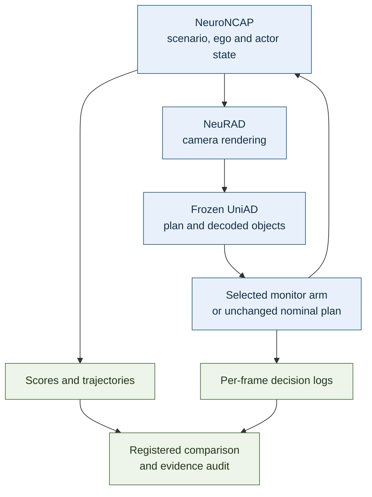
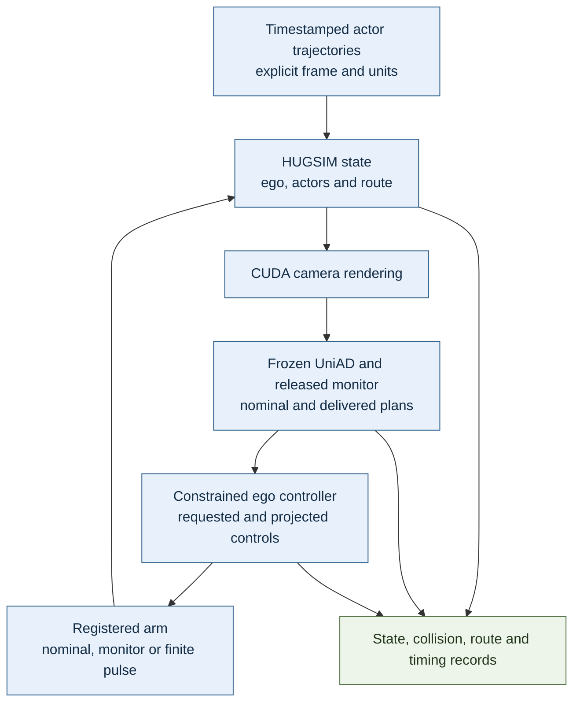
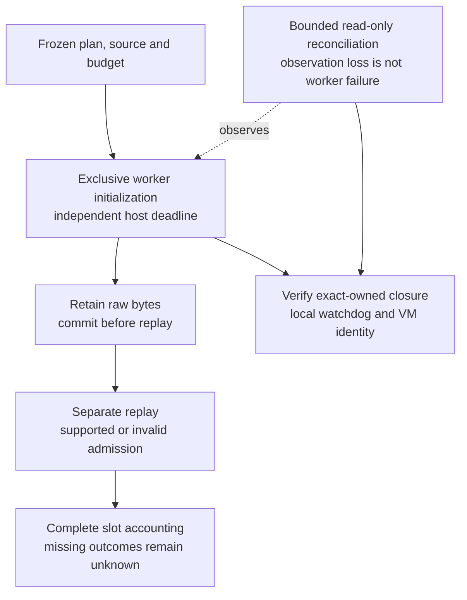
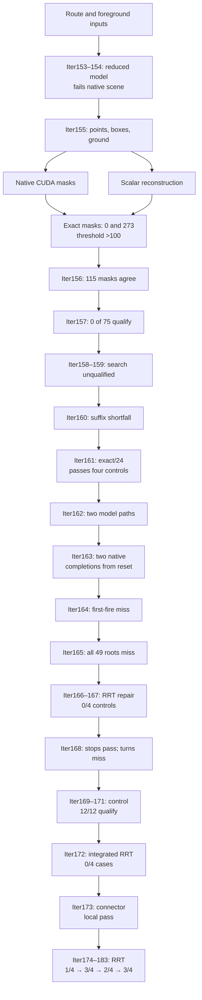
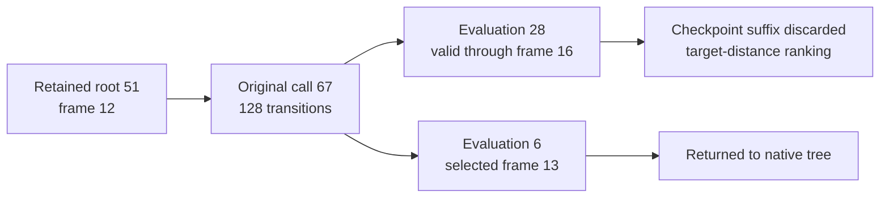
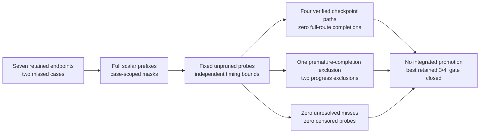
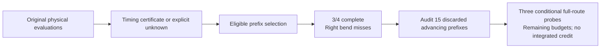

# Sentinel architecture

Updated 14 October 2026. This describes the implemented research apparatus and its measured
limits through the Iter184 research record. The [README](../README.md) carries the scientific
results and publication boundary. The [original design](history/ARCHITECTURE_original_design.snapshot.txt)
is retained as history; its proposed Maestro integration, signed receipts and universal
reproducibility guarantees are not claims about the system described here.

## Components and interfaces

| Component | Responsibility | Evidence boundary |
|---|---|---|
| Frozen planner | Produce an ego plan and decoded object outputs from rendered camera input. | A frozen checkpoint does not freeze the surrounding controller, renderer or execution schedule. |
| Released monitor | Estimate object motion; apply the registered CPA/TTC conditions and brake latch. | Uses planner outputs and pose. Hidden-state information benefit and independent perception are unestablished. |
| Plan and control adapters | Preserve explicit time, units, coordinate frames and requested/applied controls. | Simulator-specific contracts; no physical-vehicle qualification. |
| Simulator | Render observations, advance actors and ego, and evaluate collision and route state. | Evaluation labels stay outside deployable monitor inputs. |
| Worker and coordinator | Execute the fixed schedule within declared deadlines and resource bounds. | Observation availability and worker state are separate quantities. |
| Evidence replay | Recompute registered properties from retained raw records before admitting a pair. | Conditional on recorded inputs and the checks implemented; not proof of sensor completeness. |

## NeuroNCAP apparatus

The original benchmark uses NeuroNCAP for scenario orchestration and scoring, NeuRAD for
camera rendering, and frozen UniAD in its inference container. An environment-gated server
patch applies the selected monitor arm. That apparatus produced the benchmark results through
Iter134. Its repeatability was checked by run index on the retained comparisons; this is not
a blanket determinism claim for other stacks or versions.

[Released monitor source](../experiments/iter15_latch_release/server_patch_union_release.py) ·
[Power-run evidence](../experiments/full14_power/RESULT.md) ·
[Placebo protocol and result](../experiments/iter134_neuroncap_placebo_semantics_execution/RESULT.md).

## HUGSIM: distinguish the two execution regimes

Iterations 48–49 tested transfer using the then-frozen HUGSIM integration and unchanged monitor
parameters. Iterations 136–152 investigate recoverability and execution validity. Their timestamp,
actor-motion and controller changes define a new regime. Comparing or pooling their outcomes
with the old transfer data requires an explicit design accounting for those changes.

The live monitor/pulse integration used through Iter152 renders camera inputs in HUGSIM,
obtains a nominal UniAD plan and monitor decision through the instrumented client, computes constrained ego controls, and
advances the simulator. A preregistered pulse may override the applied controls. Nominal plan,
delivered plan, monitor request and applied action are retained separately.

The [trajectory contract](../experiments/iter144_timed_trajectory/trajectory.py) carries absolute
simulation seconds, owner and episode identities, SI units, frame, source rows and content
identity. Candidate costs use common times; interpolation does not license extrapolation or
prove continuous-motion feasibility. Ego and actor heading conversions are explicit.

The [constrained optimizer](../experiments/iter145_constrained_execution/optimizer.py) and
[simulator adapter](../experiments/iter145_constrained_execution/simulator.py) use the declared
update order and actuator limits. Numerical repeatability, convergence, model agreement and
deadline compliance are checked separately. A capped optimization return is not relabelled
converged because its trajectory looks reasonable.

The [current monitor replay](../experiments/iter147_full_horizon_execution/monitor.py) reconstructs
the released geometric rule conditional on accepted object rows. The study disables the
injected detector inputs used in qualification. Diagnostic monitor holds are labelled in
their raw evidence and never counted as natural hazard detection.

## Execution, observation and evidence

[Iter149 local qualification](../experiments/iter149_observation_recovery/RESULT.md) adds a
transport-independent bounded reconciliation policy, separate trace checker and local subprocess
watchdog fixture. [Iter150](../experiments/iter150_cloud_observation/RESULT.md) stream-hashes
large native artifacts into a compact observation and qualifies historical reads through actual
IAP, synthetic disconnection, host-local child expiry and exact-owned VM closure. Its live
harness failed while saving the final report; retained outputs pass a separate audit and the
filename fix passes locally. Iter151 adds exact 16-slot admission, exclusive dispatch,
Linux process ownership checks and a per-pair systemd deadline. Its first nominal pair passed
scientific replay, but a whitespace check on immutable captured source stopped publication and the schedule.
The corrected local retention pipeline passed a real Git/replay rehearsal and subsequently
completed all seven new pairs in Iter152. See [Iter151](../experiments/iter151_recovery_canary/RESULT.md).
The diagram below describes the execution and evidence flow through Iter152; each experiment
retains its own frozen schedule and resource envelope.

Iter148 fixed 112 slots; the fresh Iter151 canary fixed 16; Iter152 fixed fourteen new slots
and bound two historical nominal episodes separately. Each plan fixes its own admission order.
Pair initialization records ensure that completed or initialized work cannot be duplicated silently. Each completed raw packet is
committed before replay; a receipt binds the plan, raw identity and prior admissions.

Relevant implementations are [pair execution](../experiments/iter148_recovery_study/pair.py),
[admission](../experiments/iter148_recovery_study/admission.py),
[replay](../experiments/iter148_recovery_study/replay.py),
[comparison](../experiments/iter148_recovery_study/compare.py) and
[aggregate accounting](../experiments/iter148_recovery_study/aggregate.py).
The retained [session tools](../experiments/iter148_recovery_study/proof/session_tools)
document the executed local supervision and resource closure. They contain closed paths and
budgets and are not reusable launch commands.

**Observed limitation:** Iter148 stopped after a read-only IAP query failed to connect. The
coordinator treated that failure as a stop condition while the worker was still running.
The block is closed and its pulse outcome is incomplete. Iter149–150 implement bounded
read-only reconciliation and retain local/cloud fault checks. Iter151 exercised the new active-worker
integration; its later publication failure is separately recorded. Neither later qualification
nor a completed continuation erases that study’s missing outcome.

Iter152 completed seven new pairs with the corrected archive-to-Git-to-replay-to-admission path.
Its [continuation admission](../experiments/iter152_recovery_continuation/admission.py) binds the
two historical Iter151 nominal episodes without relabelling them as new runs; the separate
[baseline replay](../experiments/iter152_recovery_continuation/baseline.py) rechecks their bytes,
source and original scientific contract. The new fourteen-slot chain retains both scenario
boundaries and exact compute closure. The diagram distinguishes retained raw evidence from
admission and resource closure. Complete continuation accounting is in the [Iter152 result](../experiments/iter152_recovery_continuation/RESULT.md).

Hashes check identity against retained bytes. Separate replay checks specified properties.
Neither authenticates the physical world, establishes sensor completeness, or proves the
absence of shared implementation errors. This is operational verification by the research
workflow, not independent institutional certification.

## Timing contract

| Clock or measurement | Meaning | What remains outside the claim |
|---|---|---|
| Simulation time | Explicit trajectory time and 0.25 s environment steps in the current regime. | The simulator may wait longer than 0.25 s of wall time. |
| Complete controller call | Optimization and its call overhead; stopping reason retained. | Does not include the entire perception, communication and simulator loop. |
| Model exchange | Client/model communication and response. | Isolated model inference latency is not identified. |
| v2 loop duration | Recorded step work through the final guard and stop decision. | Reset, final summary serialization and worker cleanup are outside it. |
| Resource interval | Local monotonic elapsed time for the owned compute envelope. | Provider billing is separately estimated; clocks are not subtracted across hosts. |

In the four admitted Iter148 episodes, 6/368 controller calls exceeded 50 ms and all 368 loops
exceeded 250 ms. The largest checked stationarity residual was below the 1e-6 bar. Convergence
therefore passed while the full loop missed its descriptive 4 Hz budget. No late-result policy
or real-time execution guarantee follows.

Iter152 records the same distinction over 1,420 new actions: maximum checked residual
9.8965212e-7, 37 controller calls above 50 ms, and every full loop above 250 ms. Median full loop
is 1.890 s. These measurements do not establish a deadline policy for a physical vehicle.

## Diagnostic action search and background replay

Iteration 152 admitted fourteen new episodes and both fixed scenario comparisons. Neither
tested pulse recovered the collision case. All benign-case arms completed, with the monitor
adding 13 simulated seconds versus nominal. Both exact owned VM starts are terminated.
Prior nulls, missing outcomes and frozen protocols remain unchanged, including Iter148's
incomplete pulse and Iter151's interrupted schedule.

Iter153 adds an offline privileged-state diagnostic beside this live apparatus. Source route and
stationary box geometry feed a fixed 75-maneuver generator; an independent scalar implementation
rechecks policy, controls, transitions, rectangle support, swept interpolation, source route and
progress. All 150 model trials are retained; fourteen qualify and a fixed ranking selects one.
The [selected action packet](../experiments/iter153_action_feasibility/SELECTED_MANEUVER.json)
then fed Iter154's direct native-action adapter, bypassing UniAD and monitor inference. It kept
native rendering, actor updates, source termination and both foreground/background collision
channels. Both fresh replicas terminate after 13 actions at 3.25 s on native background collision.
The separately replayed prefix matches the model to 4.44e-16, with foreground and off-route false.

Iter154's device receipts did not retain the enclosed point count or mask. Iter155 closes that
finite replay gap with a bounded extraction of all pre-selection xyz, semantic features and
opacities; independently reconstructed filtering recovers the full 276,519 selected centers.
The source methods reconstruct the two historical boxes without simulator construction or steps.
Independent scalar geometry and ground projection check those inputs; native CUDA and scalar
masks agree exactly, with counts 0 at 3.00 s and 273 at 3.25 s. No new driving episode ran.

This is a source-predicate witness, not a physical reconstruction or road-boundary validation.
The native model loader is source-bound rather than independently reimplemented. Useful full-scene
recovery and information benefit remain unestablished.
[Witness and limits](../experiments/iter155_background_witness/RESULT.md).

These privileged diagnostic inputs are not delivered to the released monitor. Iter153's model
search omitted background geometry; Iter154 retained the native renderer and collision checks
but bypassed planner and monitor inference. Iter155 restored the scene model and called source
geometry methods without constructing or stepping a driving environment. The source model
loader itself did run and remains part of the bound extraction.

Iter156 adds an immutable full-population query using bounded NumPy vectorization. Its
separate scalar checker agrees on all 115 fixed development-state masks. Across 300 bindings,
26 background labels are direct, 266 are implied negatives from collision-free records, and
eight remain unknown. Median local query cost is 16.6 ms versus 1.46 s for the scalar checker;
this is exploratory CPU timing, not an end-to-end runtime guarantee. The failed maneuver is
still rejected at 3.25 s. [Calibration and limits](../experiments/iter156_background_calibration/RESULT.md).

Iter157 applies that background constraint to the fixed prior library: all fourteen
previously eligible candidates have independently verified rejection witnesses; the
other sixty-one retain their prior failures. No candidate qualifies. The checker replays
all 150 historical model traces and 27 full background masks. An initial invalid source
inventory and its narrow post-evidence correction are retained with the result. This is a
finite source-model null, not physical unavoidability or a new native driving outcome.
[Library result and limits](../experiments/iter157_constrained_action_library/RESULT.md).

Iter158 adds a bounded actuator-command search with complete hard predicates,
foreground visibility guidance and speed-group preservation. It finds no complete
trajectory. Separate scalar admission verifies the retained 19-state prefix,
including every background mask; that prefix precedes both progress checkpoints.
Search pruning remains producer evidence. The architecture now supports a checked
command path, but useful recovery and search coverage are still open.
[Result](../experiments/iter158_constraint_aware_search/RESULT.md) ·
[next decision](../experiments/iter158_constraint_aware_search/DECISION.md).

Iter159 adds a fixed-proposal factorial harness and a first-lost-witness audit.
All four constructed paths are expressible and independently verified; eleven of
sixteen searches complete. The route/speed-group candidate misses one case and
is not promoted. Separate scalar admission checks 580 states; beam selection is
mechanically replayed from retained scores. State cells are heuristic pruning,
not certified continuation equivalence. The incomplete scene reflections and all
negative outcomes remain in the [result](../experiments/iter159_route_search_qualification/RESULT.md).

Iter160 adds fixed-command continuation replay from actual retained histories.
Five unique pairs cover all sixteen first replacements; all witnesses and four
representatives complete. One ends just below the completion threshold, with no
hard rejection. Independent scalar admission checks 546 states and every full mask.
The failed candidate's first representative still admits the suffix; its complete
search failure remains unresolved. [Result](../experiments/iter160_continuation_preservation/RESULT.md).

Iter161 independently records per-depth grouping representatives and the final
beam. A fixed-budget 2×2 comparison crosses quantized/exact state grouping with
width 24/48, preserving the route guide and speed-group ordering. Exact/24
completes four controls; quantized/24 completes three; both width 48 arms complete
two. Full scene reflections correct the earlier fixture limitation in a new
version. All 643 retained states and masks replay; unselected hard predicates
remain producer evidence. [Result](../experiments/iter161_grouping_width_ablation/RESULT.md).

Iter162 reuses the unchanged search for a matched source-model grouping comparison
at width24. Both arms complete in 66 actions. Independent admission reconstructs
all 276,519 selected points, 134 complete masks and both checkpoints per path;
37,053,546 point-state classifications. Exact grouping uses more attempts and
queries here. The source model admits complete actions.
[Result](../experiments/iter162_source_grouping_qualification/RESULT.md).

Iter163 executes the preselected exact/24 path in two fresh native replicas. Each
completes 66 actions / 16.5 simulation seconds without a recorded collision or
off-route event. All 132 actual background masks are captured at the unchanged source
predicate and independently reconstructed over all selected centers: 36,500,508
point-state checks, zero disagreements. The reset has no background query. Native
actors and 804 CUDA camera calls run; inference is bypassed and controls are
precomputed. All measured loops exceed 250 ms (median 552.8 ms). Native completion
from reset is supported in this exposed scene; monitor-time recovery, real-time
operation, road compliance and information benefit remain unknown.
[Result](../experiments/iter163_native_path_replay/RESULT.md).

Iter164 makes branch time explicit in a new continuation adapter while preserving
historical source bytes. Both original prefixes qualify: 52 states and 14,378,988
scalar point checks. Exact/24 then loses its beam at 7.75 seconds after 1,778
attempts. Grouping removes zero candidates; width removes 822, without a causal
pruning claim. The admitted four-control partial suffix ends at 7.25 seconds:
30 joined states / 8,295,570 point checks; neither progress checkpoint reached.
Source-model infeasibility and native monitor-time recovery remain unknown.
[Result](../experiments/iter164_monitor_time_continuation/RESULT.md).

## Evidence delivery to the instrument

A separate data channel publishes an explicit closed-result contract after exact-source
CI. The exporter derives counts from matching state/admission fields and binds original
sources and the complete research index. An atomic Git commit contains the channel pointer
and content-addressed packet. The public reader verifies source hashes and numeric bindings;
visible clients refresh periodically, retain the last good snapshot on failure and label
corrections/retractions explicitly. Historical replay assets remain separately pinned.
This transports admitted evidence; it performs no experiment or scientific admission.
[Channel contract](../instrument/README.md).

## Next scientific boundary

The actual 25-control history qualifies, but the tested exact/24 method finds no
complete continuation. Next, qualify an independent control-search method on the
retained feasible controls, then compare at the same first-fire state and frozen
constraints. Do not infer impossibility from finite misses or a causal pruning
failure from removal counts. An admitted source continuation precedes native replay;
a measured decision window and equal-cost responsive comparison precede an
information claim. Hidden-representation
monitoring, uncertainty-aware persistence, independent sensors, physical deployment and formal
safety guarantees remain possible directions with different requirements. None is an established
capability merely because it appears in a roadmap.

Iter165 branches from every discarded two-step maximum-braking state and every
retained state at frame 27. All 49 exact/24 searches miss under equal per-root
budgets and unchanged absolute constraints. The scalar checker reuses only its own
exact box/population classifications; every selected state and full mask is still
checked. This reduces repeated verification work without accepting producer masks.
[Result](../experiments/iter165_discarded_braking/RESULT.md).

Iter166 adds released OMPL control RRT through a small native bridge. Tree selection
is upstream; physical callbacks, fixed proposals and directed sampling are Sentinel
adapters. Independent admission rejects the first early terminal path. Iter167
adds the missing terminal-clock restriction and retains four bounded qualification
misses. No RRT source-scene comparison is authorized by that failed qualification.
The next technical dependency is local-connector competence under the same budgets,
followed by source comparison only after qualification.
[Invalid qualification](../experiments/iter166_independent_planner/RESULT.md) ·
[Corrected qualification](../experiments/iter167_planner_terminal_contract/RESULT.md).

Iter168 isolates the local connector from the tree. A successor proposal generator
adds state-conditioned braking; one-step and two-step receding lookahead share the
same controls, distance metric, intermediate checks and budget. Constructed tasks
specify terminal state and time explicitly, including every required wait frame.
They do not waive the earlier route-completion checkpoint contract. All twelve
witnesses pass; the connectors complete 8/12 and 10/12, both missing longer turns.
All 213 selected/witness states and full masks independently replay. Every attempted
transition is charged and independently checked for motion and physical/task
constraints; unselected background labels remain producer evidence. No native
bridge or RRT solve occurs here. Full-horizon turning, then integrated planner
qualification, remain prerequisites to source comparison.
[Connector result and limits](../experiments/iter168_control_connector/RESULT.md).

Iter169 adds bounded shooting over the whole task horizon. Task-derived controls
are optimized against terminal residuals with explicit stop/wait phases. All
intermediate predicates remain hard admission requirements. Derivative and line
search calls are included in the per-transition budget; exact physical-vector
cache hits are recorded separately. Its 10/12 result exposes a near-zero relative
derivative problem. Iter170 fixes that policy but still completes 10/12.

Iter171 expresses optimizer variables as increments around the unchanged physical
seed and translates bounds. The evaluator, dynamics, constraints and scalar checker
are reused unchanged. All twelve tasks qualify; 284 states/full masks across
witnesses and retained/new paths replay independently. No witness controls enter
the controller API. Coordinate translation changes both initial radius and later
probe placement; a single-mechanism causal claim is not established.

Local targets and deadlines are explicitly supplied in these tasks. The unresolved
integration is how RRT supplies them, represents unreachable requests, and charges
every internal rollout to its original budget. Its four-case full-clock and
checkpoint qualification remains necessary before source comparison. No bridge,
source replay or native driving is added by the local result.
[Full-horizon failure](../experiments/iter169_full_horizon_control/RESULT.md) ·
[Derivative correction](../experiments/iter170_derivative_step/RESULT.md) ·
[Local qualification](../experiments/iter171_centered_shooting/RESULT.md).

Iter172 integrates centered shooting through a specialized sequence-token bridge.
The original RRT selects a parent and target; the callback evaluates up to eight
physical steps and returns only an initial contiguous admissible prefix. The
control token identifies its exact recorded sequence, and duration is the physical
step count. Native path expansion checks token, parent, endpoint and duration.
The bridge is not a generic constant-control OMPL propagator; unexpected native
propagation throws. Intermediate tree-node insertion remains disabled, while all
intermediate physical states retain their hard checks.

Absolute scene time, the original 4/8-second checkpoints, target sampler, metric,
goal bias and four seeds/cases are preserved. No explicit wait/stop phase is
invented for these cases. Every local derivative, line-search and rejected rollout
counts within the original outer transition cap. All four searches exhaust that
cap without completion: 71,986 transitions, 84 calls and 24 partial connections.
No accepted branch reaches the first checkpoint. Independent replay checks all
motion/accounting and 38 selected states/full masks; unselected background labels
and native tree/RNG retain producer provenance.

The local 12/12 result therefore does not qualify the integrated planner. A
post-outcome audit finds unreachable endpoint requests and frequent background
rejection; it does not identify a single cause. Iter173 subsequently compares
shooting with bounded forward-control expansion under matched available work
and time caps, retaining the same hard constraints. Source comparison stays closed
until a separately frozen original
four-case integrated qualification passes. No source recovery follows from local
qualification. [Integrated result](../experiments/iter172_integrated_rrt/RESULT.md) ·
[next decision](../experiments/iter172_integrated_rrt/DECISION.md).

Iter173 isolates the connector from tree feedback. Its manifest reconstructs the
80 executed parent/target requests from Iter172, retaining absolute state/time,
local horizon and per-call transition allocation. Four unexecuted reservation
calls are explicitly excluded. Each arm receives the same request and geometry
in a fresh process; there is no new RRT solve. Twelve unchanged explicit tasks
plus two detours supply full-trajectory controls. A physical seed precedes fixed
constant/reversing phase proposals and a deterministic four-phase Halton family.
The proposal function receives no witness actions or case identifiers. Exposed
fixtures informed its design, including a pattern shared by the new detours.

Request evaluation reuses the eight-step prefix evaluator and ranking; explicit
tasks require the full horizon and terminal conditions. Cache identity, all
predicted motion, derivative work, hard constraints and proposal-generation time
remain charged. This test does not apply early termination after a rejection.
A separate checker reconstructs proposal parameters and all attempted motion,
then replays full scalar masks for 668 selected, witness and negative-control
states. Unselected background labels retain producer provenance.

Forward passes 14/14 constructive tasks and improves 16/80 requests; shooting
passes 12/14 and improves 15/80. Both yield the same 24 admissible returns and no
checkpoint crossings. Forward spends more request transitions but fewer on the
constructed tasks. Equal caps do not establish equal work or a speedup. The
frozen finite criterion passes; a separately frozen original-four-case integrated
trial follows in Iter174. Neither this result nor local task qualification
opens source comparison. [Comparison and limits](../experiments/iter173_matched_connector_cost/RESULT.md) ·
[next decision](../experiments/iter173_matched_connector_cost/DECISION.md).

Iter174 inserts the admitted forward generator into the same integrated adapter.
A substitution contract requires exact equality with Iter172's adapter except for
the connector import and invocation; the native binary/runtime remain unchanged.
The producer keeps four fresh seeded processes, the original outer limits and
the 1,024-transition/eight-step inner allocation. There is no new 30-second clock
from the paired request experiment: every proposal shares the original outer
deadline. The checker reuses scalar path/accounting admission and independently
reconstructs forward parameters. Full masks cover all 76 returned states.

One case completes: chicane_left reaches route completion at frame 32, passing
both checkpoints. The two bends stop before frame 16; chicane_right reaches frame
17 but misses completion. All-four qualification is contradicted. Unselected
background labels and native tree/RNG remain producer evidence. Source comparison
stays closed. The next proposed test changes only the inner work allocation,
keeping the total budget fixed; its possible loss of late useful proposals is
explicitly retained. [Integrated result](../experiments/iter174_forward_integrated_rrt/RESULT.md) ·
[next decision](../experiments/iter174_forward_integrated_rrt/DECISION.md).

Iter175 changes only the connection allowance, from 1,024 to 128 transitions.
The adapter/runtime remain byte-identical, every other scientific PLAN field is
checked against the retained reference, and raw is committed before admission.
Independent replay admits 2/4: bend_left is gained, chicane_left is retained.
Calls/accepted edges rise to 387/241; 49,055 transitions are charged. All-four
qualification still fails. Full scalar masks cover 102 returned states.

The shorter cap also changes proposal coverage: none of 324 eight-step solves
reaches Halton. More calls do not isolate a pure breadth advantage. A descriptive
audit finds four discarded chicane_right prefixes through frame 32, with low
route progress. Iter176 below closes their scalar replay and audits nominal
reflected coverage; no cap sweep or source comparison follows from this failed
qualification.
[Allocation result](../experiments/iter175_connection_allocation/RESULT.md) ·
[next decision](../experiments/iter175_connection_allocation/DECISION.md).

Iter176 audits the unchanged integrated architecture above. It enumerates the
386 retained executed requests in original and reflected coordinates under nominal
full-rollout accounting, without propagation or goal stopping. A separate checker
reconstructs proposal values, cache/budget records and physical program sets:
327 sets preserve coverage and 59 do not; 317/324 eight-step sets preserve it.
These are availability results, not mirrored solver or tree outcomes.

Four fixed discarded prefixes are joined to retained ancestors using the declared
earliest exact numeric join. The raw traces and vector masks are committed before
independent scalar replay of all 132 state records / 1,054,152 point classifications.
All four paths are admissible but incomplete at 62–64% route progress. Ambiguous
joins and shared ancestry remain explicit. No native search is added by this audit. The diagrams now summarize the latest
valid integrated result through Iter178; the audit adds no integrated outcome. Iter177
below tests one pose-aware initial control program after constructed positive/adverse
qualification, with fallback order and all budgets fixed.
[Audit result](../experiments/iter176_connector_guidance_audit/RESULT.md) ·
[next decision](../experiments/iter176_connector_guidance_audit/DECISION.md).

Iter177 adds one algebraic pose-aware seed to that forward interface, then stops
invalid in chicane_right. Its first accepted five-step connection reaches speed
6.000000000000002. The unchanged trajectory validator accepts it within 1e-12;
the unchanged Controls constructor rejects it as a next root using a strict bound
of 6. This exposes a mismatch between adjacent interfaces. No state projection or
physical-tolerance relaxation has been applied.

A separately frozen failure checker binds all raw/initialization/failure records,
checks all 125 attempted transitions of the retained first connection, and scalar-
checks its six-state path / 47,916 point classifications. The next callback input
was not logged. Three prior worker outputs remain unadmitted, so no new integrated
result is admitted from Iter177. Its correction requires constructed inside/outside
boundary tests and a distinct frozen qualification under unchanged physical
tolerances and total budgets, completed in Iter178 below.
[Invalid result](../experiments/iter177_pose_aware_seed/RESULT.md) ·
[next decision](../experiments/iter177_pose_aware_seed/DECISION.md).

Iter178 changes only the next-root constructor domain to match the existing motion
predicate: speed in [-1e-12, 6+1e-12] and absolute steering at most pi/3+1e-12.
Every stored state value is preserved. No projection or physical-tolerance change
occurs. Source contracts bind the original control methods and the two evaluator/
adapter import substitutions. The pose-aware proposal and fallback generator are
unchanged from the invalid predecessor. Twenty-eight boundary/composition controls
include the next representable value outside each accepted numerical boundary.

The corrected four-case schedule admits 3/4 under unchanged maximum budgets,
gaining chicane_right and retaining the two Iter175 successes. Separate replay
verifies 118 returned states and 872,652 full scalar point-state classifications.
The diagrams count this valid result; Iter177 remains invalid and is not pooled.
This comparison evaluates the corrected candidate as a whole against Iter175,
without isolating a pure pose-seed effect. Bend_right still misses and source
comparison stays closed. The next bounded audit examines the retained late tree
frontier's continuation constraints before another planner change. Offline reset
qualification does not establish useful intervention from actual decision histories.
[Corrected result](../experiments/iter178_root_domain_consistency/RESULT.md) ·
[next decision](../experiments/iter178_root_domain_consistency/DECISION.md).

Iter179 leaves that integrated architecture unchanged and audits its complete late
bend_right frontier: 19 endpoint records, 16 distinct roots, all 2,609 evaluations
from 76 late requests. A fixed stepwise-control probe stops at checkpoint frame 16,
empty beam or its work/time cap. A separate necessary progress bound uses an exact
rational coordinate reach box; an independent four-corner formulation checks it.
The bound does not prune or skip probes. Earliest numeric joins preserve ambiguity
and do not claim native tree ancestry.

Independent replay admits three checkpoint continuations, two progress exclusions
and eleven unresolved bounded misses, with no censoring. It checks 621 distinct
full scalar masks / 4,057,614 point-state classifications, returned paths, all
attempted motions, proposal order and beam accounting. New unselected probe
background labels remain producer evidence unless materialized. The diagnostic
witnesses use 495–510 attempts, so they do not establish a repair within the
integrated connector's 128 allowance. Two viable roots received no original
outgoing request, exposing a separate expansion-allocation question. Neither fact
establishes the sole cause of the integrated miss. The diagrams continue to show
3/4; the audit adds no integrated outcome.
[Frontier audit](../experiments/iter179_frontier_continuation_audit/RESULT.md) ·
[next decision](../experiments/iter179_frontier_continuation_audit/DECISION.md).

Iter180 compares the actual retained program generator and width-two stepwise beam
on all 16 distinct roots under equal 128-transition/three-second ceilings. Both
find the same three checkpoint witnesses: null gain-without-loss claim, no
censoring. Scalar replay covers all queried states, including unselected and
invalid suffixes: 1,502 full masks / 9,814,068 point-state classifications. This
comparison changes the local objective to checkpoint feasibility; it does not
replay original sampled targets or change the integrated planner.

Original call 67 already generated a valid frame-16 program within 128 attempts.
Its transition records exactly match the admitted program witness, but original
sampled-target ranking selected an earlier prefix from another evaluation. The
following is a descriptive trace, not a counterfactual integrated result:

Next proposed change is checkpoint-aware prefix selection within and across
evaluations, with existing proposal order, stopping, predicates and total budgets.
It can alter the tree unfavorably; all four cases and losses must be checked.
Expansion allocation remains a separate question. Integrated diagrams still show
3/4, and source comparison remains closed.
[Comparison](../experiments/iter180_equal_work_continuation/RESULT.md) ·
[next decision](../experiments/iter180_equal_work_continuation/DECISION.md).

Iter181 changes only prefix selection: among continuously valid uninterrupted
prefixes, prefer more scheduled checkpoint times crossed since the root, then
retain the old target distance and tie order. Full completion takes precedence.
The independent checker uses checkpoint times and reconstructs eligibility before
ranking. Generator, sampler, native nearest-neighbor metric, root tolerance,
physical predicates, stopping and total budgets remain unchanged.

The candidate completes 2/4 against retained Iter178's 3/4, with no gains and one
lost bend_left success. Independent full scalar replay covers 115 returned-path
states / 853,050 point-state classifications. The bend_right tree reaches frame
31 without enough later progress, while bend_left approaches completion before the
required time. Four of seven late endpoints receive no outgoing request. Those
are distinct observed signatures, not continuous-control exclusions or proof of
an allocation repair. Iter182 below separates progress reach, premature
completion and feasible continuation before another integrated change. Source
comparison stays closed; the adverse candidate is not promoted.
[Selection result](../experiments/iter181_checkpoint_prefix_selection/RESULT.md) ·
[next decision](../experiments/iter181_checkpoint_prefix_selection/DECISION.md).

## Late-frontier timing audit

Iter182 independently admits four frame-32 continuations and three sufficient
numerical-model exclusions among all seven late Iter181 endpoints. The left
frame-29 root must complete too early; both right roots cannot reach checkpoint
progress in time. Zero unresolved or censored probes in this population. The
premature-completion certificate is inapplicable at frame31, independently of its
progress certificate. No certificate prunes a diagnostic probe.

All 3,969 queried states / 25,933,446 point-state classifications replay, including
unselected and rejected queries. Exact numeric joins reconstruct paths; they do
not identify native ancestry. Three witness roots lacked original expansion, but
all diagnostic witnesses used more than the original 128-transition connection
ceiling. Allocation alone is not established as the mechanism.

Next preregister necessary-constraint eligibility before prefix selection on the
Iter181 experimental parent, preserving the Iter178 comparator and every budget.
Unknown states remain eligible. Validate retained successful prefixes, bound cost
and cache identity before integration; count lost successes in all four cases.
[Audit result](../experiments/iter182_late_frontier_timing/RESULT.md) ·
[mathematical domain](../experiments/iter182_late_frontier_timing/MATHEMATICS.md) ·
[next decision](../experiments/iter182_late_frontier_timing/DECISION.md).

## Timing eligibility and the discarded-progress boundary

Iter183 excludes only independently certified late timing traps before the existing
selection rule. Uncertified prefixes remain eligible; all attempted physical work
and certificate cost count under unchanged integrated ceilings. It restores 3/4,
tying Iter178 and recovering one success against Iter181. Full scalar replay covers
115 returned states. The right bend still misses; source comparison stays closed.

The matched left request demonstrates one local selection repair. Fifteen eligible
but discarded advancing prefix records motivate a source-bound full-path/mask audit;
three fixed conditional continuations follow only after their admission. Fresh
conditional trees do not reproduce inserting nodes into the original native tree.
No ranking change is supported yet. [Result](../experiments/iter183_timing_eligibility/RESULT.md) ·
[next decision](../experiments/iter183_timing_eligibility/DECISION.md).

## Discarded-prefix admission failure

Iter184 retains 15 paths and 82 masks, but scalar admission is invalid before
replay because the copied runtime manifest is not canonically formatted. An earlier
pre-query plan-formatting failure and one mechanical amendment remain visible.
No continuation search ran; producer masks do not establish feasible prefixes.

The correction must bind original producer and corrected validator separately,
qualify the actual manifest readers, preserve historical bytes and avoid repeating
collection. Integrated qualification remains 3/4; source comparison stays closed.
[Failure scope](../experiments/iter184_discarded_progress/RESULT.md) ·
[next decision](../experiments/iter184_discarded_progress/DECISION.md).
