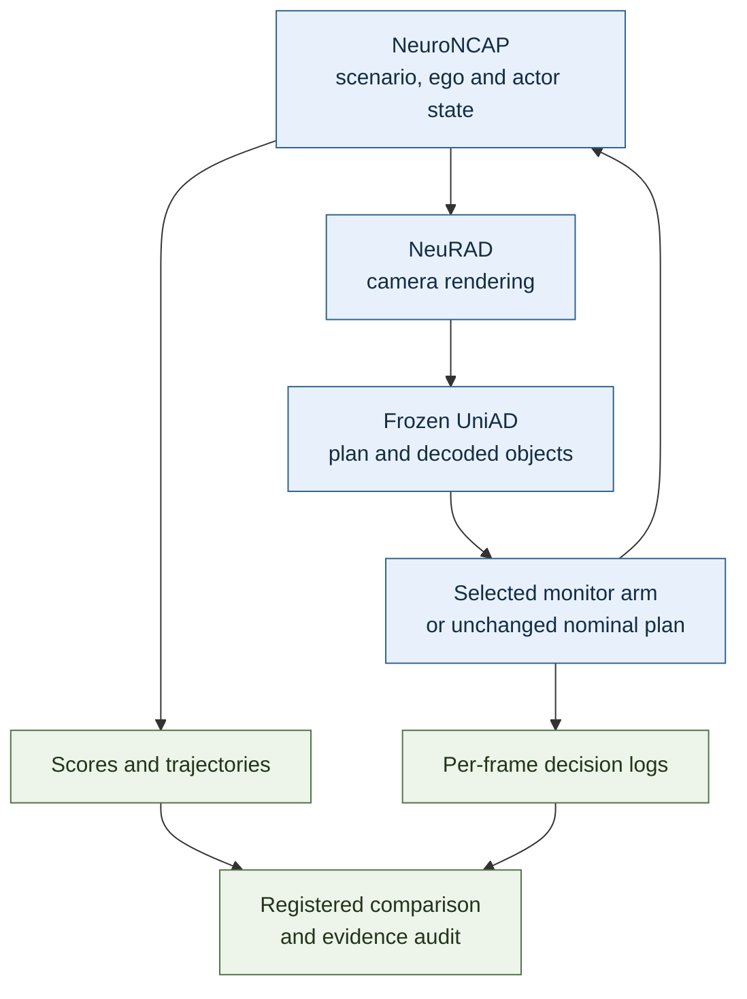
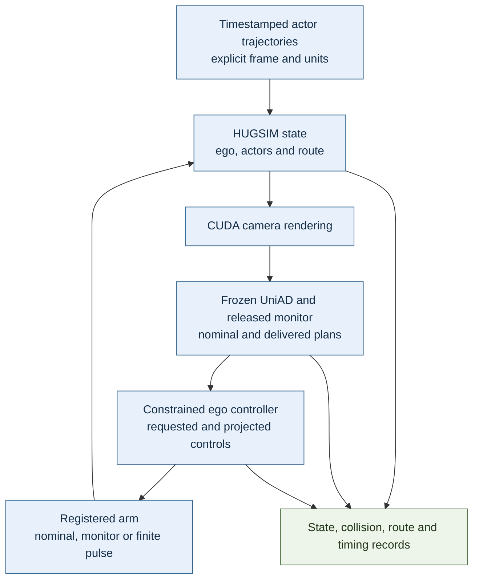
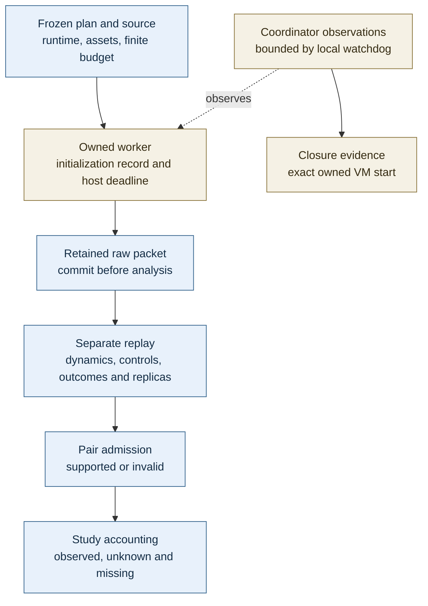

# Sentinel architecture

Updated 11 October 2026. This describes the implemented research apparatus and its measured
limits through the Iter148 research candidate. The [README](../README.md) carries the scientific
results and publication boundary. The [original design](history/ARCHITECTURE_original_design.snapshot.txt)
is retained as history; its proposed Maestro integration, signed receipts and universal
reproducibility guarantees are not claims about the system described here.

## Components and interfaces

| Component | Responsibility | Evidence boundary |
|---|---|---|
| Frozen planner | Produce an ego plan and decoded object outputs from rendered camera input. | A frozen checkpoint does not freeze the surrounding controller, renderer or execution schedule. |
| Released monitor | Estimate object motion; apply the registered CPA/TTC conditions and brake latch. | Uses planner outputs and pose. Hidden-state information benefit and independent perception are unestablished. |
| Plan and control adapters | Preserve explicit time, units, coordinate frames and requested/applied controls. | Simulator-specific contracts; no physical-vehicle qualification. |
| Simulator | Render observations, advance actors and ego, and evaluate collision and route state. | Evaluation labels stay outside deployable monitor inputs. |
| Worker and coordinator | Execute the fixed schedule within declared deadlines and resource bounds. | Observation availability and worker state are separate quantities. |
| Evidence replay | Recompute registered properties from retained raw records before admitting a pair. | Conditional on recorded inputs and the checks implemented; not proof of sensor completeness. |

## NeuroNCAP apparatus

The original benchmark uses NeuroNCAP for scenario orchestration and scoring, NeuRAD for
camera rendering, and frozen UniAD in its inference container. An environment-gated server
patch applies the selected monitor arm. That apparatus produced the benchmark results through
Iter134. Its repeatability was checked by run index on the retained comparisons; this is not
a blanket determinism claim for other stacks or versions.

[Released monitor source](../experiments/iter15_latch_release/server_patch_union_release.py) ·
[Power-run evidence](../experiments/full14_power/RESULT.md) ·
[Placebo protocol and result](../experiments/iter134_neuroncap_placebo_semantics_execution/RESULT.md).

## HUGSIM: distinguish the two execution regimes

Iterations 48–49 tested transfer using the then-frozen HUGSIM integration and unchanged monitor
parameters. Iterations 136–148 investigate recoverability and execution validity. Their timestamp,
actor-motion and controller changes define a new regime. Comparing or pooling their outcomes
with the old transfer data requires an explicit design accounting for those changes.

The current integration renders camera inputs in HUGSIM, obtains a nominal UniAD plan and
monitor decision through the instrumented client, computes constrained ego controls, and
advances the simulator. A preregistered pulse may override the applied controls. Nominal plan,
delivered plan, monitor request and applied action are retained separately.

The [trajectory contract](../experiments/iter144_timed_trajectory/trajectory.py) carries absolute
simulation seconds, owner and episode identities, SI units, frame, source rows and content
identity. Candidate costs use common times; interpolation does not license extrapolation or
prove continuous-motion feasibility. Ego and actor heading conversions are explicit.

The [constrained optimizer](../experiments/iter145_constrained_execution/optimizer.py) and
[simulator adapter](../experiments/iter145_constrained_execution/simulator.py) use the declared
update order and actuator limits. Numerical repeatability, convergence, model agreement and
deadline compliance are checked separately. A capped optimization return is not relabelled
converged because its trajectory looks reasonable.

The [current monitor replay](../experiments/iter147_full_horizon_execution/monitor.py) reconstructs
the released geometric rule conditional on accepted object rows. The study disables the
injected detector inputs used in qualification. Diagnostic monitor holds are labelled in
their raw evidence and never counted as natural hazard detection.

## Execution, observation and evidence

[Iter149 local qualification](../experiments/iter149_observation_recovery/RESULT.md) adds a
transport-independent bounded reconciliation policy, separate trace checker and local subprocess
watchdog fixture. Its small artifact schema is not yet adapted to the large GPU worker evidence,
and cloud observation/shutdown remains unqualified. The retained Iter148 diagram and workflow
below describe the last scientific run; no new scientific execution occurred.

The study plan fixes 112 slots and admission order. Pair initialization is recorded so that
completed or initialized work cannot be duplicated silently. Each completed raw packet is
committed before replay; a receipt binds the plan, raw identity and prior admissions.

Relevant implementations are [pair execution](../experiments/iter148_recovery_study/pair.py),
[admission](../experiments/iter148_recovery_study/admission.py),
[replay](../experiments/iter148_recovery_study/replay.py),
[comparison](../experiments/iter148_recovery_study/compare.py) and
[aggregate accounting](../experiments/iter148_recovery_study/aggregate.py).
The retained [session tools](../experiments/iter148_recovery_study/proof/session_tools)
document the executed local supervision and resource closure. They contain closed paths and
budgets and are not reusable launch commands.

**Observed limitation:** Iter148 stopped after a read-only IAP query failed to connect. The
coordinator treated that failure as a stop condition while the worker was still running.
The block is closed and its pulse outcome is incomplete. Bounded observation retries,
reconciliation with durable host state and tests against duplicate execution are the next
proposed control changes. The diagram above does not imply that recovery is already implemented.

Hashes check identity against retained bytes. Separate replay checks specified properties.
Neither authenticates the physical world, establishes sensor completeness, or proves the
absence of shared implementation errors. This is operational verification by the research
workflow, not independent institutional certification.

## Timing contract

| Clock or measurement | Meaning | What remains outside the claim |
|---|---|---|
| Simulation time | Explicit trajectory time and 0.25 s environment steps in the current regime. | The simulator may wait longer than 0.25 s of wall time. |
| Complete controller call | Optimization and its call overhead; stopping reason retained. | Does not include the entire perception, communication and simulator loop. |
| Model exchange | Client/model communication and response. | Isolated model inference latency is not identified. |
| v2 loop duration | Recorded step work through the final guard and stop decision. | Reset, final summary serialization and worker cleanup are outside it. |
| Resource interval | Local monotonic elapsed time for the owned compute envelope. | Provider billing is separately estimated; clocks are not subtracted across hosts. |

In the four admitted Iter148 episodes, 6/368 controller calls exceeded 50 ms and all 368 loops
exceeded 250 ms. The largest checked stationarity residual was below the 1e-6 bar. Convergence
therefore passed while the full loop missed its descriptive 4 Hz budget. No late-result policy
or real-time execution guarantee follows.

## Current state and proposed extensions

Iteration 148 admitted two baseline replica pairs and no full four-arm scenario comparison.
Both owned VM starts are terminated. Prior nulls, missing outcomes and frozen protocols remain
unchanged. See the [result](../experiments/iter148_recovery_study/RESULT.md) for exact counts,
timing scope, deployment corrections, evidence lineage and resource receipts.

The next scientific work is constructive recovery, then one explicit information ablation
against a responsive baseline, followed by new-scene evaluation. Hidden-representation
monitoring, uncertainty-aware persistence, independent sensors, physical deployment and formal
safety guarantees are possible research directions with different requirements. None is an
implemented or established capability simply because it appears in a roadmap.
