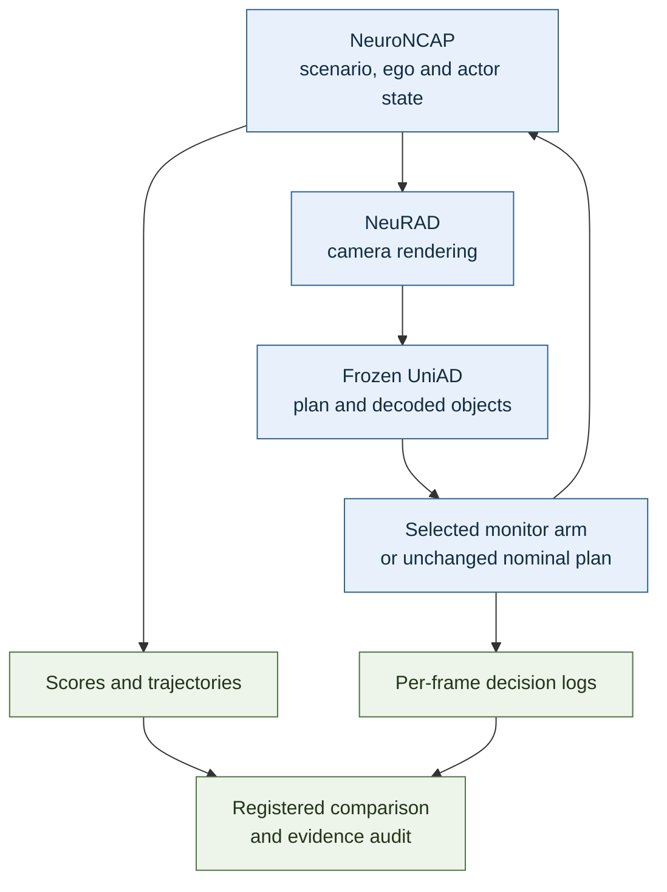
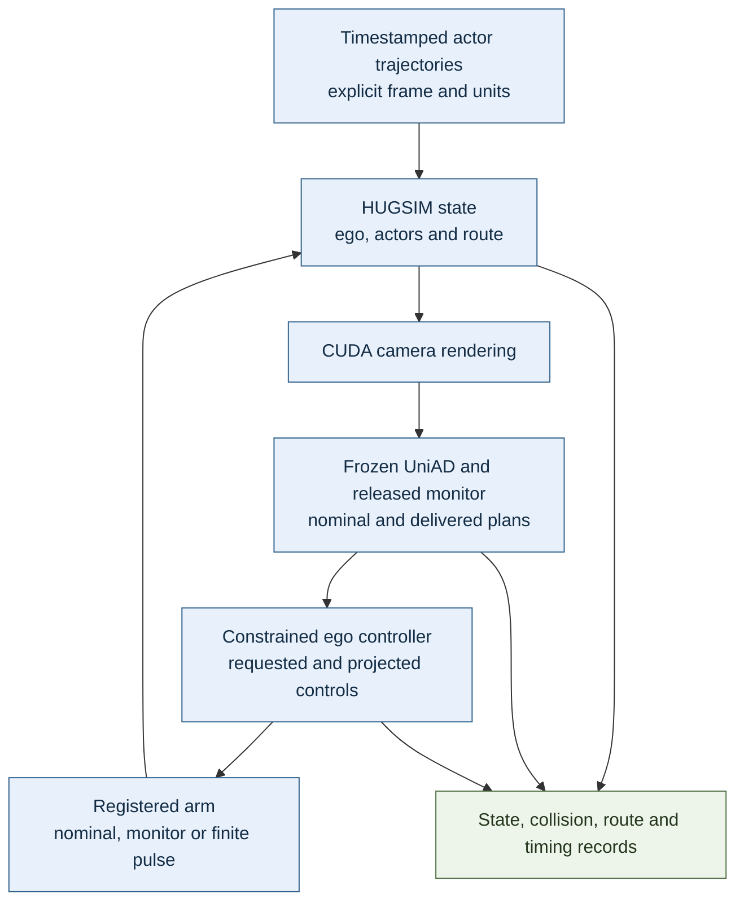
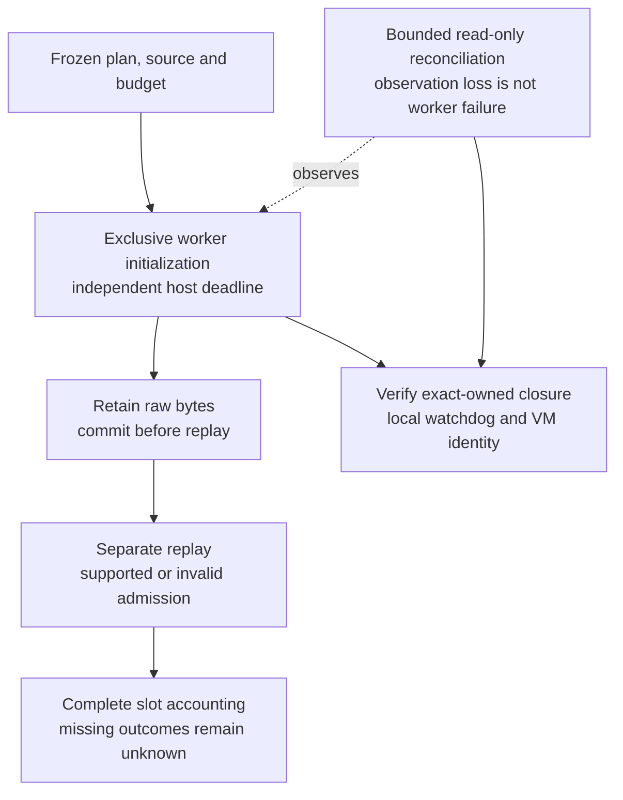
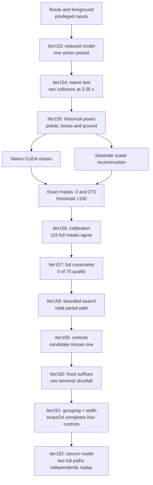

# Sentinel architecture

Updated 12 October 2026. This describes the implemented research apparatus and its measured
limits through the Iter162 research record. The [README](../README.md) carries the scientific
results and publication boundary. The [original design](history/ARCHITECTURE_original_design.snapshot.txt)
is retained as history; its proposed Maestro integration, signed receipts and universal
reproducibility guarantees are not claims about the system described here.

## Components and interfaces

| Component | Responsibility | Evidence boundary |
|---|---|---|
| Frozen planner | Produce an ego plan and decoded object outputs from rendered camera input. | A frozen checkpoint does not freeze the surrounding controller, renderer or execution schedule. |
| Released monitor | Estimate object motion; apply the registered CPA/TTC conditions and brake latch. | Uses planner outputs and pose. Hidden-state information benefit and independent perception are unestablished. |
| Plan and control adapters | Preserve explicit time, units, coordinate frames and requested/applied controls. | Simulator-specific contracts; no physical-vehicle qualification. |
| Simulator | Render observations, advance actors and ego, and evaluate collision and route state. | Evaluation labels stay outside deployable monitor inputs. |
| Worker and coordinator | Execute the fixed schedule within declared deadlines and resource bounds. | Observation availability and worker state are separate quantities. |
| Evidence replay | Recompute registered properties from retained raw records before admitting a pair. | Conditional on recorded inputs and the checks implemented; not proof of sensor completeness. |

## NeuroNCAP apparatus

The original benchmark uses NeuroNCAP for scenario orchestration and scoring, NeuRAD for
camera rendering, and frozen UniAD in its inference container. An environment-gated server
patch applies the selected monitor arm. That apparatus produced the benchmark results through
Iter134. Its repeatability was checked by run index on the retained comparisons; this is not
a blanket determinism claim for other stacks or versions.

[Released monitor source](../experiments/iter15_latch_release/server_patch_union_release.py) ·
[Power-run evidence](../experiments/full14_power/RESULT.md) ·
[Placebo protocol and result](../experiments/iter134_neuroncap_placebo_semantics_execution/RESULT.md).

## HUGSIM: distinguish the two execution regimes

Iterations 48–49 tested transfer using the then-frozen HUGSIM integration and unchanged monitor
parameters. Iterations 136–152 investigate recoverability and execution validity. Their timestamp,
actor-motion and controller changes define a new regime. Comparing or pooling their outcomes
with the old transfer data requires an explicit design accounting for those changes.

The live monitor/pulse integration used through Iter152 renders camera inputs in HUGSIM,
obtains a nominal UniAD plan and monitor decision through the instrumented client, computes constrained ego controls, and
advances the simulator. A preregistered pulse may override the applied controls. Nominal plan,
delivered plan, monitor request and applied action are retained separately.

The [trajectory contract](../experiments/iter144_timed_trajectory/trajectory.py) carries absolute
simulation seconds, owner and episode identities, SI units, frame, source rows and content
identity. Candidate costs use common times; interpolation does not license extrapolation or
prove continuous-motion feasibility. Ego and actor heading conversions are explicit.

The [constrained optimizer](../experiments/iter145_constrained_execution/optimizer.py) and
[simulator adapter](../experiments/iter145_constrained_execution/simulator.py) use the declared
update order and actuator limits. Numerical repeatability, convergence, model agreement and
deadline compliance are checked separately. A capped optimization return is not relabelled
converged because its trajectory looks reasonable.

The [current monitor replay](../experiments/iter147_full_horizon_execution/monitor.py) reconstructs
the released geometric rule conditional on accepted object rows. The study disables the
injected detector inputs used in qualification. Diagnostic monitor holds are labelled in
their raw evidence and never counted as natural hazard detection.

## Execution, observation and evidence

[Iter149 local qualification](../experiments/iter149_observation_recovery/RESULT.md) adds a
transport-independent bounded reconciliation policy, separate trace checker and local subprocess
watchdog fixture. [Iter150](../experiments/iter150_cloud_observation/RESULT.md) stream-hashes
large native artifacts into a compact observation and qualifies historical reads through actual
IAP, synthetic disconnection, host-local child expiry and exact-owned VM closure. Its live
harness failed while saving the final report; retained outputs pass a separate audit and the
filename fix passes locally. Iter151 adds exact 16-slot admission, exclusive dispatch,
Linux process ownership checks and a per-pair systemd deadline. Its first nominal pair passed
scientific replay, but a whitespace check on immutable captured source stopped publication and the schedule.
The corrected local retention pipeline passed a real Git/replay rehearsal and subsequently
completed all seven new pairs in Iter152. See [Iter151](../experiments/iter151_recovery_canary/RESULT.md).
The diagram below describes the execution and evidence flow through Iter152; each experiment
retains its own frozen schedule and resource envelope.

Iter148 fixed 112 slots; the fresh Iter151 canary fixed 16; Iter152 fixed fourteen new slots
and bound two historical nominal episodes separately. Each plan fixes its own admission order.
Pair initialization records ensure that completed or initialized work cannot be duplicated silently. Each completed raw packet is
committed before replay; a receipt binds the plan, raw identity and prior admissions.

Relevant implementations are [pair execution](../experiments/iter148_recovery_study/pair.py),
[admission](../experiments/iter148_recovery_study/admission.py),
[replay](../experiments/iter148_recovery_study/replay.py),
[comparison](../experiments/iter148_recovery_study/compare.py) and
[aggregate accounting](../experiments/iter148_recovery_study/aggregate.py).
The retained [session tools](../experiments/iter148_recovery_study/proof/session_tools)
document the executed local supervision and resource closure. They contain closed paths and
budgets and are not reusable launch commands.

**Observed limitation:** Iter148 stopped after a read-only IAP query failed to connect. The
coordinator treated that failure as a stop condition while the worker was still running.
The block is closed and its pulse outcome is incomplete. Iter149–150 implement bounded
read-only reconciliation and retain local/cloud fault checks. Iter151 exercised the new active-worker
integration; its later publication failure is separately recorded. Neither later qualification
nor a completed continuation erases that study’s missing outcome.

Iter152 completed seven new pairs with the corrected archive-to-Git-to-replay-to-admission path.
Its [continuation admission](../experiments/iter152_recovery_continuation/admission.py) binds the
two historical Iter151 nominal episodes without relabelling them as new runs; the separate
[baseline replay](../experiments/iter152_recovery_continuation/baseline.py) rechecks their bytes,
source and original scientific contract. The new fourteen-slot chain retains both scenario
boundaries and exact compute closure. The diagram distinguishes retained raw evidence from
admission and resource closure. Complete continuation accounting is in the [Iter152 result](../experiments/iter152_recovery_continuation/RESULT.md).

Hashes check identity against retained bytes. Separate replay checks specified properties.
Neither authenticates the physical world, establishes sensor completeness, or proves the
absence of shared implementation errors. This is operational verification by the research
workflow, not independent institutional certification.

## Timing contract

| Clock or measurement | Meaning | What remains outside the claim |
|---|---|---|
| Simulation time | Explicit trajectory time and 0.25 s environment steps in the current regime. | The simulator may wait longer than 0.25 s of wall time. |
| Complete controller call | Optimization and its call overhead; stopping reason retained. | Does not include the entire perception, communication and simulator loop. |
| Model exchange | Client/model communication and response. | Isolated model inference latency is not identified. |
| v2 loop duration | Recorded step work through the final guard and stop decision. | Reset, final summary serialization and worker cleanup are outside it. |
| Resource interval | Local monotonic elapsed time for the owned compute envelope. | Provider billing is separately estimated; clocks are not subtracted across hosts. |

In the four admitted Iter148 episodes, 6/368 controller calls exceeded 50 ms and all 368 loops
exceeded 250 ms. The largest checked stationarity residual was below the 1e-6 bar. Convergence
therefore passed while the full loop missed its descriptive 4 Hz budget. No late-result policy
or real-time execution guarantee follows.

Iter152 records the same distinction over 1,420 new actions: maximum checked residual
9.8965212e-7, 37 controller calls above 50 ms, and every full loop above 250 ms. Median full loop
is 1.890 s. These measurements do not establish a deadline policy for a physical vehicle.

## Diagnostic action search and background replay

Iteration 152 admitted fourteen new episodes and both fixed scenario comparisons. Neither
tested pulse recovered the collision case. All benign-case arms completed, with the monitor
adding 13 simulated seconds versus nominal. Both exact owned VM starts are terminated.
Prior nulls, missing outcomes and frozen protocols remain unchanged, including Iter148's
incomplete pulse and Iter151's interrupted schedule.

Iter153 adds an offline privileged-state diagnostic beside this live apparatus. Source route and
stationary box geometry feed a fixed 75-maneuver generator; an independent scalar implementation
rechecks policy, controls, transitions, rectangle support, swept interpolation, source route and
progress. All 150 model trials are retained; fourteen qualify and a fixed ranking selects one.
The [selected action packet](../experiments/iter153_action_feasibility/SELECTED_MANEUVER.json)
then fed Iter154's direct native-action adapter, bypassing UniAD and monitor inference. It kept
native rendering, actor updates, source termination and both foreground/background collision
channels. Both fresh replicas terminate after 13 actions at 3.25 s on native background collision.
The separately replayed prefix matches the model to 4.44e-16, with foreground and off-route false.

Iter154's device receipts did not retain the enclosed point count or mask. Iter155 closes that
finite replay gap with a bounded extraction of all pre-selection xyz, semantic features and
opacities; independently reconstructed filtering recovers the full 276,519 selected centers.
The source methods reconstruct the two historical boxes without simulator construction or steps.
Independent scalar geometry and ground projection check those inputs; native CUDA and scalar
masks agree exactly, with counts 0 at 3.00 s and 273 at 3.25 s. No new driving episode ran.

This is a source-predicate witness, not a physical reconstruction or road-boundary validation.
The native model loader is source-bound rather than independently reimplemented. Useful full-scene
recovery and information benefit remain unestablished.
[Witness and limits](../experiments/iter155_background_witness/RESULT.md).

These privileged diagnostic inputs are not delivered to the released monitor. Iter153's model
search omitted background geometry; Iter154 retained the native renderer and collision checks
but bypassed planner and monitor inference. Iter155 restored the scene model and called source
geometry methods without constructing or stepping a driving environment. The source model
loader itself did run and remains part of the bound extraction.

Iter156 adds an immutable full-population query using bounded NumPy vectorization. Its
separate scalar checker agrees on all 115 fixed development-state masks. Across 300 bindings,
26 background labels are direct, 266 are implied negatives from collision-free records, and
eight remain unknown. Median local query cost is 16.6 ms versus 1.46 s for the scalar checker;
this is exploratory CPU timing, not an end-to-end runtime guarantee. The failed maneuver is
still rejected at 3.25 s. [Calibration and limits](../experiments/iter156_background_calibration/RESULT.md).

Iter157 applies that background constraint to the fixed prior library: all fourteen
previously eligible candidates have independently verified rejection witnesses; the
other sixty-one retain their prior failures. No candidate qualifies. The checker replays
all 150 historical model traces and 27 full background masks. An initial invalid source
inventory and its narrow post-evidence correction are retained with the result. This is a
finite source-model null, not physical unavoidability or a new native driving outcome.
[Library result and limits](../experiments/iter157_constrained_action_library/RESULT.md).

Iter158 adds a bounded actuator-command search with complete hard predicates,
foreground visibility guidance and speed-group preservation. It finds no complete
trajectory. Separate scalar admission verifies the retained 19-state prefix,
including every background mask; that prefix precedes both progress checkpoints.
Search pruning remains producer evidence. The architecture now supports a checked
command path, but useful recovery and search coverage are still open.
[Result](../experiments/iter158_constraint_aware_search/RESULT.md) ·
[next decision](../experiments/iter158_constraint_aware_search/DECISION.md).

Iter159 adds a fixed-proposal factorial harness and a first-lost-witness audit.
All four constructed paths are expressible and independently verified; eleven of
sixteen searches complete. The route/speed-group candidate misses one case and
is not promoted. Separate scalar admission checks 580 states; beam selection is
mechanically replayed from retained scores. State cells are heuristic pruning,
not certified continuation equivalence. The incomplete scene reflections and all
negative outcomes remain in the [result](../experiments/iter159_route_search_qualification/RESULT.md).

Iter160 adds fixed-command continuation replay from actual retained histories.
Five unique pairs cover all sixteen first replacements; all witnesses and four
representatives complete. One ends just below the completion threshold, with no
hard rejection. Independent scalar admission checks 546 states and every full mask.
The failed candidate's first representative still admits the suffix; its complete
search failure remains unresolved. [Result](../experiments/iter160_continuation_preservation/RESULT.md).

Iter161 independently records per-depth grouping representatives and the final
beam. A fixed-budget 2×2 comparison crosses quantized/exact state grouping with
width 24/48, preserving the route guide and speed-group ordering. Exact/24
completes four controls; quantized/24 completes three; both width 48 arms complete
two. Full scene reflections correct the earlier fixture limitation in a new
version. All 643 retained states and masks replay; unselected hard predicates
remain producer evidence. [Result](../experiments/iter161_grouping_width_ablation/RESULT.md).

Iter162 reuses the unchanged search for a matched source-model grouping comparison
at width24. Both arms complete in 66 actions. Independent admission reconstructs
all 276,519 selected points, 134 complete masks and both checkpoints per path;
37,053,546 point-state classifications. Exact grouping uses more attempts and
queries here. The source model now admits complete actions; native and decision-time
recovery remain unknown. [Result](../experiments/iter162_source_grouping_qualification/RESULT.md).

## Evidence delivery to the instrument

A separate data channel publishes an explicit closed-result contract after exact-source
CI. The exporter derives counts from matching state/admission fields and binds original
sources and the complete research index. An atomic Git commit contains the channel pointer
and content-addressed packet. The public reader verifies source hashes and numeric bindings;
visible clients refresh periodically, retain the last good snapshot on failure and label
corrections/retractions explicitly. Historical replay assets remain separately pinned.
This transports admitted evidence; it performs no experiment or scientific admission.
[Channel contract](../instrument/README.md).

## Next scientific boundary

Next is a separately registered source-model qualification of exact/24, with a
matched quantized/24 control, complete retained geometry and calibrated resource
caps. The synthetic four-case bar is now met; source-model recovery is unresolved. Independent replay and a competent responsive
comparison on equal budgets precede an information claim. An information-selection study
follows useful native recovery and a measured decision window. Hidden-representation
monitoring, uncertainty-aware persistence, independent sensors, physical deployment and formal
safety guarantees remain possible directions with different requirements. None is an established
capability merely because it appears in a roadmap.
