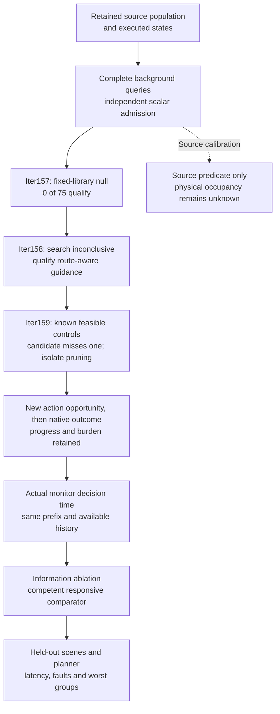

# Sentinel: the next useful engine capability

12 October 2026. This review extends the [9 October research direction](SENTINEL_INFORMATION_AND_RECOVERABILITY_RESEARCH_DIRECTION_2026-10-09.md)
and the [Iter154 follow-up](../../experiments/iter154_full_scene_maneuver/FOLLOWUP_REVIEW.md).
It is a research and engineering recommendation, not a competitive performance claim.
Primary-source retrievals, dates and local content identities accompany the source ledger.
The review does not establish private company architectures, market demand or commercial value.

Follow-up later on 12 October: Iter156 qualified the complete background predicate;
[Iter157](../../experiments/iter157_constrained_action_library/RESULT.md) then ruled out
all fourteen previously eligible actions, leaving 0/75 qualified in the retained library.
The original inventory failure and its post-evidence correction remain part of the result.
The next development question is an admissible action opportunity under complete constraints,
not another native test of these rejected actions. Competitive benefit remains unestablished.

Sentinel should earn an advantage by making a useful intervention easier to establish and
cheaper to test. A new risk score is insufficient if no admissible action can help at the
available decision time. A visually convincing simulation is insufficient if its outcome
predicate omits the constraint that rejects the action. The missing background term exposed by Iter154 is now qualified. Its finite-library null
makes a more expressive, constraint-aware action interface the next development task,
followed by a native intervention test and a competent responsive policy comparison with
equal information and actuator access.

Further follow-up: [Iter158](../../experiments/iter158_constraint_aware_search/RESULT.md)
finds no full trajectory in a bounded command search. Its retained prefix has
complete scalar replay, but both progress checkpoints remain beyond it. The
[decision packet](../../experiments/iter158_constraint_aware_search/DECISION_PACKET.md)
adds fresh CommonRoad, released-planner and motion-primitive research. Next is
route-aware guidance and constructive coverage qualification, not native spending.

Prior follow-up: [Iter159](../../experiments/iter159_route_search_qualification/RESULT.md)
contradicts the proposed four-case qualification bar: route guidance with speed
groups completes 3/4, with no aggregate coverage gain over the existing guide.
Its factorial and first-lost-witness audit separate proposal coverage from retained
search branches. [New primary-source review](../../experiments/iter159_route_search_qualification/DECISION_PACKET.md)
examines Smac, CommonRoad and multi-heuristic search without importing their
performance guarantees. Next is continuation preservation and a pruning ablation;
more recent or complex guidance has not earned promotion.

Prior follow-up: [Iter160](../../experiments/iter160_continuation_preservation/RESULT.md)
replays ten fixed continuations. One representative ends just below completion;
four preserve it. Every observed hard constraint passes. The first retained state
of the failed route candidate still completes, so this is not its causal diagnosis.
[The decision packet](../../experiments/iter160_continuation_preservation/DECISION_PACKET.md)
uses recent retention analysis and released SST documentation without importing
a guarantee. Next is one isolated retention ablation or a qualified released
adapter, keeping baseline development subordinate to the information mission.

Latest follow-up: [Iter161](../../experiments/iter161_grouping_width_ablation/RESULT.md)
separates state grouping from beam width at a fixed transition cap. Exact/24
completes all four disclosed controls; quantized/24 completes three; width 48
completes two under either grouping. The candidate now meets this synthetic bar,
while source and native recovery remain unknown. First witness loss still occurs
in every run; it does not imply loss of all complete alternatives. Carry the
unchanged candidate to a matched full-source-model test with calibrated costs,
then decide native eligibility. No released-planner superiority is established.
[Decision](../../experiments/iter161_grouping_width_ablation/DECISION.md).

## What adjacent work already covers

| Primary source and version | What it contributes to this decision |
|---|---|
| [NVIDIA Alpamayo 2 Super, 4 August 2026](https://blogs.nvidia.com/blog/alpamayo-2-super-open-model-now-available/) | The published release combines reasoning and trajectory outputs with simulation and training tools. Sentinel should assess a specific intervention interface and its cost; calling a planner reasoning-enabled does not answer that question. Company results are not Sentinel reproductions. |
| [Waymo World Model, 6 February 2026](https://waymo.com/blog/2026/02/the-waymo-world-model-a-new-frontier-for-autonomous-driving-simulation/) | Controllable camera/lidar simulation and long rollouts make counterfactual scenario generation a substantial existing field. A plausible rendered branch still needs a qualified outcome evaluator. |
| [Wayve GAIA-4, 3 August 2026](https://wayve.ai/thinking/gaia-4/) | Its discussion distinguishes logged-agent and reactive-agent modes and several layers of fidelity. Sentinel must state which agent behavior an intervention assumes. Our inference: holding other agents to a logged path is not universally conservative for every action and metric. |
| [Mobileye Meteor/Genario, 27 May 2026](https://www.mobileye.com/blog/diagnosing-the-long-tail-how-mobileye-turns-edge-cases-into-targeted-training/) | Failure-group retrieval and targeted generation already have industrial implementations. Generic automatic failure mining is not a defensible novelty claim for Sentinel. This source was already covered in the 9 October review. |
| [ECO, 2609.31383v1, 25 September 2026](https://arxiv.org/html/2609.31383v1) | The history/plan-based trajectory repair method supplies a relevant responsive comparison. Its smoothness, turn and deviation objectives, endpoint constraint and reported local optimizer cost require interface qualification. Aggregate improvements coexist with adverse collision components; its result does not validate Sentinel's background geometry. Already considered in Iter154. |
| [CausalDrive, 2606.15341v1, 13 June 2026](https://arxiv.org/html/2606.15341v1) | Action- and language-conditioned reactive video illustrates a useful scenario tool. A generator yielding more often under a prompt is not an independent physical counterfactual oracle. The resulting intervention needs evaluation outside the generator's own favorable response. |
| [Simulation fidelity for motion control, 2602.07984v1, 8 February 2026](https://arxiv.org/html/2602.07984v1) | The racing-control study separates comparisons with a recorded lap from comparisons treating another simulator as reference. Tire parameters and actuator dynamics affect its controller metrics. Sentinel should qualify the terms that change its actual decisions and name the reference layer. |
| [Waabi SaLF, ICRA 2026](https://waabi.ai/research/salf) | Sparse multisensor rendering is another developed research direction. The exact initial posting date was not established. A Three.js presentation or ordinary point-query acceleration is not frontier rendering research. |
| [RiskMonitor, 2503.07425v2, 8 February 2026](https://arxiv.org/abs/2503.07425v2) | Planning/motion-token risk prediction with braking is already a direct baseline. A claim for additional internal representations must identify the computation or information advantage and reproduce a relevant comparator. |
| [Tesla AI and Robotics, undated; read 12 October 2026](https://www.tesla.com/AI) | The public overview emphasizes correctness, latency, determinism and evaluation. It does not supply a dated current architecture or a comparative Sentinel benchmark. No ranking against Tesla follows from it. |

These sources motivate a choice of experiment. They do not make the implementation novel,
validate its physical interpretation, or establish a result against those organizations.

## Build in the order that can falsify the proposed benefit

The first component scans every selected source center. Vectorization changes the cost,
not the point population or collision threshold. A spatial index can be considered later
only if it preserves every point that could change the decision. The scalar implementation
remains a separate oracle, and numeric uncertainty remains visible. This closes a real
omission; it is not a new geometric theorem.

Next, freeze a finite action library and a ranking before evaluating it. An action must
satisfy foreground, background, actuator and useful-progress constraints separately. Missing
road-boundary evidence remains missing. Failure to find an action in that library must not
be presented as inevitable collision. A successful reset-time maneuver remains only a
candidate until the same opportunity is shown at the monitor's actual trigger.

Then compare the proposed signal with a policy that can already react to the declared
baseline history. Hold action access and time budgets equal; include the cost of obtaining
and processing the signal. If an internal representation is a deterministic function of
that full history, its possible benefit is computational access within a budget, not new
Shannon information. A clock-only placebo cannot by itself separate those alternatives.

The primary decision contrast should retain a vector of collision incidence/severity,
useful progress, unnecessary intervention and elapsed computation. A single favorable
composite score must not conceal an adverse component. Define the case distribution,
missingness, stopping, multiplicity and resource rules before acquisition. Repeat only
under a new registered procedure when a failed or inconclusive result requires it.

## What would justify a stronger claim

The proposed advantage is a smaller cost of finding and rejecting decision-relevant
interventions while preserving the observations needed to audit the decision. Establish it
against the same competent baseline on the same evidence, including failed branches and
abstentions. Extend to independently held-out scenes and another planner before claiming
transfer. Establish physical and counterfactual validity separately from source replay.

The completed [Iter156 protocol](../../experiments/iter156_background_calibration/PROTOCOL.md)
was deliberately narrower. It tested a complete background feasibility component on one
already exposed scene. Useful recovery and incremental information value remain the next
scientific targets. Nothing here establishes state-of-the-art performance, safety,
production readiness or superiority to the teams whose work informed this review.
