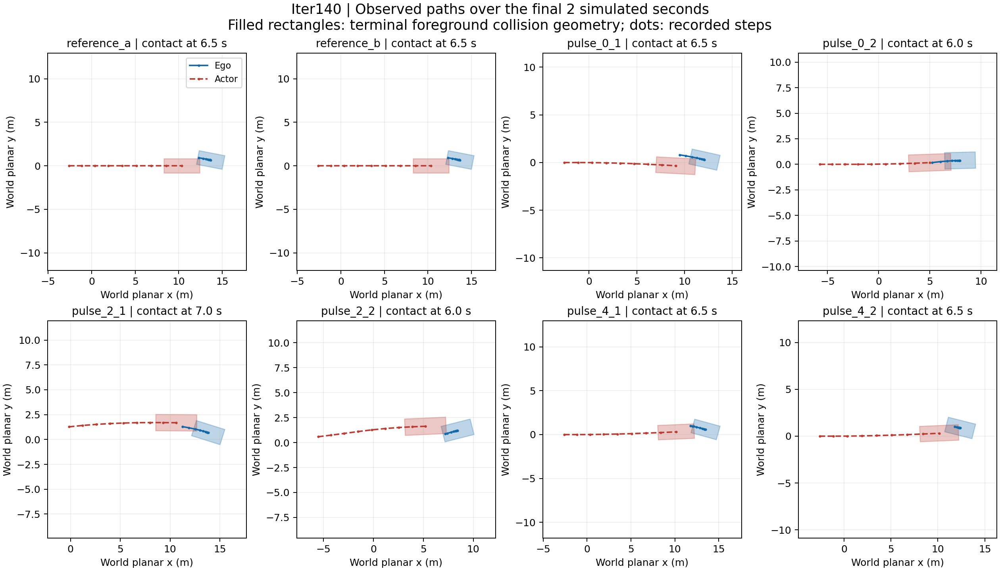

# Iteration 140 contact and actuation reconstruction

Status: **supported / CONTACT_ACTUATION_RECONSTRUCTED**, 2026-10-09. This status supports
the reconstruction in the declared simulator. [Iter139's recovery result](../iter139_finite_pulse_recoverability/RESULT.md)
remains **null: 0/6 useful recoveries**.

All eight terminal collisions reconstruct as foreground rectangle overlap. In every case the
actor's center is behind the ego at contact, and its center closes the distance during the final
recorded interval. All 206 delivered ego actions match the source integration equations.
The actor's path differs from the reference in every pulse branch. These findings support
testing continued nominal planning as the next action option, before a stronger-braking search.
The [decision memo](DECISION.md) defines that bounded proposal and its stopping decisions.

## Reconstruction checks

Exactly eight episodes and 206 actions were analyzed, binding 106 input files to parent commit
`ed23a8c5596c563e6475be2c190856feb481072b`. The source geometry functions were extracted from
the retained runtime-bound source and executed without importing the simulator. A separate
standard-library implementation used analytic separating-axis projections, polygon clipping
and point-to-edge distance. It imported neither the primary analyzer nor NumPy/Shapely.

- **412 before/after box-pair checks** agree on contact, with zero numerically ambiguous states
  under the frozen 1e-9 m separation band. Adjacent before/after checks reuse states: there
  are 214 per-episode timestamped states, not 412 independent observations.
- All 206 before states and 198 nonterminal after states have no foreground overlap. Exactly
  eight terminal after states overlap, at the same times as actual environment collision flags.
  There are zero collision/foreground mismatches or earlier post-action overlaps.
- The maximum cross-implementation overlap-area difference is **2.887e-15 m²** and the maximum
  polygon-distance difference is **3.553e-15 m**, within the pre-execution 1e-9 checks.
- Every state-continuity, timestamp, delivered acceleration/steering, planar position, speed,
  steering and heading check passes the registered 1e-9 threshold in its respective units.
  Primary speed and planar-position residuals are zero; its maximum heading residual is
  2.776e-17 rad. Independent linear state arithmetic uses Decimal.
- One configured persistent actor and one recorded box in every state support correspondence
  as **source-inferred agent_0**. No logged actor ID or perception-track association is claimed.

The [primary report](proof/primary.json) retains every before/after geometry measurement,
action/phase time series, residual and comparison. The [independent replay](proof/independent.json)
binds its SHA-256 and independently checks the quantities, source scenario identity and input
bytes. This is independent implementation, not an independent human or scientific replication.

## Terminal encounter geometry

Offsets use the ego heading frame. Negative longitudinal offset means the actor center is
behind the ego center; lateral offset is signed. Relative center speed is the norm of the
difference of center displacements over the last 0.25 seconds. It is not physical impact
velocity, injury severity, fault or an identification of the first contacting face.

| Episode | Contact time (s) | Actor longitudinal offset (m) | Lateral offset (m) | Last-interval relative center speed (m/s) | 2D overlap area (m²) |
| --- | ---: | ---: | ---: | ---: | ---: |
| `reference_a` | 6.5 | -3.133129 | -1.288167 | 7.027809 | 0.207999 |
| `reference_b` | 6.5 | -3.133129 | -1.288167 | 7.027809 | 0.207999 |
| `pulse_0_1` | 6.5 | -2.801857 | -1.279903 | 5.554997 | 0.406430 |
| `pulse_0_2` | 6.0 | -2.968068 | -0.141090 | 5.687176 | 0.884289 |
| `pulse_2_1` | 7.0 | -3.357526 | -0.013025 | 5.003609 | 0.217123 |
| `pulse_2_2` | 6.0 | -3.018373 | 1.194205 | 5.148392 | 0.333136 |
| `pulse_4_1` | 6.5 | -3.161935 | -1.156304 | 6.609230 | 0.227333 |
| `pulse_4_2` | 6.5 | -2.025657 | -1.098185 | 6.874625 | 1.261503 |

The actor center is 2.026–3.358 m behind the ego at terminal contact. Positive center-distance
closing rates range from 4.838 to 6.939 m/s over the final recorded interval. Low ego speed
therefore does not imply low relative closing in this simulator. Contact rectangles ignore
height, following the source. We did not reconstruct static-point-cloud/background collisions
or contacts between the recorded samples.

The figure shows the final two simulated seconds, with terminal rectangles and recorded
center samples. Lines connect samples for display; they are not continuous collision
reconstruction. Each panel uses equal spatial units on both axes; plot limits differ between
panels. [SVG version](proof/figures/terminal_contacts.svg).

## Actor paths respond across the intervention branches

Compare each post-action actor box with reference_a at common timestamps, using the frozen
absolute 1e-6 threshold and zero relative tolerance. Exact differences begin at the same
reported times. Both references have identical actor paths.

| Episode | First actor-box difference >1e-6 (s) | Common post-action states | Maximum center displacement from reference (m) | Maximum wrapped heading difference (rad) |
| --- | ---: | ---: | ---: | ---: |
| `reference_a` | none observed | 26 | 0.000000 | 0.000000 |
| `reference_b` | none observed | 26 | 0.000000 | 0.000000 |
| `pulse_0_1` | 5.0 | 26 | 1.307496 | 0.053040 |
| `pulse_0_2` | 2.5 | 24 | 1.836462 | 0.034965 |
| `pulse_2_1` | 2.5 | 26 | 2.904912 | 0.135405 |
| `pulse_2_2` | 2.5 | 24 | 2.296002 | 0.135405 |
| `pulse_4_1` | 5.0 | 26 | 0.370758 | 0.041504 |
| `pulse_4_2` | 5.0 | 26 | 0.370758 | 0.041504 |

The 7-second pulse_2_1 episode has only 26 common states through 6.5 seconds; the reference
terminated there. Its final two states have no corresponding reference observations and are
not extrapolated. First path differences at 2.5 or 5.0 seconds are consistent with the source's
scheduled replan cadence, but internal replan events were not logged. Do not infer those events
solely from first path divergence.

The bound scenario uses AttackPlanner. Its source receives predictions based on ego state and
scores candidate actor paths partly by proximity to those predictions. The combination of this
dependency and observed branch differences shows why a fixed reference actor trajectory cannot
stand in for the tested closed-loop interaction. It does not prove that the actor can collide
with every possible ego policy, or identify a population-level causal mechanism.

## Delivered action and resumption

Intervals below are decision phases; the listed end is the resulting state's time. All values
come from actual delivered controls and recorded states. Reference episodes use the released
monitor. The zero-plan pulses also induce steering-rate commands, preserved in the full report.

| Episode | Phase | State interval (s) | Actions | Start → end speed (m/s) | Min / max acceleration (m/s²) |
| --- | --- | ---: | ---: | ---: | ---: |
| `reference_a` | reference | 0.00–6.50 | 26 | 1.000000 → 0.107449 | -3.000000 / 3.000000 |
| `reference_b` | reference | 0.00–6.50 | 26 | 1.000000 → 0.107449 | -3.000000 / 3.000000 |
| `pulse_0_1` | during_pulse | 0.00–1.00 | 4 | 1.000000 → 0.192279 | -1.351236 / -0.392357 |
| `pulse_0_1` | resumed | 1.00–6.50 | 22 | 0.192279 → 0.249152 | -3.000000 / 3.000000 |
| `pulse_0_2` | during_pulse | 0.00–2.00 | 8 | 1.000000 → 0.036971 | -1.351236 / -0.075442 |
| `pulse_0_2` | resumed | 2.00–6.00 | 16 | 0.036971 → 0.234319 | -3.000000 / 3.000000 |
| `pulse_2_1` | before_pulse | 0.00–2.00 | 8 | 1.000000 → 3.097647 | -0.233417 / 3.000000 |
| `pulse_2_1` | during_pulse | 2.00–3.00 | 4 | 3.097647 → 0.698562 | -3.000000 / -1.431521 |
| `pulse_2_1` | resumed | 3.00–7.00 | 16 | 0.698562 → 0.248177 | -3.000000 / 2.347267 |
| `pulse_2_2` | before_pulse | 0.00–2.00 | 8 | 1.000000 → 3.097647 | -0.233417 / 3.000000 |
| `pulse_2_2` | during_pulse | 2.00–4.00 | 8 | 3.097647 → 0.133545 | -3.000000 / -0.273674 |
| `pulse_2_2` | resumed | 4.00–6.00 | 8 | 0.133545 → 0.126693 | -2.061581 / 3.000000 |
| `pulse_4_1` | before_pulse | 0.00–4.00 | 16 | 1.000000 → 2.708423 | -0.542668 / 3.000000 |
| `pulse_4_1` | during_pulse | 4.00–5.00 | 4 | 2.708423 → 0.559821 | -3.000000 / -1.160217 |
| `pulse_4_1` | resumed | 5.00–6.50 | 6 | 0.559821 → 0.325464 | -2.292355 / 2.766267 |
| `pulse_4_2` | before_pulse | 0.00–4.00 | 16 | 1.000000 → 2.708423 | -0.542668 / 3.000000 |
| `pulse_4_2` | during_pulse | 4.00–6.00 | 8 | 2.708423 → 0.105387 | -3.000000 / -0.218429 |
| `pulse_4_2` | resumed | 6.00–6.50 | 2 | 0.105387 → 0.045725 | -0.143878 / -0.094772 |

All pulses delivered slowing and then resumed the released plan/monitor behavior. They did
not establish useful recovery. Assigned overrides, incoming-plan changes and monitor requests
remain the separate counts reported in Iter139; no post-treatment normalization or adjustment
is used here. A slowed ego, a delayed collision and successful recovery are distinct outcomes.

## Limits found in the simulator contract

The [source review](SOURCE_REVIEW.md) records a 0.1-second actor candidate-planning interval
alongside the 0.25-second environment/prediction step. It also records that the step integrator
does not clip acceleration to the declared Gym action space: logged -3 m/s² commands exceed
its declared [-2,2] m/s² bounds. Matching the actual integration equations establishes execution
consistency with this source, not physical actuator admissibility or calibrated actor timing.
No simulator, controller, action envelope or historical result was changed by this diagnostic.

## Preregistration, tests and retained failures

The retrospective [protocol](HYPOTHESIS.md) and [input inventory](INPUTS.json) were committed at
`68131877a62e8fb6d1524aabcb2aab0a0b1187e7` before implementation and new contact/actor calculations.
Prior exposure to Iter139 outcomes and the source configuration was explicitly disclosed.
The pre-execution source review also froze the auxiliary area/distance cross-check at 1e-9.

Implementation commit **`d554903eab834be7433c3505b24402f34ba34b21`** was extracted into an
isolated directory. All **37 focused tests** passed there before the primary analysis, followed
by independent replay and plotting from that exact implementation. The same 37 tests passed
in the working source; these are 37 distinct tests, not 74. Fixtures include 200 deterministic
random rectangle pairs, rotated/touching/contained boxes, dimension swaps, malformed input,
changed bytes/symlinks, corrupted reports, continuity failure and missing actor correspondence.

Initial testing retained two synthetic failures: integer zero versus floating zero in an
independent velocity calculation. Explicit floating arithmetic fixed the representation without
loosening thresholds. One E731 lint finding was corrected; implementation/test Ruff passes.
Local Python 3.11.15, NumPy 1.26.4, Shapely 2.0.7 / GEOS 3.11.4, pytest 8.3.5 and Matplotlib 3.9.4
are recorded with all installed dependencies in [the environment receipt](proof/environment_freeze.stdout).
This is an isolated local diagnostic environment, not the original host's complete software stack.
Full, frozen repository and hosted CI are not claimed.

The [execution binding](proof/execution_binding.json), raw command outputs, initial failures,
input/source hashes and independently reproduced report remain retained. The terminal plot was
visually inspected. No provider/API/remote-host command, cloud launch, GPU episode or simulator
modification occurred in Iter140. The last retained provider observation is Iter139's confirmed
shutdown; no fresh provider status is inferred from this CPU-only work.

## Decision and claim boundary

This diagnostic is complete. It resolves execution consistency, discrete contact geometry and
actor-path dependence for the eight disclosed trajectories. It does not resolve a successful
alternative action, online choice, additional information value, transfer, physical safety or
real-time feasibility. The proposed next canary tests continued nominal planning once under a
named model/control contract. Earlier OFF results are unfavorable context, explicitly retained
in [the decision memo](DECISION.md); continuation is not assumed to succeed.

Candidate branch `research/iter140-contact-actuation` is local and unpushed. Canonical master
remains F17. Iter135 stays deferred, Iter136–139 evidence stays unchanged, and unrelated WIP
is preserved. The experiment is retrospective development work on one case, with no population
interval, industrial superiority or state-of-the-art claim.
