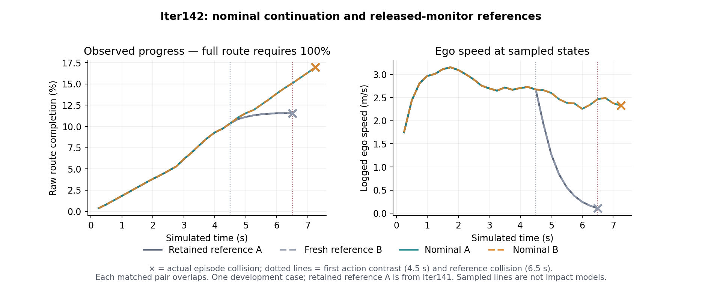

# Iter142 result: nominal continuation delayed collision; no useful recovery

Status: **null / NOMINAL_CONTINUATION_NULL**. Date: 2026-10-09.
All three fresh episodes completed and passed the frozen replay and comparison rules.
The comparison includes one explicitly retained Iter141 reference. Both nominal
continuations collided at **7.25 s**, versus **6.5 s** for both references:
**0/2 useful recoveries**. The pair is a repeatability check on one disclosed
scene and fixed seeds, not two independent driving cases.

## Question, protocol and outcome

The [preregistered protocol](HYPOTHESIS.md) asked whether delivering the current
responsive nominal plan throughout this case, while keeping the monitor enabled
in shadow, allows useful recovery. It preserves the complete Iter141 science
contract, source, model, seeds, typed plans, numerical controller and simulator.
The first delivered-action contrast is frame 18, pre-action time **4.5 s**.
Monitor state, tracking and latch continue updating in the nominal arms.

| Arm | Evidence provenance | Actions | Actual first collision | Raw final route completion |
| --- | --- | ---: | ---: | ---: |
| reference_a | retained Iter141 | 26 | 6.5 s | 0.11557062998555366 |
| reference_b | fresh Iter142 | 26 | 6.5 s | 0.11557062998555366 |
| nominal_a | fresh Iter142 | 29 | 7.25 s | 0.16958733747880156 |
| nominal_b | fresh Iter142 | 29 | 7.25 s | 0.16958733747880156 |

Both nominal arms remained collision-free through the reference hazard time 6.5 s,
with raw progress **0.15074429998115696**, exceeding the frozen minimum
0.06557062998555366. Neither completed the route, and both subsequently collided.
Neither was censored. Useful recovery required no actual collision anywhere and
full route completion within the original 401-action horizon, alongside the valid
contrast and progress requirements. The **0.75-second delay is not a recovery**.
An endpoint restricted to surviving the reference's failure time would have given
a misleadingly favorable answer on these data.

The figure shows only the observed route fraction; full completion requires 100%.
Pair curves overlap. Joining samples is a display choice, not an impact model.
An [SVG version](proof/figures/continuation.svg) is retained.

## Reproduction and actuation

Reference B matched retained A and the Iter139 historical reference. Both nominal
prefixes matched until the frozen first contrast and both nominal replicas matched.
The bound host replayed all **84 newly executed controller calls** from original
solver source. A separately implemented Decimal validator checked states, typed
plan delivery, controls, prefix equality and outcomes. A further local direct-count
reconstruction agreed with every reported stopping, deadline and Gym-limit count.
See [host reports](proof/completed_reports.json),
[independent recount](proof/independent_recount.json) and
[final analysis](proof/final_analysis.json).

All 84 new calls converged; zero stopped at a deadline or iteration limit. Including
retained A gives 110 calls in the comparison, of which only 84 were newly executed.
Numerical mode deliberately does not use wall time to select the final iterate.
Actual delivered trajectory dtype was float32. This is repeatability within the retained
source/runtime/inputs, with separate wall-time measurements.

| Arm | Monitor brake proposals | Proposed vs delivered plan differences | Declined monitor replacements | Gym acceleration violations | Gym steering-rate violations | Either Gym limit exceeded |
| --- | ---: | ---: | ---: | ---: | ---: | ---: |
| reference_a (retained) | 8 | 0 | 0 | 4/26 | 11/26 | 13/26 |
| reference_b | 8 | 0 | 0 | 4/26 | 11/26 | 13/26 |
| nominal_a | 11 | 11 | 11 | 2/29 | 14/29 | 14/29 |
| nominal_b | 11 | 11 | 11 | 2/29 | 14/29 | 14/29 |

In each reference the monitor delivered eight plans differing from nominal. In each
nominal arm eleven monitor proposals differed from nominal and were declined;
the actual current nominal array was delivered unchanged. All actual controls
passed the effective controller envelope: acceleration ±3 m/s², steering rate
±0.4 rad/s and current/predicted steering angle ±pi/3. The declared Gym space is
narrower (±2 m/s², ±pi/12 rad/s); simulator stepping does not enforce those
bounds. No clipping or source repair was introduced to hide the mismatch.

## Deadline behavior measured separately

**69/84 new complete calls exceeded 50 ms**, as did **65/84 full solver calls**.
Convergence and exact replay do not establish a deadline guarantee. Nearest-rank
quantiles below are rounded to 0.001 ms; unrounded values are in the host reports.
Retained-reference timing is shown separately from fresh measurements.

| Arm | Layer | >50 ms / calls | p50 ms | p95 ms | p99 ms | Max ms |
| --- | --- | ---: | ---: | ---: | ---: | ---: |
| reference_a (retained) | solver | 13/26 | 49.972 | 71.138 | 72.941 | 72.941 |
| reference_a (retained) | adapter | 17/26 | 53.621 | 75.053 | 76.600 | 76.600 |
| reference_a (retained) | complete_call | 17/26 | 53.629 | 75.063 | 76.611 | 76.611 |
| reference_a (retained) | client_roundtrip | 26/26 | 1734.150 | 2238.657 | 32290.394 | 32290.394 |
| reference_b | solver | 23/26 | 61.379 | 82.460 | 87.699 | 87.699 |
| reference_b | adapter | 25/26 | 64.970 | 89.404 | 94.984 | 94.984 |
| reference_b | complete_call | 25/26 | 64.983 | 89.416 | 94.998 | 94.998 |
| reference_b | client_roundtrip | 26/26 | 1686.124 | 2255.745 | 34251.192 | 34251.192 |
| nominal_a | solver | 21/29 | 57.693 | 79.146 | 84.211 | 84.211 |
| nominal_a | adapter | 21/29 | 61.504 | 85.458 | 90.882 | 90.882 |
| nominal_a | complete_call | 21/29 | 61.512 | 85.471 | 90.895 | 90.895 |
| nominal_a | client_roundtrip | 29/29 | 1701.134 | 2091.912 | 15550.502 | 15550.502 |
| nominal_b | solver | 21/29 | 58.246 | 84.431 | 85.943 | 85.943 |
| nominal_b | adapter | 23/29 | 62.162 | 89.876 | 90.285 | 90.285 |
| nominal_b | complete_call | 23/29 | 62.170 | 89.890 | 90.303 | 90.303 |
| nominal_b | client_roundtrip | 29/29 | 1727.336 | 2116.690 | 15496.055 | 15496.055 |

Solver duration includes warm start and finalization. Adapter duration also includes
validation, conversion and numerical receipt construction; complete-call duration
includes the surrounding controller metadata. Client roundtrip additionally includes
image capture, transport and model startup where incurred; it is not isolated model
inference. Fixed simulation steps do not advance according to wall latency. These
observations therefore do not measure an end-to-end vehicle deadline policy.

## Provenance and operational corrections

Preregistration: `ba72e457a96f8ea248810ffa7b982c171b32c5f4`.
Executed source packet: `a70aa3fe095839d62c390f0569f44ddc5f9be9df`.
Runtime manifest SHA-256:
`54647066bd8296ef21106a3eeacf660294d8cf4f9a5fc865424be18696b8a6e3`.
The client, generated driver and numerical science engine remain exact Iter141
source. New coordinator/runner wrappers redirect ownership and schedule, verify
retained inputs and enforce the raw-commit-before-analysis order. Historical
`iter141_trace.jsonl`, `controller141.jsonl` and `delivery141.jsonl` encoding
names remain inside the separate Iter142 output directories.

| Arm | Raw commit, before interpretation |
| --- | --- |
| retained reference_a | `888a8a3c86f327de15612d5b7a8553e66b43805f` |
| fresh reference_b | `522ff44b5f079f3d4795a2b49ac0f700a228aaeb` |
| fresh nominal_a | `5f351f80ae006f990be15b2e34f5db126a35172b` |
| fresh nominal_b | `b191f5e29a0681f545625dea91d9161b39c26db0` |

The [input binding](INPUTS.json) identifies retained reference A and its prior
validation. [Schedule events](proof/schedule_bootstrap2/events.jsonl) record
launch, raw commit and validation before each next launch. The
[commit ledger](proof/episode_commit_ledger.json) preserves distinct provenance.

Operational failures remain visible:

1. The first extracted-source check produced 62 passes and one failure because a
   test treated the extracted archive folder as a Git root. Explicit canonical-root
   binding was corrected before provider access; all 63 then passed. A premature
   start-helper invocation stopped at missing source admission, before any provider
   command. Neither failure was an experiment observation.
2. The first provider start hit L4 capacity exhaustion; the second succeeded within
   the allowance. One SSH attempt failed during boot before the second connected.
3. The first wrapper launch failed at import in 0.117309 s because the system-Python
   command lacked the packet PYTHONPATH. Output was empty, with no initialized
   marker or simulator/planner invocation. Collection refused the missing episode
   record, and the original one-shot coordinator stopped. The fake-backend tests
   and host fixture had not exercised this exact entry boundary.
4. The [pre-initialization correction](PREINITIALIZATION_CORRECTION.md), committed
   as `d41396b8c56e17ae47249ede880ea31ce07dbcec` before any initialized episode,
   supplied the explicit path and authorized one corrected attempt within the
   original budget. The actual system-Python entrypoint passed its import/argument
   probe; empty outputs and absent owned compute were verified. Original failure
   logs and marker remain; corrected `bootstrap2` names are distinct. All three
   initialized episodes then completed without retries or scientific changes.

The original missing-PYTHONPATH failure is retained as the counterexample to that
entry boundary. There were **zero initialized episode retries**, no case/seed
search and no post-outcome endpoint adjustment. Iter141 remains operationally
failed with an incomplete comparison; Iter142 does not rewrite that history.

## Validation, resources and scope

19 distinct new coordinator/runner tests passed. The extracted-source set had
63 passes: those same 19 plus 44 unchanged Iter141 execution tests, not 82 distinct
tests. New-source Ruff passed. The local fixture mocks unsupported threadpool
observation only; the bound-host synthetic fixture uses the real check and passed.
Synthetic successful routes are fixture data, not live recoveries. No full,
frozen-environment or hosted CI result for this candidate is claimed.

The [closure integrity check](proof/final_integrity.stdout) passed on result commit
`e23af9f3d709e84571f1eb0044c30b2a81db94b0`: 357 proof hashes, all 36 fresh and
12 retained raw files against their original commits, 17 retained inputs, unchanged
source/protocol, schedule ordering, links and human commit attribution. An
[in-memory corrupted proof](proof/final_integrity_known_bad.stderr) was rejected.
Prior experiments, canonical master and the root index remained unchanged.

Postflight matched all **614 bound files**, with no owned processes, running
containers or GPU applications and **109.255 GiB** free. Provider readback confirms
[TERMINATED](proof/final_provider_state.stdout), last stop
`2026-10-09T09:27:50.197-07:00`; the stop operation finished
`2026-10-09T09:27:51.343-07:00`. The observed provider start-to-stop interval was
**2234.048 s**; original budget start through
completed shutdown was **2354.248 s**
of 6,000 s, before the owned minute-98 timer. The three initialized driver processes
took **339.752 s** total, including their setup/cleanup.
These are different timing boundaries. Billed cost is unobserved; see
[resource accounting](proof/resource_accounting.json).

All **36 fresh raw files** are retained; **264 media/geometry files** are inventoried
on the remote disk. Retained A has its separate 12 raw files and 82 remote assets.
Opaque pickle artifacts were not deserialized for analysis. No new packages/images
or replacement machine were used.

The unchanged controller/environment/actor clocks are .5/.25/.1 seconds, and actor
trajectory indexing consumes at the environment rate. Alongside the declared-space
mismatch, these limit physical interpretation. Responsive actors and planner inputs
can change with ego actions; this is a live policy comparison, not a fixed-actor
counterfactual or a sensor-information effect. No physical inevitability, universal
lack of evasive action, safety, real-time operation, population generality or
industrial superiority follows.

This is a local, unpushed research candidate. Canonical master remains F17;
Iter135 remains deferred. The [next decision](DECISION.md) closes this case/action
comparison and proposes model/control qualification plus a finite new case family
before any information ablation.
