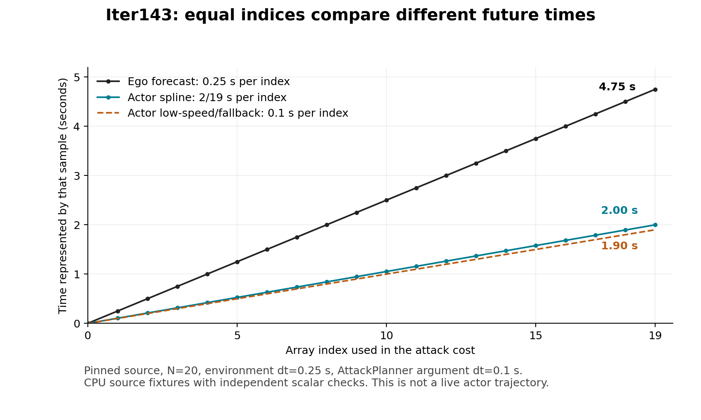

# Iter143 model and timing contract result

Status: **contradicted / COMMON_MODEL_CONTRACT_REJECTED**, 2026-10-10.
The separately implemented scalar/Fraction check passed. Executed source fixtures
contradict three specific assumptions: exact controller/environment transition
agreement, equal-time actor/ego comparisons by array index, and enforcement of the
declared Gym action limits. **No new driving episode or cloud access occurred.**

The most consequential next engineering target is the actor time interface: the
same array index represents different future times, and a stored speed can disagree
with displacement per simulated second. These are source-contract counterexamples,
not a demonstrated explanation for previous collisions or a measured physical model.

## Actor time coordinates

For the retained N=20 and environment step 0.25 s, the actor dispatch passes dt=0.1
and horizon 2.0 s. The cost compares candidate and ego rows by index. The original
[spline generator](https://github.com/hyzhou404/HUGSIM/blob/62c690d39fd90020e68a196bd8bcc1c4d4191f2e/submodules/Pplan/Sampling/spline_planner.py)
and its locally retained bytes distinguish these clocks:

| Sequence | Sample time at index i | Last sample at i=19 |
| --- | --- | ---: |
| Ego forecast | i × 0.25 s | 4.75 s |
| Actor spline | i × 2/19 s | 2.00 s |
| Actor low-speed resampling / fallback | i × 0.1 s | 1.90 s |

Thus the last compared samples differ by **2.75 s** for spline candidates and
**2.85 s** for low-speed/fallback candidates. The source drops the spline time
channel when building the actor state array; positional cost evaluation uses the
indices directly. Earlier .5/.25/.1 shorthand identified configured parameters.
It should not be read as saying every actor spline sample is exactly .1 s apart.

The [SVG figure](proof/figures/actor_time_coordinates.svg) retains the same data.

A straight, constant-speed source fixture labelled **4 m/s** gives spline sample
displacements 8/19 m. Consuming one such sample per .25-second environment step
corresponds to **32/19 = 1.684210526 m/s**, while its stored speed remains 4 m/s.
The constant-headaway fallback gives **1.6 m/s** under the same consumption rule.
These are synthetic unit fixtures. No historical live actor candidate type, physical
speed or impact velocity was recovered by this calculation.

The actual dispatch/update slices also checked 21 calls at 0,.25,...,5 s. With
ATTACK_FREQ 10 they replanned at 0,2.5,5 s and incremented the execution pointer once
per environment call. Reset at t=0 consumes the first future actor sample. The fixture
uses a single deterministic straight candidate, so it validates this source path and
indexing behavior, not full sampling, filtering, map, rendering or actor-policy fidelity.

## Ego transition and declared controls

Of the fixed 32 states/actions, **24/32** differ between the source controller and
environment even at the same .25-second interval. **26/32** differ between one
.5-second controller step and two .25-second environment steps under held controls.
These are designed counterexamples, not estimated driving error rates.

After explicit axis mapping, the source controller translates using old speed and
turns using old speed/steering. The environment first updates speed/steering, then
translates using new speed and turns using new speed/steering. Merely making dt
identical leaves that integration-order difference.

For fixture 17, initial speed 4 m/s, heading/steering 0, acceleration 2 m/s² and
steering rate .2 rad/s, both .25-second calculations end at speed 4.5 m/s and
steering .05 rad, but:

| Quantity after .25 s | Controller source | Environment source |
| --- | ---: | ---: |
| Forward position | 1.000 m | 1.125 m |
| Heading | 0 rad | 0.02085071182314116 rad |

The largest equal-interval position difference in this fixture set is **0.1875 m**.
Using an approximate or slower-rate prediction model can be a legitimate controller
design. This diagnostic rejects exact equivalence; it does not establish that a
multirate controller is intrinsically wrong or quantify real-vehicle model error.
A future claim must state and qualify the approximation or use a matching transition.

All four tested commands outside the declared Gym space were integrated unchanged
by the source step prefix. Declared bounds are acceleration±2 m/s² and steering
rate±pi/12 rad/s; effective controller bounds are±3 m/s² and±.4 rad/s. Boundary and
outside-bound commands are retained separately. No clipping was added. This confirms
the interface behavior on the fixtures; it does not validate a physical actuator.

## Finite development inventory

The union of two historical hash inventories contains **88 scenario files from 18
base scenes**. All are labelled historically exposed development material. Five
rows from closed scene 0411 remain visible and excluded from new action search.
There are **83 eligible scenarios across 17 base scenes**, with current asset
availability unobserved locally.

The frozen lexical selection proposes **14 scenarios across scenes 0013, 0038, 0041**
for a pilot; the remaining 69 scenarios are development reserve. Difficulty variants
of one scene are not independent scenes. There are **zero unexposed holdout scenes**
in this retained pool. The selection used filenames and hashes, not outcome values.
See the complete [inventory](proof/case_inventory.json) and
[proposed case-family protocol](CASE_FAMILY_PROTOCOL.md).

## Evidence and validation

- Preregistration: `a5fe7d8c16a7283753610f3126b47d2f93e727bf`.
- Dependency binding addition before implementation: `e625f03c278ed5478aca0f799384bba320a9af23`.
- Executed corrected implementation: `e240e748551e960185809d2a29c411847327f3b8`.
- Valid [raw fixtures](proof/raw_fixtures_v3.json) were committed before interpretation
  at `e34aaa12097070495003f35b4a7894621e4a9602`.
- Inventory bytes were retained earlier at `fea72a16101a475c22d2befa6fbd75694df5dc89`.
- [Independent analysis](proof/analysis.json) checks all 32 ego fixtures, 8 limit
  commands, actor sampling/indexing, and the complete inventory. Ego tolerance 1e-9;
  tensor/sampling tolerance 1e-6, unchanged after data.

[INPUTS](INPUTS.json) binds 11 retained inputs to the closed Iter142 parent and two
newly retrieved source files to hashes already present in its host runtime manifest.
Upstream source is pinned to `62c690d39fd90020e68a196bd8bcc1c4d4191f2e`; the
[retained upstream license](../iter136_hugsim_recoverability_canary/proof/source/HUGSIM/LICENSE.txt)
remains with the source chain. Extraction names, line ranges, omitted components,
synthetic substitutions and exact local versions are in the raw record.

The final **46 distinct focused tests** passed locally and from extracted committed
source; these repeated runs are not 92 distinct tests. New-source Ruff passed.
Tests include changed input, symlink/size limits, malformed/duplicate/nonfinite data,
altered time/control/ordering, missing/duplicated actor rows, corrupted numerical
output, actual sampler and dispatch adapter boundaries, and invalid exception records.

Execution used local CPU Python 3.14.2, NumPy 2.4.2, Torch 2.10.0 and SciPy 1.17.1.
This is an ambient diagnostic environment, not the bound Linux simulator runtime.
Full simulator behavior, full/frozen/hosted CI and physical qualification remain
unestablished. No packages were installed. The figure used the existing Iter140
Python 3.11 / Matplotlib 3.9.4 environment and was visually checked.

## Retained implementation failures

The first full probe failed on mismatched synthetic sampler mask/terminal shapes,
without a complete raw artifact. The next reached dispatch and failed because the
synthetic actor used float64 storage while source assignment casts values to float32.
It produced an explicit invalid record. The final repair matches the source's
ordinary float32 actor-state construction and adds targeted adapter tests. Both
failed invocations remain; neither is counted as completed measurement evidence.

The inventory producer succeeded, but its wrapper then refused a metadata filename
that collided with the produced artifact. The inventory was preserved and not rerun;
missing wrapper timing stays null. Subsequent receipts have a separate directory and
a retained rejection test for output collisions. One early pytest run warned about
its cache path; its tests passed. The initial plotting command lacked Matplotlib;
using the already retained plotting environment succeeded without installation.

The [correction record](EXECUTION_CORRECTION.md) also clarifies the imprecise subject
of commit b2184ae: it retained an invalid artifact, not completed measurements.
The actual valid raw commit is e34aaa1 above. No failure was erased, no tolerance
changed, and no historical driving source, episode or result was modified.

## Decision

Build and qualify a separate trajectory interface carrying explicit time coordinates
before further live intervention comparisons. Check time-aligned actor/ego costs,
execution timestamps, reset semantics, stored speed versus displacement, and declared
control behavior. Document controller prediction approximation or align it explicitly.
Then freeze a source/asset-bound live protocol from the finite development inventory.
The [next decision](DECISION.md) specifies that implementation target.

This is a local, unpushed research candidate. Canonical master remains F17 and Iter135
is deferred. Earlier Iter139/142 recovery nulls remain unchanged. No recovery, safety,
state-of-the-art, industrial superiority or generalization claim follows from Iter143.
