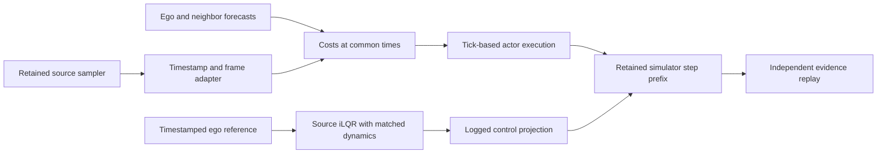

# Iter144 explicit trajectory execution result

Status: **supported / TIMED_TRAJECTORY_CPU_CONTRACT_SUPPORTED**, 2026-10-10.
Explicit trajectory timestamps and simulator-matched ego prediction are implemented
and pass the registered local CPU qualification. **From-rest optimization remains
unresolved: four solver calls reached the 100-iteration cap without convergence.**
The 14-scenario schedule is prepared; it has not been admitted or executed.

## Implemented contract

The new regime `sentinel.timed_trajectory.v1` carries absolute simulation seconds,
episode and owner identities, SI units, a named coordinate frame, source branch,
original source rows, and a content identity. All candidate costs compare the same
20 times, from the plan origin through 4.75 s in .25 s increments. Source generation
uses a 5 s horizon; actual spline and low-speed time channels survive resampling.
Position and speed use linear interpolation; heading uses the shortest angular arc.
Extrapolation, shifted/dropped times, stale plans and invalid identities are rejected.

Actor native heading and ego native heading have different explicit conversions.
Reset preserves the supplied state. The first future state is consumed at .25 s.
Execution uses integer ticks and refreshes a plan after ten completed steps, before
the next advance. The fixture replans have origins 0 and 2.5 s; its final observation
is at 5 s. A subsequent advance would require a plan originating at 5 s.

The ego predictor uses the retained simulator's update order: speed and steering
first, then displacement and heading. Requested acceleration is projected to ±2 m/s²,
steering rate to ±pi/12 rad/s, and steering angle to ±pi/3 by adjusting the applied
rate. Requested and applied controls are logged. Signed ego speed is explicit;
braking moves either sign toward zero without crossing it. Negative actor speed at
a source-generation origin stops as unqualified because the source clamps that input.

These are declared new-policy choices: 5 s candidate generation, timestamp alignment,
corrected heading boundaries, reset without advancement, deterministic lowest-cost
selection with index ties, neighbor exclusion by identity, .25 s matched ego dynamics,
and stricter controls. Legacy source and outcomes remain unchanged. Source feasibility
filtering occurs before interpolation; this qualification does not certify continuous
motion feasibility after interpolation. Interpolated stored speed is not asserted to
be the exact position derivative on accelerating or curved trajectories.

## Retained measurements

| Check | Observed result |
| --- | --- |
| Straight source/fallback sequences | 9 sequences, 180 advances |
| Maximum straight speed versus displacement error | 2.3841852403450048e-7 m/s |
| Full default sampler fixtures | 9 fixtures, 616 candidates checked |
| Matched ego transitions | 32/32 independently replayed |
| Analytic Jacobian fixtures | 8/8 checked by central differences |
| Maximum Jacobian absolute error | 2.5698909666971304e-10 |
| Numerical solver repeatability | 4/4 pairs matched within 1e-10 |
| Simulator-prefix integration | 20/20 steps replayed |
| Corrupted full evidence packets | 17/17 rejected |

The straight fixtures use actual source spline generation and forward sampling with
restricted straight-motion grids, and select a declared branch. Empty generation
is injected only for the fallback fixture. The separate nine default-grid fixtures
exercise actual generation, feasibility filtering, adaptation and selection at
speeds 0, 1 and 4 m/s and headings -.4, 0 and .4 rad. The integration executes the
actual retained environment step prefix with the new actor dispatch and actual iLQR
controls. It omits renderer, collision, route termination, live assets and nominal
planner/monitor processes. The bridge returns CPU actor states; CUDA render transforms
and full simulator reset, including steering state, remain to be integrated.

## Solver and deadline findings

Of 28 calls, 24 converged and 4 reached the iteration cap. The four capped calls are
the two from-rest reference shapes, each repeated twice. Their final input-change
norms were 1.199168243419043 (straight) and 1.1998867576369974 (curved), above the
1e-6 convergence threshold. Repeatability therefore does not establish convergence.
All 20 calls in the moving-ego integration converged.

Complete-call times were 1.807708–99.267916 ms; solver times were
1.722625–99.156416 ms. Four complete calls exceeded 50 ms, exactly the capped calls.
These are ambient CPU observations with numerical mode and no wall-time cutoff.
They do not establish an end-to-end deadline, deployment latency or a late-result policy.
The preregistered software pass requires repeatability and truthful stopping records;
it does not turn an iteration-limit return into convergence or qualify it for driving.

## Study preparation

The generated [schedule](proof/study_schedule.json) retains the complete 88-row
inventory and all exclusions. Its proposed pilot is 14 scenarios from base scenes
0013, 0038 and 0041, with nominal, released-monitor, brake-at-0 and brake-at-2.5 arms,
two replicas each: 112 slots, at most 401 actions each. All are historically exposed
development cases; there are zero untouched holdout scenes. All outcomes remain null.
Seed 144, one explicit reset, and signed-speed braking are proposed successor choices.
They do not authorize launching this schedule from the old simulator runner.

The [readiness record](proof/study_readiness.json) binds this local qualification and
retains six missing live bindings: full source, runtime, assets, full simulator smoke,
resource envelope and live preregistration. Current study cloud budget is zero.
The next work is in [DECISION.md](DECISION.md).

## Reproduction and evidence

- Preregistration: `b84348d0a50a80f6050ce8cb3bcf11f876e402ea`.
- Executed source: `c7dce0639c7fca8f8f34171b31f282811ab31d44`.
- Raw data committed before replay: `bc8c1b7ca52b34797d9f7cd75846defdf6418f0e`.
- [Raw fixtures](proof/raw_qualification.json), [independent analysis](proof/analysis.json),
  [source packet](proof/source_packet.json), [binding](proof/qualification_binding.json),
  [known-bad mutations](proof/artifact_knownbads.json).

71 distinct focused tests passed in the workspace and from the isolated committed
source packet; repeated invocations are not additional distinct tests. Ruff passed.
Python 3.14.2, NumPy 2.4.2, Torch 2.10.0 CPU, SciPy 1.17.1; Torch and BLAS threads
were fixed to one for qualification. This is ambient macOS, not the prior Linux host.
No full/frozen/hosted CI was run. No packages were installed. No cloud compute,
provider observation or live episode occurred. State-of-the-art performance, physical
fidelity, safety, industrial value and recoverability remain unestablished.

The pinned upstream [rotation helper](https://github.com/hyzhou404/HUGSIM/blob/62c690d39fd90020e68a196bd8bcc1c4d4191f2e/submodules/Pplan/utils/geometry_utils.py)
was retrieved and matched the retained Iter142 runtime hash before use. The source
sampler retains its original tensor-construction warnings; these are recorded in
command stderr. Development Ruff initially found unused imports, which were fixed.
A first packet-test invocation had the repository working directory; it is not used
as isolation evidence. The subsequent `isolated_packet_pytest` ran from the extracted
packet directory, as did qualification and independent replay. No fixture rerun or
outcome-driven replacement occurred.
