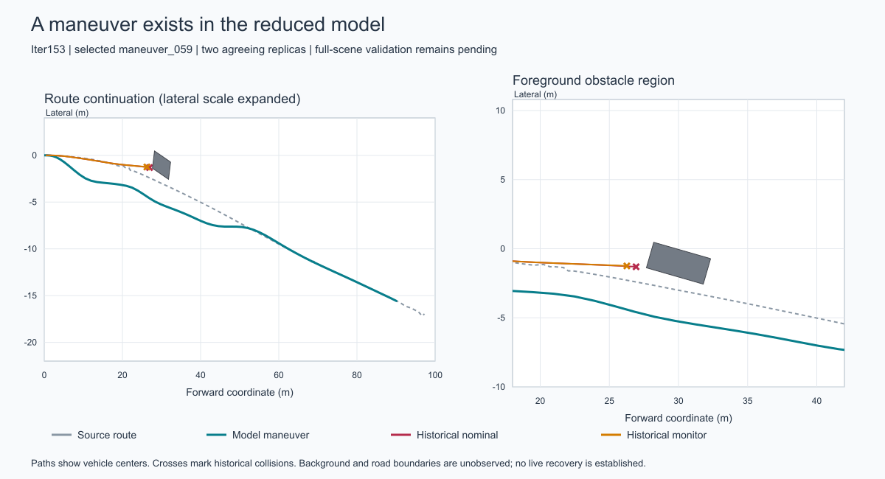

# Iter153: a maneuver candidate in the reduced model

11 October 2026. **Supported within the registered privileged-state model; live recovery is
unknown.** All 75 fixed maneuvers ran twice and passed separate scalar replay: 150 model trials,
10,012 verified model actions, zero incomplete and zero uninitialized trials. Fourteen maneuvers
met completion, swept-clearance, control and both historical progress requirements. No new
simulator episode, renderer, provider or GPU was used.

The registered ranking selected **maneuver_059**: target speed 6 m/s, signed route-normal offset
−2 m, shift starting at station 0 over 10 m, return beginning at station 40 over 15 m. It completed
the source-defined route rule after **65 actions / 16.25 simulated seconds**, identically in
both replicas. This supports a concrete full-scene validation target. It does not establish a
live recovery, deployable monitor, road-compliant path or information benefit.

[Protocol](HYPOTHESIS.md) · [plan](PLAN.json) · [independent analysis](proof/analysis.json) ·
[selected action packet](SELECTED_MANEUVER.json) · [next decision](DECISION.md).

[Vector figure](proof/selected_path.svg). Paths show centers; the left panel expands the lateral
scale and the obstacle-region panel uses equal scales. Background and road boundaries are not
available in this diagnostic. The historical traces are exposed development evidence.

## Complete finite-search accounting

| Model terminal outcome | Distinct candidate settings | Model replicas |
|---|---:|---:|
| Source foreground contact | 38 | 76 |
| Source-defined model completion | 26 | 52 |
| Source off-route condition | 2 | 4 |
| Registered control/comfort screen violated | 9 | 18 |
| Incomplete or uninitialized | 0 | 0 |

All 26 completed candidates passed the 0.25 m foreground interpolation-clearance screen.
Fourteen also met both progress requirements; the twelve completions at 2 m/s did not. These
are counts in a fixed action library on one exposed geometry, not independent scenes, population
rates or a statistical interval. Contact, off-route and control failures remain in the raw.

| Target speed | Fixed candidates | Model completions | Fully eligible candidates |
|---|---:|---:|---:|
| 2 m/s | 25 | 12 | 0 |
| 4 m/s | 25 | 9 | 9 |
| 6 m/s | 25 | 5 | 5 |

The three zero-offset route-following baselines all contacted the foreground obstacle, at
15.0, 8.0 and 6.0 s respectively. They are diagnostic pure-pursuit baselines, not reruns of UniAD.
No search expansion or favorable stopping occurred. Both replicas agree exactly in retained
states, controls and outcomes. Replica agreement adds no independent environmental evidence.

## Selected maneuver and claim boundary

The candidate has route-completion fractions 0.480121 at 7.75 s and 0.557330 at 9.0 s. Historical
nominal and monitor fractions at their respective collisions are 0.329251 and 0.322151; the fixed
progress slack is 0.05. Useful progress therefore passes both registered comparisons in this model.

| Selected trajectory quantity | Observation | Registered screen |
|---|---:|---:|
| Maximum absolute acceleration | 2.0 m/s² | 2.0 m/s² |
| Maximum absolute steering rate | 0.261799 rad/s | pi/12 rad/s |
| Maximum absolute steering angle | 0.250643 rad | pi/3 rad |
| Maximum absolute lateral acceleration | 2.223343 m/s² | 4.89 m/s² |
| Maximum absolute yaw rate | 0.370557 rad/s | 0.95 rad/s |
| Maximum source-route distance | 2.301770 m | 10 m |
| Minimum certified interpolation separation bound | 2.031626 m | Greater than 0.25 m |

The last row is an analytical midpoint displacement enclosure evaluated in float64 for the
specified linear center/heading interpolation. It is not a formal rounding proof, an actual
minimum-distance measurement or a guarantee for different continuous physical dynamics.
The comfort restrictions are inherited source screening thresholds, not measured vehicle limits.
Completion uses the source's 90%-sample rule: final nearest index 1,139 of 1,252 samples,
completion fraction 1.011715. The literal final sample is not reached.

The source obstacle is held stationary beyond its logged interval by explicit model assumption.
The search sees full source route and box geometry. It replaces the diagnostic control policy,
not the available observation interface of a deployed monitor. **Background collision, road
compliance, live recovery and information benefit are all null/unknown** in the retained result
and candidate packet. Distance to sampled route cannot certify containment in a drivable lane.

## Qualification, execution and provenance

- Protocol committed before search at `1149ec0`; qualified source at
  `7d475a54c58ad542f68f56ef0252d6ef634551d2`.
- Sixteen retained inputs bound by exact bytes; original nominal/monitor traces replayed over
  134 historical actions. Those are not new outcomes or part of the 10,012 model-action total.
- Qualification: 48 actual source transition fixtures, 12 source rectangle fixtures, 27
  separately computed rectangle-pair gaps, three source-route fixtures, and between-sample
  contact/touching counterexamples. Source slices omit renderer, ground height, background
  point-cloud collision and GEOS. Their substitutions and scope are explicit.
- Pre-search regression: **298 passed / 161 retained upstream warnings**; final focused
  suite: **40 passed**. Ambient macOS Python 3.14.2; no Linux or hermetic environment claim.
  The initial qualification attempt's two test failures are retained: incorrect expected
  fixture count and an invalid corruption expectation. Corrections and additional dimension,
  initialization and false-success checks preceded search. [Commands](proof/test_commands.json).
- The exclusive search completed in 6.254 s within 600 s; outer child supervision completed
  in 6.691 s within 660 s. The lightweight model omits the live rendering/planner workload;
  this is not evidence of real-time driving. [Execution](proof/search_000/execution.json) ·
  [supervisor](proof/supervisor.json).
- All raw committed at `13ee0925d96ceea9a8b12886b69680b245e8962d` before separate policy,
  dynamics, support-function geometry, progress, replica and selection replay. Independent
  admission committed at `f5ac5ce`; no candidate outcome was used to change the frozen search.

The old Iter145–152 source and evidence, accepted master, pinned authority and unrelated root
work remain unchanged. No new compute provider was accessed. New authored-source lint and the
repository supply-chain verifier pass; whole-repository lint and master integration remain open.
The [engineering review](ENGINEERING_REVIEW.md) records the dated public guidance and its scope.
The result supports validating this exact action sequence next, before further information-model
work or a claim about real driving, generalization or industrial superiority.
