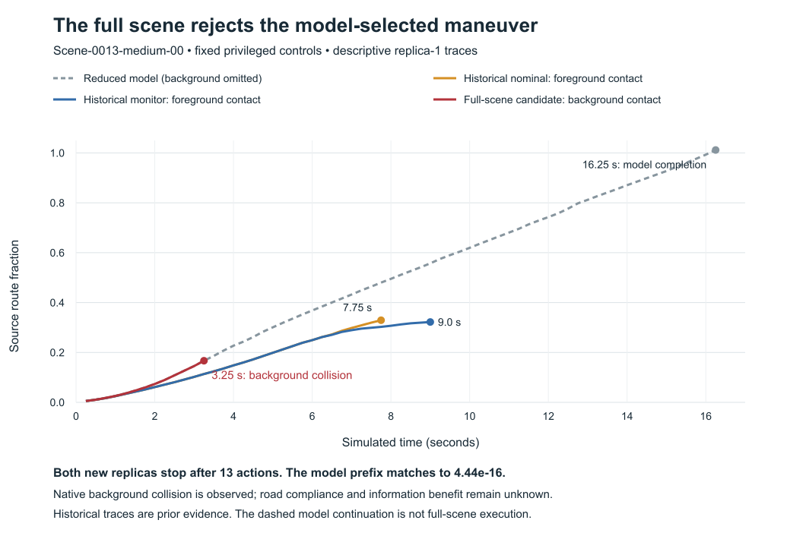

# Iter154: the model candidate collides with the full scene's background

11 October 2026. **Contradicted as a useful full-scene maneuver.** Both fresh replicas of
Iter153's exact selected action sequence terminate on native background collision at
**3.25 simulated seconds / 13 actions**. Foreground contact and the source off-route condition
are false. Both episodes passed the separate execution/outcome replay: **2 admitted, 0 incomplete,
0 uninitialized; 26 verified actions and 168 camera renders**.

This result locates a decisive omission in the reduced model. It does not establish that no
maneuver can recover this scene, that a physical vehicle would collide, or that the reconstructed
background is correct. No alternative model candidate was tried.

[Protocol](HYPOTHESIS.md) · [admission](proof/admissions/pair_000.json) ·
[per-episode analysis](proof/analysis.json) · [next decision](DECISION.md).

[Vector figure](proof/model_scene_gap.svg). Replica 1 is plotted; replica 2 has the same checked states and outcomes.

## Model expectation and observed scene outcome

| Quantity | Iter153 selected model candidate | Each Iter154 full-scene replica |
|---|---|---|
| End of executed trajectory | Model completion at 16.25 s / 65 actions | Background collision at 3.25 s / 13 actions |
| Foreground collision | None in the selected model trial | False through native termination |
| Background collision | Unknown; omitted from model | True at action 13 |
| Source off-route condition | False | False |
| Source route fraction at termination | 1.011715 | 0.166844 |
| Useful completion | Supported only within reduced model | False |
| Road compliance | Unknown | Unknown |
| Information benefit | Unknown | Unknown |

The final full-scene state is forward 13.494639 m, lateral −2.858447 m, heading −0.047913 rad,
speed 6 m/s and steering 0.078018 rad in the declared common coordinates. The nearest route index
is 187 of 1,252 samples; distance to the sampled route is 2.301770 m. The source's 10 m off-route
threshold therefore remains false even though its background-collision predicate is true.
Route proximity is insufficient evidence of collision-free or road-compliant motion.

The maximum absolute difference between the observed state and the fixed model prefix is
**4.440892098500626e-16**, below the registered 1e-9 tolerance, in both replicas. Controls, constant
actor state, route/reset and source geometry pass replay. This supports the narrower diagnosis
that the source-model kinematic prefix was delivered, while the omitted native background check
stopped the maneuver. It does not independently verify the background point cloud.

The source background function was called on 276,519 selected CUDA scene points per action.
Its criterion is more than 100 enclosed selected Gaussian centers. We retained the boolean,
source/assets, point-population size, time and outcome consistency; the actual enclosed count,
mask and points were not collected. Neither a specific curb/wall label nor physical-contact
certainty follows. The [next task](DECISION.md) makes this missing witness replayable.

Both progress checks at the historical 7.75 s and 9.0 s collision times remain **null/unobserved**
because the new episodes had already terminated. They are not zero progress or passing checks.
The historical nominal and monitor outcomes retain their original IDs and bytes and contribute
zero new episodes. Replica agreement adds no independent scenes or population rate.

UniAD and monitor inference were bypassed; this is privileged predetermined control from reset.
Median full-loop times were 0.529388 s and 0.528045 s, and all 26 loops exceeded 250 ms. These timings
exclude inference and do not establish real-time driving. Even a successful time-zero maneuver
would not establish that a monitor can select an effective continuation at its later decision time.

## Qualification, execution and retained failure

- Protocol committed at `b221b3c`; first qualified source
  `ad063849c502d21967d3bc6b8590057f797e1a13`.
- **607 local regression tests passed / 307 upstream warnings**, including 62 new focused checks,
  source-method CPU fixtures and an archive → Git → independent replay rehearsal. Rendering,
  background and height substitutes are explicit; these fixtures are not GPU outcomes.
- The first VM start request was rejected for L4 capacity. No scientific replica initialized.
  The supervisor reported `unreconciled_start`; its original failure remains retained. A separate
  qualified no-start closure confirmed the prior-start VM stayed TERMINATED and the detached
  watchdog was later observed absent. Its exit code was not observed.
- [Pre-evidence amendment 001](PRE_EVIDENCE_AMENDMENT_001.md) permitted one capacity retry,
  keeping the scientific plan/packet fixed and deducting the first envelope from the original
  resource ceiling. **295 startup/control regression checks passed / 144 warnings**, with 76
  current focused checks. Source frozen at `e61a4950a48589554f5b1f882671e011189fc546`.
  Ambient macOS Python 3.14.2; no hermetic or hosted-test pass is inferred.
- The second request obtained the same VM/hardware. Actual Linux ownership and short-deadline
  qualification passed before scientific initialization. All 11,715 source/asset bindings passed
  preflight and postflight, with no changed originals or owned cache files.
- Full raw committed at `6b2d4a99439f8cb1965cb5f406926442ac280096` before independent admission
  `a0fc7985a85ddb88088011a898d12b71d3286b24`. Admission `supported` means the execution evidence
  passed; the scientific result remains `contradicted`.

The successful owned start 07:33:44.939 UTC−07:00 was verified TERMINATED at 07:40:01.456 UTC−07:00.
Its local watchdog exited 0; no owned job remains. Combined local supervisor envelopes were
415.165872 seconds, conservative compute **$0.345972 within $3**. This includes denied-start
overhead as a conservative allowance, is not an invoice, and excludes storage/taxes.
[Resource closure](proof/resource_closure.json). New authored-source lint and supply-chain
verification pass. Whole-repository Ruff still reports 832 existing findings. The legacy docs guard
remains red because its mission snapshot is fixed at Iter134 while research now reaches Iter154;
the dirty-checkout tooling probe is also red before the closure commit. Scoped checks passed all
209 frozen input bindings and 309 local links/anchors, preserved all five architecture diagrams,
and confirmed Iter145–153 unchanged. These do not constitute a full CI pass or master integration.

The exact maneuver failed sooner than the historical nominal and monitor trajectories, through
a different collision channel. Preserve that adverse result alongside the earlier model success.
The next task is measurement of background occupancy, before another search or information model.
