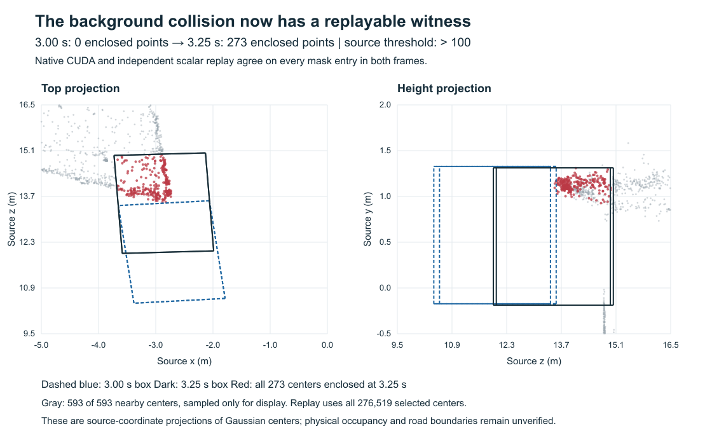

# Iter155: the background collision witness replays exactly

11 October 2026. **Supported for the two fixed historical frames.** The source CUDA predicate
and a separate scalar implementation both count **0 selected Gaussian centers at 3.00 s and273
at 3.25 s** inside the native vehicle box. Every mask entry agrees in both frames; no point is
classification-ambiguous under the registered diagnostic band. The native threshold remains
strictly greater than 100. These observations match both retained Iter154 replicas.

This closes the specific point-cloud replay gap identified by Iter154. It does not make the
failed maneuver a useful recovery, establish physical occupancy, or validate road boundaries.
Iter154 remains contradicted for that exact full-scene maneuver. **No new driving episode ran.**

[Protocol](HYPOTHESIS.md) · [independent admission](proof/admission.json) ·
[raw manifest](proof/raw/witness.json) · [next decision](DECISION.md).

[Vector figure](proof/background_witness.svg) · [display selection](proof/figure_data.json).
The gray display sample is only for readability; replay checks the complete selected population.

## What was measured

| Historical frame | Native count | Independent count | Source collision | Mask disagreements | Ambiguous classifications |
|---|---:|---:|---|---:|---:|
| 12 / 3.00 s, last clear |0 |0 |False |0 |0 |
| 13 / 3.25 s, first collision |273 |273 |True |0 |0 |

The native model exposed **1,345,702 pre-selection points**. Retained xyz, all 20 semantic feature
values per point and opacity permit independent reconstruction of the source filter: first-index
argmax, semantic index greater than 1 and not 10, opacity strictly greater than float32(0.8).
The independent filter recovers all **276,519 selected points**, in the same order and with the
same coordinates. Neither a local neighborhood filter nor favorable point removal enters replay.

The two native boxes were reconstructed from the exact historical states and bound ground asset,
using source methods on an uninitialized object: `HUGSimEnv.__init__`, `reset`, `step` and `render`
were not called. Independent yaw geometry
and ground-plane projection reproduce their inputs. Nearest ground indices are 163 and 187;
heights are −0.172711470608214 m and −0.187812607640404 m. Four historical replica/frame bindings
represent two unique poses, not four new trials or independent scenes.

The scalar checker uses binary64 projections of retained float32 inputs and strict open faces.
Its exact classification matches CUDA at both frames. The declared numerical band also yields
possible/certain counts 0/0 and 273/273. This finite agreement is not a certified error bound,
universal GPU determinism or physical clearance guarantee. Actual runtime: PyTorch 2.4.1+cu124,
NumPy 1.26.4, CUDA 12.4, NVIDIA L4, TF32 disabled and float32 matmul precision `highest`.

## Evidence and execution

Protocol `b2c8e80`; qualified source `c677e2c7dbb11db5006bde1978a829a2cfac501f`.
Full raw committed at `45c5bbb7270f4d1bfd70cd2c73da0f2b448d61ab` before independent admission
`33526109878d99099c81e59fc51b7a047fba37b8`. The retained array content is 134,564,808 bytes in
bounded compressed chunks. The redundant 81,022,803-byte transport archive is retained locally
and hash-bound in the collection receipt; the extracted chunks are committed canonical evidence.
Source/model decoding is bound to exact source and assets; it was not independently reimplemented.

**239 local regression checks passed / 144 upstream warnings**, including 75 focused checks.
CPU source-method fixtures explicitly substitute NumPy for torch and use synthetic points/ground;
they do not themselves establish CUDA behavior. One initial fixture compared pre-cast float64
vertices with float32 collision vertices; its failure and correction remain retained. New authored
lint and supply-chain checks pass. Whole-repository Ruff retains 832 existing findings. All 221
frozen inputs and 321 local links/anchors pass; all five prior architecture diagrams and
Iter145–154 evidence are unchanged. Hosted CI and the historical publication/doc guards are
reported separately; no whole-repository pass or master integration is claimed.

An initial local storage check stopped before any provider command. Completed Sentinel pytest
fixtures were removed after retaining their inventory; research evidence and other projects were
preserved. Then one provider start and one extraction invocation completed. Two early read-only
SSH startup failures were retained; the third observation succeeded. No capacity retry was used.
All 396 bound source/asset files remained unchanged before and after extraction.

Exact owned start 2026-10-11T11:23:31.309-07:00 was verified TERMINATED at 11:27:51.064-07:00.
Watchdog exit 0, idle GPU/container readback and no owned job remain. Inclusive supervisor elapsed
275.085 s; conservative compute **$0.229238 within $1.50**, not an invoice; storage/taxes excluded.
[Resource closure](proof/resource_closure.json) · [storage cleanup](proof/storage_cleanup.json).

The next work is a new background-aware feasibility model and calibration against retained native
prefixes. Preserve the failed maneuver and unchanged predicate. New search comes after calibration;
physical occupancy, drivable-road compliance, useful live recovery and information benefit stay unknown.
