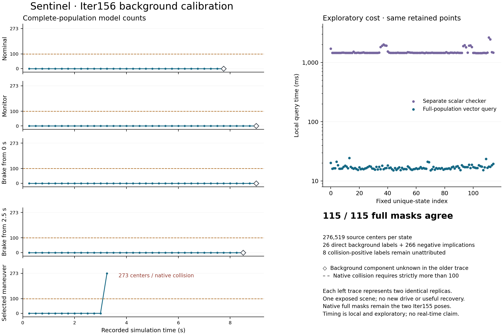

# Iter156: complete background queries pass the fixed calibration

12 October 2026. **Supported for this one-scene development population.** The new
vectorized background query and a separately implemented scalar checker agree on all
**115 complete masks of 276,519 selected centers**. No point is dropped. Across the
300 historical step bindings, the model agrees with all 26 directly recorded background
booleans and all 266 negative implications from combined collision-free records.
Eight older collision-positive records do not identify their background component and
remain unknown. No threshold-straddling diagnostic state was observed.

The model now rejects the exact Iter154 maneuver at its recorded failure: **273 centers
at 3.25 s**, above the unchanged strict threshold of 100. The preceding 3.00 s state
has zero. Iter153's omitted background term has a qualified offline implementation;
Iter154's failed maneuver remains failed. **No new drive, maneuver search or provider
execution occurred.** Useful recovery, physical occupancy, road compliance and the value
of additional monitor information remain unestablished.

[Registered procedure](PROTOCOL.md) · [fixed inputs](STUDY_PLAN.json) ·
[independent admission](proof/admission.json) · [raw predictions](proof/raw/predictions.json) ·
[next decision](DECISION.md).

[Vector figure](proof/calibration.svg) · [display identities](proof/figure_identity.json).
The left plots show one representative of each identical replica pair; the raw records
retain both. Joining recorded samples does not establish intermediate-time clearance.
The eight unattributed collision records remain unknown native background labels even
where the source model predicts zero.

## What passed, and what did not become a new observation

| Evidence layer | Result and scope |
|---|---|
| Point selection | Replayed the full Iter155 filter: 1,345,702 pre-selection centers become 276,519 selected centers, in order. |
| Independent numeric query | Every bit in 115 masks agrees: 31,799,685 point-state comparisons. Counts, certainty diagnostics, ground projection and vertex geometry also agree. |
| Direct native background labels | 26 matched bindings, representing 13 distinct selected-maneuver states across two replicas. |
| Combined collision-free labels | 266 consistent negative implications under the retained source `background or foreground` rule; these are not separately instrumented background measurements. |
| Combined collision-positive labels | Eight background components remain unknown; no positive or negative label is imputed. |
| Native CUDA full masks | Still only Iter155's two distinct poses, independently replayed again before calibration. |
| Scene/sample independence | Ten historical runs, 300 bindings, 115 unique states, one already exposed scene. No blind or held-out evaluation. |

The vector query scans the whole population with three projection tests. The scalar
checker uses its own geometry and arithmetic implementation and imports neither the
candidate query nor its producer. It also reconstructs point selection and historical
bindings, checks the frozen source and input identities, and verifies committed raw bytes.
This is implementation separation, not independent human review or independently acquired
data. Both implementations use the same declared source predicate and retained inputs.

All 114 other unique states have zero enclosed centers; the last selected-maneuver state
has 273. No point classification is ambiguous under the registered diagnostic band.
That finite observation does not certify a floating-point error bound or every unseen
trajectory. The strict raw predicate and diagnostic clear/collision/ambiguous status stay
separate; future threshold-straddling queries cannot be silently treated as clear.

## Local cost and resource closure

The producer completed the full input load, 115 queries and evidence writing in **2.830 s**.
The independent checker completed its scalar loop in **176.654 s**; its outer process took
178.598 s. Per-query timings exclude common setup and measure different implementations
in separate local processes:

| Query | Median | Observed range |
|---|---:|---:|
| Full-population vector query | 16.564 ms | 15.143–24.513 ms |
| Independent scalar query | 1,460.081 ms | 1,449.636–2,642.106 ms |

These are exploratory local costs, not a controlled hardware comparison, end-to-end
planner benchmark or real-time guarantee. Other local activity was not isolated. Source
agreement is the admission criterion; speed does not substitute for it. The method is
ordinary NumPy vectorization, with no claim of algorithmic novelty.

The local numeric environment was Python 3.11.15, NumPy 2.4.6, macOS arm64. This is not
the historical PyTorch/CUDA environment. Peak checker RSS was 404,176,896 bytes, within
the 1 GiB budget. The complete derivative output is below 8 MiB. Both commands returned
zero, with no retry, owned provider job, GPU operation or new provider spending.
[Producer execution](proof/producer-run.json) · [checker execution](proof/checker-run.json).

## Source, qualification and publication scope

Procedure and executable source were frozen at
`b427539fa999b2d487925ebfd982fc4cb7c542a6`. All producer raw was committed at
`c5b274f0fde9e1df7768023a4027c3f4a31d0f85` before independent admission
`748e1825b54a7827048dbf5ab8b983ef2bd53a7c`. No post-result change to those producer,
checker, plan or raw bytes is part of this result.

**151 focused tests passed**: 76 new query/admission checks and 75 retained witness checks.
Known-bads exercise strict 100/101 boundaries, rotated boxes and open faces, invalid ground,
source/population corruption, caller mutation, favorable mask/count edits, missing states,
unknown-label substitution, mismatches, raw commit identity and resource gates. The older
point-selection/native-mask witness replay also passed. The isolated local test environment
is recorded literally; hosted whole-repository results are separate exact-commit evidence.

The [frontier review](../../docs/research/SENTINEL_FRONTIER_ENGINE_REVIEW_2026-10-12.md)
explains why this constraint comes before another search and why responsive repair,
qualified simulation outcomes and information-budget comparisons are necessary next.
No improvement in driving outcome or superiority over another system is claimed here.
