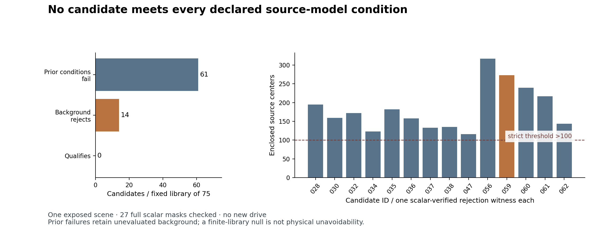

# Iter157: no candidate survives the complete source-model conditions

12 October 2026. **Null for the fixed 75-action development library.** All 14
maneuvers that passed Iter153's foreground, control and progress conditions fail
the background predicate. The other 61 retain their prior failures. Neither
registered ranking has an eligible candidate. This rules out a native test of
this library under these conditions; it does not prove physical unavoidability.

The producer queried 221 state bindings, representing 172 distinct model states,
using all 276,519 selected centers every time. A separately implemented scalar
checker verifies all 14 rejection witnesses, plus the failed Iter154 maneuver's
entire reset-to-rejection prefix: **27 complete masks, 7,466,013 point-state
classifications**. Every checked mask agrees. All 150 historical model traces
replay again, including 10,012 control actions, foreground swept margins and
progress. No new driving episode, provider task or GPU use occurred.

[Registered protocol](PROTOCOL.md) · [fixed plan](PLAN.json) ·
[admitted evidence](proof/admission.json) · [raw inventory](proof/raw/predictions.json) ·
[next decision](DECISION.md).

[Vector figure](proof/library-null.svg). Bars show independently verified
background counts at retained rejection states, not physical occupancy or a
continuous-time clearance estimate. Earlier clear samples of other rejected
candidates were producer diagnostics, not separately scalar-replayed timings.

## The full denominator remains visible

| Disposition | Candidates | Interpretation |
|---|---:|---|
| Prior foreground/control/progress conditions failed | 61 | Background remains unevaluated for these candidates, never imputed clear or zero. |
| Previously eligible, now rejected by background | 14 | At least one full scalar-verified counterexample per candidate. |
| Numerical abstention | 0 | None observed in the queried population; no global numerical guarantee. |
| Qualifies under every declared condition | 0 | Finite library and sampled background times only. |

The background predicate is the source's unchanged strict **count >100**. Its
14 rejection counts range from **116 to 317**, at retained times from 3.25 to
4.50 seconds. These are verified rejection states; only the mandatory negative
control's preceding sampled states are all independently checked here. That
control still has **273 centers at 3.25 s** and no earlier sampled rejection.
No stronger earliest-collision or between-step claim is made.

The library consists of already exposed route-offset feedback specifications,
not 75 independent scenes or 150 independent observations. Two model replicas
agree; this does not add case diversity. Useful native recovery, physical
occupancy, road compliance, actual-trigger recoverability and additional
information value all remain unknown. The experiment does not compare Sentinel
against an implemented ECO or another competent responsive repair policy.

## The first admission failed; the correction is part of this result

The first checker stopped before any scalar query because the registered source
inventory mistakenly included PyTorch's synthetic `_classes.py` and `_ops.py`
references as repository files. The source-inventory gate correctly rejected
that manifest. Its [failed receipt](proof/checker-run.json) and
[stderr](proof/checker.stderr) remain unchanged.

A disclosed **post-evidence administrative correction** removed exactly those
two nonexistent extra references. The original PLAN, producer, raw and checker
remain unchanged. The corrected checker has the same scientific AST and checks
all 38 real frozen source paths, the original plan hash and every raw byte. Eight
new correction controls pass, alongside the 47 new library gates; 151 background
checks passed before acquisition. This is not a claim that the original protocol
executed unchanged. [Correction and limits](ADMISSION_CORRECTION.md) ·
[exact correction](ADMISSION_CORRECTION.json) ·
[corrected execution](proof/corrected-checker-run.json).

Original source: `35f1d711e25af599e30016ae8d6d120a734026ee`.
Raw committed before any scalar admission: `8e2077e8581b02a1dfbc0215a4cc6a75f9d43140`.
Correction source: `b7f5fdf` (full identity in the corrected execution receipt).
Admitted evidence committed separately at `1a88bbb37d765a6bed5675f0d022420c85b526eb`.
No producer was retried and no action parameter was changed after the outcome.

## Local cost and resource closure

The one producer completed in **5.684 s** (6.138 s outer process). Corrected
scalar admission, including all historical trajectory replay, completed in
**58.216 s**. Peak RSS was 490,274,816 bytes for the producer and 557,498,368 for
the checker; raw derivatives occupy 7,998,975 bytes. All are within the registered
bounds. The first failed checker and correction costs remain separately retained.

Python 3.14.2, NumPy 2.4.2 and PyTorch 2.10.0 were present in the local environment;
the geometry computation is NumPy/scalar CPU code. The isolated Python 3.11
environment lacked a transitive Torch import, so qualification used the existing
Python 3.14 environment explicitly. No hosted Linux-lock or real-time performance
claim follows from these local timings. Current hosted CI is separate exact-source
evidence.

This result closes a practical decision: do not spend another native run on a
candidate already contradicted by the simulator's own complete source predicate.
A better action generator, a different development case, or a defensible revision
to the progress task must be registered separately. None is justified merely by
wanting a positive result.
