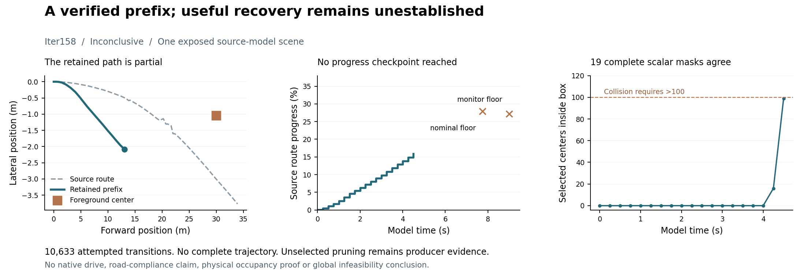

# Iter158: no complete action found by the bounded search

**Inconclusive about task feasibility.** One registered actuator search on the
exposed static source model ended with an empty beam at the first progress
checkpoint, 7.75 s. It found no complete trajectory. The independently checked
retained prefix ends at 4.5 s and source progress 0.1588569400; it does not reach
either progress checkpoint and is not a useful recovery. The registered completion
criterion was not met.

The producer attempted **10,633 transitions**. It recorded 9,199 clear transitions,
1,008 background rejections, 70 control rejections, 355 progress rejections and
one numerically ambiguous transition. These are transitions in a pruned search,
not independent cases or complete candidate trajectories. The 10,209 search
background queries include reset. A further 19 queries materialized the retained
prefix masks. All queries scan all 276,519 selected centers. Unqueried background
components after an earlier rejection remain missing, not clear.

Separate scalar admission reconstructs the retained prefix's **18 actions and
19 states**, foreground clearance, conservative interpolated foreground sweep,
ground projection and complete background masks: **5,253,861 point-state
classifications**. All masks agree. Its largest background count is 99 under the
unchanged strict collision threshold >100. No numeric threshold abstention occurs
on this prefix. The single ambiguous search transition remains excluded.
Background clearance between sampled states is unestablished.

Admission does **not** independently replay every rejected or pruned branch.
Those search accounting labels remain producer evidence. Beam/cell pruning and
foreground-only guidance can discard a useful route; this procedure is incomplete.
It cannot show that no admissible control sequence exists, establish an optimal
planner, or justify moving a failed policy into another native episode.

The scientific bottleneck remains a constructive useful action. The new interface
can generate and independently verify a constructed detour, but that qualification
did not establish capability on this source scene. Guidance ignores background
geometry and the route's curvature when estimating remaining cost. That is a
candidate explanation for poor search allocation, not a demonstrated causal
explanation of this outcome. See [next decision](DECISION.md).

## Retained execution and limits

- Source frozen/published before acquisition: `06dfbb728ec980a8a925d995a7a611c8fe13b189`.
- Raw committed before admission: `f23de2bee271770997e3a0f338a388c3aefe031d`.
- Admission committed: `022435fbd6cf04d52402ab57923920ffbc517ddf`.
- Producer: 198.466 s (199.640 s outer), 526,417,920-byte peak RSS.
- Independent checker: 33.499 s (35.415 s outer), 552,140,800-byte peak RSS.
- Raw: 5,772,323 bytes. All declared resource caps respected; no retry or post-outcome source correction.
- Local acquisition uses Python 3.14.2 / NumPy 2.4.2. Timing is local execution accounting, not an equal-resource planner benchmark. Other local work was running.
- 196 focused/retained checks pass in Python 3.14; all 22 new checks pass in the existing Python 3.11 environment. Whole-repository Ruff passes. Preregistered source CI [38263389987](https://github.com/manfromnowhere143/sentinel/actions/runs/38263389987) passes on Python 3.10 and 3.11; closure CI is a separate scope.

The earlier qualification failures are disclosed in [QUALIFICATION.json](QUALIFICATION.json).
They were corrected on synthetic controls before source-scene acquisition. No
native drive, cloud compute, GPU or compute spending occurred. Road compliance,
physical occupancy, actual-trigger recovery, information benefit, transfer and
competitive advantage remain unestablished. Iter135 remains deferred and unrun.

[Local validation and platform limits](proof/validation/local.json) ·
[preregistered source CI](proof/validation/source-ci.json).
