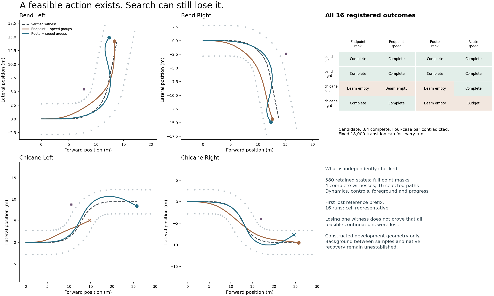

# Iter159: known feasible, still missed by search

12 October 2026. **Contradicted:** route guidance with speed-group retention did
not complete all four registered controls. It completed three and exhausted its
18,000-transition budget on the fourth. The older endpoint guide also completed
three, with a different failure. No aggregate coverage advantage is established.



| Guidance / pruning | Bend left | Bend right | Chicane left | Chicane right | Complete | Attempted transitions |
|---|---|---|---|---|---:|---:|
| Endpoint / rank | complete | complete | beam empty | complete | 3/4 | 22,184 |
| Endpoint / speed groups | complete | complete | beam empty | complete | 3/4 | 25,467 |
| Route / rank | complete | complete | beam empty | beam empty | 2/4 | 24,134 |
| Route / speed groups | complete | complete | complete | budget exhausted | 3/4 | 53,286 |

All sixteen runs are retained: **11 completions, four empty beams and one budget
exhaustion**. The common cap is 18,000 attempted transitions, with 24 retained
nodes and a 96-action horizon. Total actual work is 125,071 attempted transitions
and 116,150 search background queries, including each reset. Witness creation and
selected-mask materialization are additional producer work, included in total
elapsed time but outside that search-query count. These are not equal wall-time
comparisons or a runtime performance benchmark.

The interaction matters. Speed groups improve route guidance from two to three
completed cases, but do not improve endpoint guidance's completion count. Changing
only guidance within the speed-group arm gains chicane left and loses chicane
right. Neither the route heuristic nor speed grouping is a uniformly superior
choice on these four development cases.

## What the independent check establishes

All four constructive witnesses complete. They satisfy the inherited dynamics,
actuator limits, conservative foreground sweep, full sampled background predicate
and both registered progress checkpoints. Every witness command is in the common
primitive alphabet. Search receives the route and geometry, not the witness
commands. This removes absence of an expressible solution as an explanation for
these specific misses; it does not prove completeness of the whole action set.

Separate scalar admission checks **580 states**: 214 witness states and 366 states
from the sixteen selected search paths. Every full mask agrees, covering
**4,228,224 point-state classifications**. It checks all selected dynamics, control,
foreground, route and sampled background conditions. Some search completions
precede the second checkpoint; those later observations remain unobserved under
the inherited termination rule, not measured passes.

The mechanical audit replays beam selection from retained scores and finds the
first exact witness prefix is replaced by another state in the same quantized
cell in **all sixteen runs**: sample one for bends, sample two for chicanes. All
reference commands are covered. This is not a complete causal explanation of
search failure: eleven runs still find another complete trajectory. Unselected
hard-rejection labels and heuristic score calculations remain producer evidence.
The checker does not certify a continuation-equivalence relation for these cells.

## Fixture limitation found during interpretation

The protocol describes the left/right fixtures as mirrors. The route, background
patches and witness commands are mirrored, but the constructor places each
foreground object on the same local side rather than reflecting it. The literal
CASES bytes were frozen before acquisition and used unchanged in every arm.
Within-case guidance/pruning comparisons and the four-case completion claim remain
well-defined. **These are not full-scene reflection controls**, and differences
between left and right cannot diagnose directional bias. This limitation was
identified after acquisition; no fixture, frozen implementation or result was
repaired or rerun. A future reflection test must validate its transform explicitly.

The routes are generated from the witnesses and the background patches are
constructed point populations. This is intentionally favorable development
qualification, not a road benchmark. Sampled point-count clearance is not physical
occupancy, continuous background clearance, a road boundary or native recovery.
There is no new evidence for useful recovery, information value or transfer.

## Reproduction, resources and validation

- Frozen source: `1a5a16e444bbfc64fa2927f036ace34754164e66`.
- All raw before admission: `ffa79d4d81039ba73c6867ccb6e5863f4ffeecb7`.
- Independent admission: `5f7c8431ea2247501f663431ed651f076ffc644c`.
- Producer: 96.736 s internally / 96.906 s outer; 71,319,552-byte peak RSS.
- Checker: 34.661 s internally / 36.359 s outer; 350,175,232-byte peak RSS.
- Producer raw before final execution receipt: 59,982,651 bytes. Exact committed
  inventory is independently bounded below 256 MiB. All declared caps pass.
- 128 focused/retained tests pass on Python 3.14.2, including 22 new controls;
  whole maintained Ruff, supply-chain and documentation checks pass. Two initial
  malformed test reset fixtures were corrected before acquisition. A later local
  Python 3.11 graphics environment cannot collect the tests because it lacks Torch;
  this is not a Python 3.11 test pass. Exact hosted outcomes are retained separately.
- One acquisition, one admission, no retry or post-outcome source correction.
  No new native episode, GPU, provider use or spending. No owned job remains.

Replay from the frozen source with its required Python/NumPy dependencies:

```bash
python3 -m experiments.iter159_route_search_qualification.run \
  --root "$PWD" --source 1a5a16e444bbfc64fa2927f036ace34754164e66 \
  --output /an/unused/output/path
```

The admission command and raw binding are retained in
[checker-run.json](proof/checker-run.json). Admission requires the committed raw
inventory and the exact frozen source files; it rejects changed masks, states,
beam selection, missing proposals, false completion and budget accounting.
See [protocol](PROTOCOL.md), [decision packet and sources](DECISION_PACKET.md),
[admission](proof/admission.json) and [next decision](DECISION.md).
