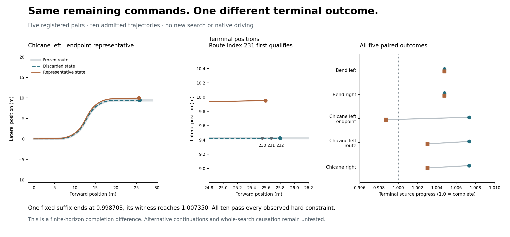

# One fixed continuation changes; four are preserved

**Contradicted:** the claim that every retained representative completes under
the same remaining witness commands. All five original witness paths complete.
Four representatives also complete; one ends just below the source completion
threshold after exhausting the exact frozen suffix. Every observed hard
constraint passes on all ten trajectories. This is a finite-horizon terminal
difference, not a collision or proof that a useful continuation was impossible.

| Pair | Replacement frame | Discarded-state progress | Representative progress | Representative outcome |
|---|---:|---:|---:|---|
| Bend left | 1 | 1.004785 | 1.004785 | Complete |
| Bend right | 1 | 1.004785 | 1.004785 | Complete |
| Chicane left, endpoint guide | 2 | 1.007350 | 0.998703 | Fixed suffix exhausted |
| Chicane left, route guide | 2 | 1.007350 | 1.003026 | Complete |
| Chicane right | 2 | 1.007350 | 1.003026 | Complete |

The five distinct pairs retain all sixteen Iter159 bindings. They are fixed
constructed diagnostics, not five independent population samples. The endpoint
chicane-left pair represents two historical runs; both had empty beams. The
route chicane-left pair represents a failed and a successful run. The chicane-right
pair represents three successful runs and the failed route/speed-group candidate.
Those differing historical outcomes despite the same first representative show
why this one-step audit cannot explain the entire search.

For the differing pair, the discarded state starts the suffix at
`[1.625, 0, 0, 3, 0]`; its representative is
`[1.6248308148340742, 0.01592950486575882, 0.02124093702345683, 3, 0]`.
Their actual reset-to-state histories are retained and checked. At sample 58
(14.5 s), the witness is nearest route index 232; the representative is nearest
index 230. With 257 route points, index 231 first satisfies the source's
`(nearest + 1) / (0.9 * 257) >= 1` rule. The representative ends about 0.566 m
from the witness endpoint. No extra command was executed to repair that result.
Its outcome under more time or another command sequence remains unobserved.

Separate scalar admission verifies **546 states, all 546 full masks and
4,081,572 point-state classifications**. Both absolute-time checkpoints pass on
every trajectory:20 observed checks. All observed background counts are zero.
Controls, foreground contact and sweep, route distance, progress and completion
are replayed separately; the checker does not import the producer or vector query.
This establishes the retained model predicates, not physical safety, continuous
background clearance, road compliance, native recovery or information benefit.
The prior incomplete full-scene reflection construction remains disclosed.

One producer acquisition took 2.234 s; admission took 32.301 s. Recorded peak RSS
was 213,024,768 and 412,811,264 bytes respectively. Raw output before the final
execution receipt was 797,867 bytes. All registered caps passed. A mistyped source
commit was rejected before initialization and any trajectory evaluation; that
preflight rejection is retained separately. There was no initialized retry,
post-outcome source change, provider access, GPU use or new driving episode.

Before acquisition, 198 focused/retained tests passed on Python 3.14.2, including
35 new controls and known-bads. Whole Ruff and supply-chain checks passed. The
exact hosted Python 3.10/3.11 checks are a separate publication requirement;
local ambient results do not substitute for them.

Source **16590b3e4a6583e7a42e942c571d83c7c66e26d1**; raw committed before
checking at **d423dd6cecff29d362003552e0e9858b1edbb98b**; independent admission
committed at **bc6bb9ff074180dc589888a222f7f9c5e25511d4**.

[Independent admission](proof/admission.json) · [Frozen protocol](PROTOCOL.md) ·
[Inputs and all historical bindings](INPUTS.json) · [Execution](proof/raw/execution.json) ·
[Pre-initialization rejection](proof/preflight.json) · [Next decision](DECISION.md).
