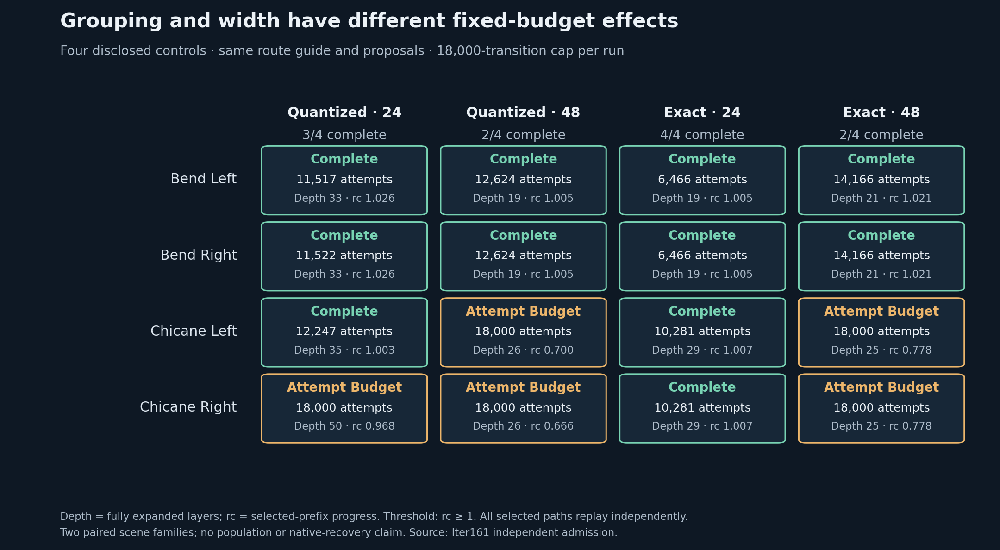

# Grouping helped at width 24; a wider beam did not

**Supported:** exact state grouping at width 24 completes all four frozen
development controls. Quantized grouping at width 24 completes three. Both
width-48 arms complete two. Each run had the same 18,000 attempted-transition cap,
route guide, proposals, constraints and stopping rules. All sixteen outcomes
pass independent admission. These are two disclosed paired scene families,
not a population benchmark or a native recovery result.

| Grouping | Width | Complete | Total attempts | Background queries | Search seconds |
|---|---:|---:|---:|---:|---:|
| Quantized | 24 | 3/4 | 53,286 | 50,002 | 40.164 |
| Quantized | 48 | 2/4 | 61,248 | 58,498 | 47.075 |
| Exact | 24 | **4/4** | **33,494** | **31,918** | 25.752 |
| Exact | 48 | 2/4 | 64,332 | 61,818 | 49.347 |

Each row totals all four cases, including failures. Caps are equal; actual work
and wall time are not. Timing is one local acquisition, not a latency benchmark.
Exact/24 uses 37.1% fewer attempts than quantized/24 over these controls and
completes the previously missed chicane-right case. That is the effect of changing
grouping in this fixed implementation, including downstream search changes; it
does not identify one particular replacement as the entire historical failure.

At width 48, removing approximate grouping changes no binary completion outcome.
Increasing width from 24 to 48 loses one completion with quantized grouping and
two with exact grouping. The difference of those differences is -1 completion
among four controls. No significance test or general advantage follows. All
five incomplete runs exhaust the transition cap, not time or an empty beam.
Width-48 chicane searches finish only 25–26 full layers; exact/24 completes both
at layer 29. The width change also changes retained branches, so insufficient
depth is an observed budget consequence, not proof of a unique causal mechanism.
[Every case, stop, depth, progress and count](proof/table.md).

## The two deletion stages are now explicit

| Arm | Removed by grouping | Removed by width | Retained events | Partial-depth survivors |
|---|---:|---:|---:|---:|
| Quantized / 24 | 31,206 | 8,194 | 3,564 | 300 |
| Quantized / 48 | 42,632 | 8,136 | 4,148 | 469 |
| Exact / 24 | 0 | 28,348 | 2,272 | 0 |
| Exact / 48 | 0 | 55,016 | 4,288 | 1,254 |

At completed depths, **187,804 clear candidate events** partition into 73,838
grouping removals, 99,694 width removals and 14,272 retained events. Another 2,023
clear candidates lie in interrupted partial depths and receive no selection.
These counts concern different visited trees and repeated temporal events;
they are not distinct trajectories or causal shares of the failures.

No exact duplicate keys occurred among the admitted clear candidates at completed
depths. Thus exact grouping removed zero candidates here, while the width cap
remained active. All eight quantized runs first lose the supplied witness to
grouping at frame 1 or 2; each winner survives the beam. All eight exact runs
first lose that witness to width at frame 2 or 3. Exact/24 nevertheless finds
four other complete paths. Preserving that particular witness is not necessary
for completion, and losing it is not proof that all feasible paths were lost.

## Evidence and limits

The new right-hand fixtures fully reflect the left-hand scene, including foreground
placement, ground and all points. The left fixtures remain byte-identical to
Iter159. A separately implemented transform check and involution controls pass;
all four original constructive paths replay before acquisition. Historical
Iter159's incomplete reflections and outcomes remain unchanged. These privileged
route constructions do not provide an independent perception or road benchmark.

Scalar admission checks **643 states and full masks**, totaling 4,716,822
point-state classifications across four witnesses and sixteen selected paths.
It separately reconstructs controls, dynamics, foreground contact/sweep, route,
28 observed absolute-time checkpoints and completion. The exact/24 paths complete
before frame 32, so their second checkpoints are unobserved under the frozen
termination rule. Their maximum sampled background counts are zero; the largest
count across other admitted paths is 100, permitted by the strict >100 predicate.

Both selection stages are independently replayed from retained producer scores
and clear labels. The checker does not independently recompute every unselected
hard rejection or guide score. Five uncompleted searches retain valid prefixes;
those prefixes are not feasible complete solutions. Sampled point clearance does
not establish physical occupancy, continuous background clearance, road compliance,
safety, native recovery, information benefit or transfer.

One acquisition took 163.331 seconds; independent admission took 37.628 seconds.
Peak RSS was 75,431,936 bytes for the producer and 391,593,984 for the checker.
Raw before its final execution receipt was 102,811,285 bytes. All caps passed.
Total attempts were 212,360; search queries including resets were 202,236.
No retry, post-outcome search change, native episode, GPU, provider or spend.

Before freeze, 224 focused/retained tests passed on ambient Python 3.14.2, including
26 new checks. Toy-budget, shared-reference reflection and checker-list corrections
were completed before freeze; [qualification](QUALIFICATION.json) records them.
Whole Ruff and supply-chain checks passed. Exact hosted Python 3.10/3.11 validation
is a separate publication requirement, not implied by these local results.

Frozen source **bc326a44051e556ca63983377833d47c93849d41**; raw committed before
checking at **634ba75f56f6fbacad304d0933e917f7e94c6b59**; independent admission
committed at **b38b0b7cde224c1ee2a5c5b28d9aa91282b4f232**.

[Independent admission](proof/admission.json) · [Execution](proof/raw/execution.json) ·
[Protocol](PROTOCOL.md) · [Decision packet](DECISION_PACKET.md) ·
[Derived arithmetic](proof/summary.json) · [Figure PDF](proof/factorial.pdf) ·
[Next decision](DECISION.md).
