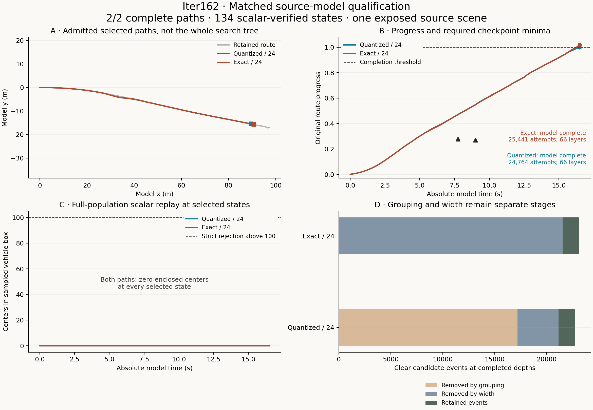

# Both grouping rules complete the retained source model

**Supported:** the preregistered exact-state/width24 candidate finds a complete
independently admitted path on the retained source model. The matched quantized/24
arm also completes. Both paths take 66 actions, or 16.5 seconds of modeled time,
and observe both original absolute-time progress checks. This establishes bounded
model action feasibility on one exposed scene, not native or responsive recovery.

| Grouping / width | Attempts | Search queries | Actions | Final progress | Maximum background count | Search seconds |
|---|---:|---:|---:|---:|---:|---:|
| Quantized / 24 | 24,764 | 22,723 | 66 | 1.000177 | 0 | 428.091 |
| Exact / 24 | 25,441 | 23,124 | 66 | 1.019702 | 0 | 412.180 |

The completion contrast is zero. Exact grouping uses **677 more attempts (2.7%)**
and **401 more background queries (1.8%)**. Its four-control synthetic advantage
therefore does not establish an efficiency advantage here. Wall times differ in
the opposite direction in this one fixed-order local acquisition; they are not a
latency benchmark. Each arm had 60,000 attempts, 401 actions and 1,800 search seconds.
Neither exhausted a limit. Guidance, proposals, width, ordering, constraints and
stopping were identical; only the state grouping rule changed.

## What was independently checked

The checker reconstructs selection from the original semantic and opacity arrays,
then confirms all **276,519** selected binary32 centers. It separately reconstructs
both full paths: dynamics, controls, foreground contact and sweep, route outcomes,
both original checkpoints per path, and every complete scalar background mask.
That is **134 states**, **37,053,546 point-state classifications**
and **4 observed checkpoint checks**. Both complete paths pass.
No partial prefix has been counted as completion, and no missing checkpoint was
imputed. The strict background threshold and numerical ambiguity policy are unchanged.

| Arm | Removed by grouping | Removed by width | Retained events | Partial-depth survivors |
|---|---:|---:|---:|---:|
| Quantized / 24 | 17,201 | 3,952 | 1,569 | 0 |
| Exact / 24 | 25 | 21,522 | 1,576 | 0 |

These are repeated candidate events at completed depths, not distinct paths or
causal shares of failure. Both stages replay independently from the retained clear
labels and guide scores. Unselected hard predicates and guide scores remain
producer evidence; the complete search tree was not independently collision-checked.
Exact-state grouping and width pruning remain different mechanisms even though
both arms complete this scene.

## Cost, identity and limits

One acquisition took **843.796 s**, including 1.208 s setup and
2.258 s selected-mask materialization. Independent admission took
**225.129 s**. Producer/checker peak RSS: 475,267,072 /
648,134,656 bytes. Raw before the final execution receipt:
28,713,838 bytes. All registered envelopes pass. Total search work:
**50,205 attempts and 45,847 full-population queries**, plus 134 materialization
queries. These are offline costs; no real-time response or computational advantage
has been demonstrated.

The source scene was already exposed. Geometry is privileged and static. Sampled
point clearance does not establish physical occupancy, continuous background
clearance, drivable-road compliance, dynamic-scene validity or physical safety.
Native recovery, actual decision-time availability, information benefit and transfer
remain unknown. No new driving episode, provider, GPU use, spending, retry or
post-outcome search amendment occurred. Iter135 remains deferred.

Frozen source: **219f4605f2bfd3aed9ed97ab084616ce1ee35ce8**. Raw committed before checking:
**682214de17d57a7a5232bc697a7d9d5c644fd631**. Independent admission commit: **79f2da20e0ffc5585a4f64899bd93b33673d6a4c**.
260 focused/retained tests passed before freeze, including 36 new checks. Whole
Ruff, supply-chain and the documentation guard passed. Exact frozen-source CI
[38442327746](https://github.com/manfromnowhere143/sentinel/actions/runs/38442327746)
passed 3,849 tests with two skips on each hosted Python 3.10/3.11 version. Closure
publication is separately checked at its own final head.

[Admission](proof/admission.json) · [Execution](proof/raw/execution.json) ·
[Protocol](PROTOCOL.md) · [Decision packet](DECISION_PACKET.md) ·
[Qualification](QUALIFICATION.json) · [Next decision](DECISION.md) ·
[Current research review](RESEARCH_UPDATE.md) · [Vector figure](proof/source_comparison.svg) ·
[PDF figure](proof/source_comparison.pdf).
