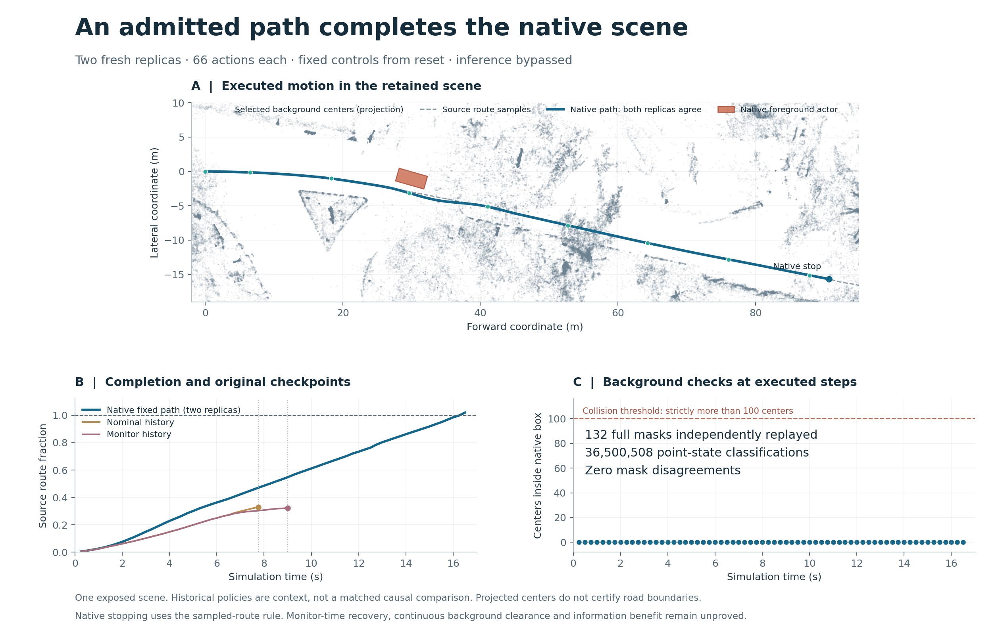

# Iter163: the admitted path completes the native scene

13 October 2026. **Supported within the registered scope.** The preselected
Iter162 exact/24 path completes `scene-0013-medium-00` in both fresh native
replicas: 66 actions and 16.5 simulation seconds each. Neither run records a
collision or off-route event. Both original progress checkpoints pass.

This establishes a complete native action sequence from reset in one previously
exposed scene. The controls were computed offline using privileged geometry;
UniAD and Sentinel inference were bypassed. It does not establish recovery from
the actual monitor history, useful information, real-time operation or superiority
to another planner. The two replicas are repeated executions of the same case,
not two independent scenes.

| Registered observation | Replica 1 | Replica 2 |
|---|---:|---:|
| Executed actions | 66 | 66 |
| Native completion time | 16.5 s | 16.5 s |
| Final source route fraction | 1.0197018104 | 1.0197018104 |
| Native foreground/background collision | None observed | None observed |
| Progress at 7.75 s | 0.4703585375 | 0.4703585375 |
| Progress at 9.0 s | 0.5475683351 | 0.5475683351 |
| Full background masks checked | 66 | 66 |
| Maximum background count | 0 | 0 |
| CUDA camera calls | 402 | 402 |

The native stopping rule uses the sampled route near 90% completion. Both runs
stop at nearest index 1,148 of 1,252 samples, rather than the literal final sample.
The final route distance is 0.014548455 m. Historical nominal and monitor traces
in the figure are context; their different policies and inference paths do not
constitute a new matched causal comparison.

## What independent admission checked

The two scientific traces agree. All 132 applied controls and state transitions
replay, with zero numerical difference from the admitted model states. Actor states,
transforms, foreground overlap, render correspondence, route indices, terminal
conditions and all four checkpoint observations pass their registered checks.
The source actor remains stationary in these records; that was observed, not
enforced by freezing its controller.

For every executed background query, the actual source predicate's complete mask
and query box were captured. Its per-call population identity matches all 276,519
retained selected centers. Separate scalar replay checks **36,500,508 point-state
classifications**, with zero mask disagreements. Reconstructed vertices match
exactly; maximum ground-height discrepancy is 5.56e-16. The reset has no native
background query and is not counted as one. These are step samples, not a proof
of continuous background clearance or physical occupancy.

[Independent pair admission](proof/admissions/pair_000.json) ·
[Public aggregate](proof/admission.json) · [Descriptive analysis](proof/analysis.json) ·
[Registered protocol](HYPOTHESIS.md) · [Immutable plan](STUDY_PLAN.json).

## Timing, resources and the retained correction

All **132/132 measured loops exceed 250 ms**. Median loop time is 552.8 ms;
maximum is 605.3 ms. These instrumented loops include native rendering and
evidence collection, bypass inference and consume a precomputed path. The earlier
offline search cost remains separate. Neither this timing nor simulation dt
establishes a 4 Hz deployed planner or monitor.

One VM start closed in 438.745 seconds, within the 3,600-second envelope. The
conservative incremental compute estimate is **$0.366 within $3**, excluding
persistent storage and taxes; it is not an invoice. The
[price binding](proof/price_binding.json) comes from
[Google's accelerator pricing](https://cloud.google.com/products/compute/pricing/accelerator-optimized).
All 11,754 bound files pass postflight, with no original or owned-cache changes.
The exact owned start is verified `TERMINATED`; the local watchdog exited normally.
Collected evidence totals 23,403,517 bytes against a 512 MiB bound. No initialized
retry or extra scientific episode occurred. [Resource closure](proof/resource_closure.json).

The first frozen source failed three hosted threshold tests because Python 3.14's
AST serialization included a field absent in Python 3.10/3.11. No VM had started.
The [pre-evidence correction](PRE_EVIDENCE_AMENDMENT_001.md) replaced that identity
encoding with a source-text hash; no predicate arithmetic, plan or budget changed.
All 66 CPU query records match the earlier scalar-replayed fixture after correction.
The failed run and its logs remain retained. Corrected-source CI
[38454828251](https://github.com/manfromnowhere143/sentinel/actions/runs/38454828251)
passes **3,952 tests, with two skips, on each locked Python version**. Final closure
CI and public delivery are observed separately from this frozen-source check.

Source: `e6a6a80f2a0301377af5f307e79eea52a60f464b`.
Raw committed before analysis: `8d0e2c2fac91c44285d9d51009955897fef33062`.
Independent admission: `0dae260c93afd19253c49f9895c3f57e75120013`.

The next dependency is [continuation from the retained first-fire history](DECISION.md).
Road compliance, real-world safety, information benefit, held-out transfer and
competitive advantage remain unproved.
