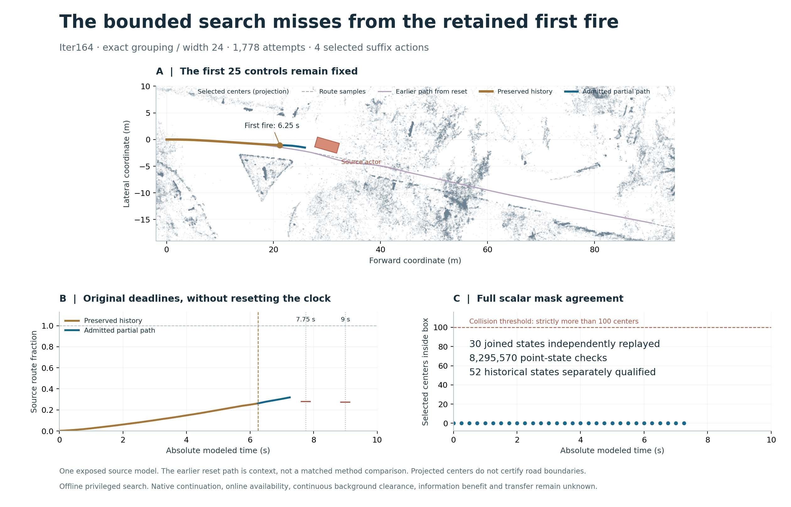

# The reset-time success does not carry over to the monitor's first fire

14 October 2026. **Contradicted:** the registered exact/24 method does not find a
complete source-model continuation after preserving the actual 25-control history.
This is a valid bounded miss, not evidence that recovery is impossible.

Both retained historical prefixes independently qualify through **6.25 seconds**:
52 states, 14,378,988 scalar point-state classifications, matching controls, states,
actor records and absolute timestamps. The first alterable control applies at
6.50 seconds. The original progress deadlines remain **7.75 and 9.00 seconds**;
the original total horizon remains 401 actions, leaving 376 after first fire.

One search uses **1,778 attempted transitions** and 935 background queries. Its
beam empties at absolute frame 31 / **7.75 seconds**, after 17.496 seconds of search.
It reaches neither the 60,000-attempt cap nor the 1,800-second search cap. Exact
state grouping removes **zero** candidates; width pruning removes **822** across
completed depths. These counts do not establish that pruning caused the miss.

The best retained partial path adds four controls and ends at **7.25 seconds**,
source progress 0.31860135. Independent replay reconstructs the complete joined
history: **30 states and full masks**, 8,295,570 point-state classifications, no
mask disagreement or selected-path constraint violation. All background counts
are zero. Neither checkpoint is reached by this partial path; **zero observed
checkpoint checks is not two passed checks**. This path is not a complete recovery.

## What the retained search explains

| Absolute time | Attempts | Accepted labels | Retained beam | Removed by grouping | Removed by width |
|---|---:|---:|---:|---:|---:|
| 6.50 s | 16 | 16 | 16 | 0 | 0 |
| 6.75 s | 250 | 250 | 24 | 0 | 226 |
| 7.00 s | 372 | 372 | 24 | 0 | 348 |
| 7.25 s | 394 | 234 | 24 | 0 | 210 |
| 7.50 s | 376 | 62 | 24 | 0 | 38 |
| 7.75 s | 370 | 0 | 0 | 0 | 0 |

At the final depth the producer labels 356 proposals as foreground-sweep
rejections and 14 as foreground overlap. Those unselected physical predicates
remain producer evidence; admission independently replays beam selection from
retained labels and all physical checks along the selected path. There is no
released-planner comparison and no demonstrated causal explanation for the miss.
[Descriptive counts](proof/descriptive_search_counts.json).

## Evidence and resources

Frozen source `08fc375ddbe0cc26dcd03b954105da22d9df25ad` precedes all acquisition.
Prefix raw `e0d777324968cf7e0ad073a4031a20f23222dda3` precedes independent prefix
admission `182f3383de7f5cb087f3db17baa924559a8dd9df`. Search raw
`4317baf339dbb7eb26a0d0e2a8070b4bbae19063` precedes independent final admission
`67714239d8dd01e4a65a02761308f8dd6c271c7c`.

Prefix producer/checker take 3.157 / 87.814 seconds; continuation producer/checker
19.048 / 52.251 seconds. Peak reported process RSS stays below 559 MiB. Both
acquisitions and both checkers complete under the frozen wall, memory and output
caps. The owned supervisor reaps every process. **No new native episode, provider
access or spending.** [Resource closure](proof/resource_closure.json) retains exact
values and [supervision](proof/supervision) retains wall deadlines and logs.

Qualification passes 303 focused/retained tests, including 43 new controls for
clock reset, changed history, wrong splices, false completion, rejected prefixes,
resource corruption and initialized failures. Ambient local Python is 3.14.2;
exact-source hosted checks are a separate publication observation. The initial
undersized constructed fixture failure is retained in the qualification record;
its correction preceded scientific acquisition and changed no scientific budget.

[Protocol](PROTOCOL.md) · [Plan](PLAN.json) · [Prefix admission](proof/prefix_admission.json) ·
[Final admission](proof/admission.json) · [Qualification](QUALIFICATION.json) ·
[Next decision](DECISION.md).

## Scope

One exposed static source model, privileged full geometry, offline computation.
The previous reset-time native success remains valid within its own scope. This
new miss neither retracts it nor extends it to monitor-time recovery. Continuous
background clearance, road boundaries, native continuation, latency tolerance,
useful information, held-out transfer and competitive superiority remain unknown.
