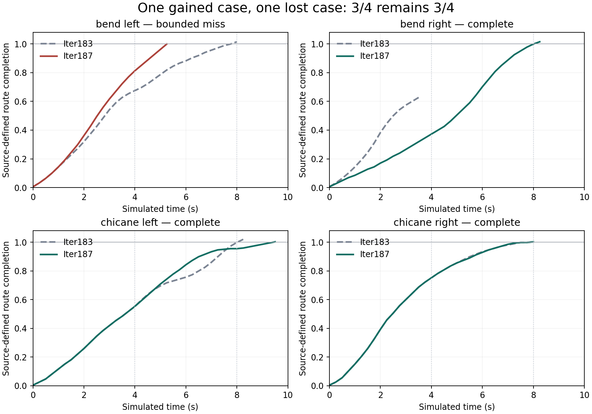

# Iter187 — one gained case and one lost case

27 October 2026. **The all-four qualification is contradicted.** The integrated
extra-branch mechanism completes the right bend that Iter178 and Iter183 missed,
but loses their left-bend success. Both chicanes complete. The aggregate stays
**3/4, with one gain and one loss against each comparator**. Source comparison
remains closed. All four runs are admitted; none is censored, incomplete or retried.

| Fixed case | Iter178 | Iter183 | Iter187 | Returned frame | Attempted transitions | Registered extras | Extras on returned path |
|---|---|---|---|---:|---:|---:|---:|
| bend_left | complete | complete | bounded miss | 21 | 17,993 | 4 | 2 |
| bend_right | bounded miss | bounded miss | complete | 33 | 11,259 | 2 | 1 |
| chicane_left | complete | complete | complete | 38 | 4,225 | 7 | 1 |
| chicane_right | complete | complete | complete | 32 | 12,155 | 3 | 1 |

The original cases, seeds, physical constraints, 18,000-transition / 120-second
case limits, 128-transition connection allowance and eight/96-step horizons are
unchanged. Primary selection is unchanged at each actual request. Additional
branches change later nearest-parent choices; preserving a local primary does
not preserve the old complete search tree or its successes.

The dashed lines are retained Iter183 paths. Vertical dotted lines mark the two
progress checkpoints at 4 and 8 simulated seconds. Source-defined route completion
is a model predicate, not physical road safety. [Figure data](proof/figure-data.json).

## What independently replayed

Separate admission checks **45,632 attempted transitions**, proposals, physical
and timing predicates, cache/query accounting, primary selection and the online
extra rule. Exact native IDs bind sampled parents, tokens, durations and control
sequences. All **235 registered primaries and 16 registered extras** are included.
Full scalar collision replay covers **483 distinct registered states and 3,530,538
point-state classifications**, including unused branches. The four returned paths
contain 128 state records and seven checked progress checkpoints.

Background labels of evaluated but unregistered alternatives remain producer
evidence. Native RNG/sampling is source-bound rather than independently regenerated.
These four repeatedly exposed constructed cases provide no independent-scene
generalization, actual-history recovery, information-value or competitive claim.
The right-bend completion is a new finite model witness, not a live intervention.

## Retained chronology and next question

On the left bend, the first extra is registered at call 1 and the first numeric
request divergence from Iter183 occurs at call 2. Of 17,993 attempted transitions,
12,875 start from parents with extra-branch ancestry; this is descriptive allocation,
not a causal estimate. No registered node reaches beyond frame 21. The returned
endpoint is already at source progress 0.999468 with speed 3.5 m/s, while completion
before frame 32 is forbidden. The attempted-evaluation records contain 960 first
premature-completion rejections, compared with 34 in Iter183.

This supports a specific question about advancing too early and allocating work
among changed parents. It does not prove that the selected endpoint is unavoidable
or that a new filter will help. [Exploratory chronology](proof/chronology.json) ·
[next decision](DECISION.md). No extra search or motion query was used for this description.

## Identities, resources and checks

- Frozen source/protocol: `7302dd9f1f0a82858f74ff284c7f1e91386aca08`.
- Constructed worker raw: `375713f826ab72ccac257c28ae53e8ea7466aa29`; separate admission:
  `06982623ddd1ae554f4ac3a8fe2af04b87351d3a`.
- Four-case raw before admission: `0ae5bd0a7804827ba591ccc93fe3afe08684029a`.
- Independent scientific admission: `f2d21146a005a2b0827dc5e9992cd9ea31940daa`.

The constructed worker control admits three extras, two on the returned path,
510 attempted transitions and 27 distinct states. **201 distinct focused tests
pass**, including 36 new checks. The main invocation passed 199 and skipped two
because the parent-library environment variable was incorrectly named; those two
checks then passed with the correct binding. The native successor was exercised
locally, not inferred from a hosted skip. Whole-repository lint, supply-chain and
documentation checks pass at their retained local scopes. Hosted publication
checks are observed separately; this paragraph does not assert a hosted outcome.

Scientific searches took 12.284, 18.557, 4.716 and 24.846 seconds. The producer
envelope closed in 89.817 seconds with all four children reaped, within 900 seconds;
raw content before finalization was 43,679,126 bytes. Independent admission took
86.763 seconds, peak RSS 299,155,456 bytes. Runtime is observed macOS Python 3.14.2,
not a certified hermetic environment. No new simulator driving, provider access,
GPU use or spending. Historical evidence, mission bytes and the original dirty
root/index are preserved. This trial is closed and must not be rerun.

[Protocol](PROTOCOL.md) · [admission](proof/admission.json) · [state](STATE.json) ·
[primary research review](RESEARCH.md).
