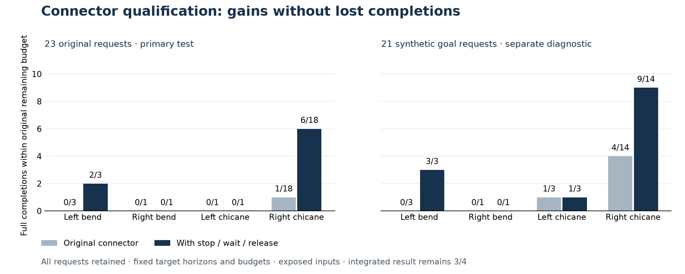

# Iter191 — state-dependent connector qualification supported

**A single feedback proposal increases full completions from 1/23 to 8/23 on the
original late-state requests, with no lost completion.** All 23 baseline requests
reproduce their original deterministic work and selections. Two original left-bend
requests now complete at frame 33 in eight attempted transitions each. No result
is censored. This supports the preregistered connector qualification; integrated
qualification remains **3/4**, with no new integrated trial.

The intervention computes bounded braking from the evaluated speed, holds through
the final scheduled checkpoint, then applies the frozen route controller at
2 m/s. One feedback request precedes the unchanged proposal schedule when the
checkpoint is within the next eight frames. The target-derived horizon, transition
checks, timing eligibility, selectors, native binary, sampling and allocation stay
fixed. No state is clamped and no hidden rollout supplies the controls.

## Complete populations and paired results

The fixed population contains all 23 actual outgoing requests from Iter190's
22 late node records and 21 separately disclosed synthetic goal requests, one per
exact retained root. Duplicate left nodes 76/85 share a root; the synthetic request
uses the later, smaller-budget history and its completed registration batch. Both
arms preserve exact targets, original tree contexts, ancestry and consumed work.
Each receives at most 128 attempted transitions, within the original 18,000 case
cap. Full original case wall time plus new setup, evaluation and payload
serialization must remain below 120 seconds. Arm order alternates by request.

| Population / case | Requests | Original complete | Candidate complete | Gains | Losses |
|---|---:|---:|---:|---:|---:|
| Original · left bend | 3 | 0 | 2 | 2 | 0 |
| Original · right bend | 1 | 0 | 0 | 0 | 0 |
| Original · left chicane | 1 | 0 | 0 | 0 | 0 |
| Original · right chicane | 18 | 1 | 6 | 5 | 0 |
| **Original total** | **23** | **1** | **8** | **7** | **0** |
| Synthetic goal · left bend | 3 | 0 | 3 | 3 | 0 |
| Synthetic goal · right bend | 1 | 0 | 0 | 0 | 0 |
| Synthetic goal · left chicane | 3 | 1 | 1 | 0 | 0 |
| Synthetic goal · right chicane | 14 | 4 | 9 | 5 | 0 |
| **Synthetic total** | **21** | **5** | **13** | **8** | **0** |

The synthetic population cannot rescue a failed primary criterion. Here the
original population independently meets all criteria: constructed interfaces
qualified, baseline reconstruction exact, no lost original completion, and two
new original left-bend completions within remaining budgets. These are exposed,
dependent requests from four development cases, not independent held-out scenes.

## What changes at the left-bend boundary

All three original requests start at node 62, frame 25, speed 0.125 m/s.
The first braking command is −0.5 m/s²; subsequent zero-speed commands hold the
pose through frame 32. Release at frame 33 is still subject to every motion and
background constraint.

| Original call | Frozen horizon | Original return / attempts | Candidate return / attempts |
|---|---:|---|---|
| 120 | 7 | Frame 26, incomplete / 126 | Frame 32, checkpoint only / 126 |
| 132 | 8 | Frame 26, incomplete / 128 | Frame 33, complete / 8 |
| 139 | 8 | Frame 26, incomplete / 128 | Frame 33, complete / 8 |

Call 120 is not lengthened to create a release opportunity. It keeps its shortened
target horizon. The two completions require no new expansion allocation, extra
branch rule or additional connection allowance. This isolates a useful proposal
intervention on those requests; it does not establish what a new integrated tree
will do after earlier decisions change.

## Work, costs and complete replay

Original requests use **2,815 → 1,956 attempts** and **1,392 → 1,021 queries**.
Synthetic requests use **2,200 → 1,248 attempts** and **1,190 → 829 queries**.
No returned progress decreases, but costs do not improve uniformly: candidate
attempts increase on one original and five synthetic requests. Observed charged
wall time increases on eight original and ten synthetic requests. These single
observations are not timing distributions or an end-to-end response-delay result.
Every pair, including checkpoint crossings and exact costs, is in [PAIRS.md](PAIRS.md)
and [admission](proof/admission.json).

The largest original-plus-new total is **17,903 attempts** and **23.330275 seconds**,
below the unchanged ceilings. Every candidate request invokes the feedback program.
Six fresh native constructed workers qualify untimed deterministic parity and
timed straight/curved dispatch, completion, registration and path transport.

Separate replay verifies all prefixes and joined paths, exact program order,
cache namespaces, attempts, queries, timing eligibility, both selectors and
native identities. Scalar replay includes every queried rejected, unselected and
post-rejection state. Retained requests account for **8,219 attempts / 4,432
queries**; native controls add **1,031 attempts / 751 queries**. Across both scopes,
**1,726 scalar-state records / 10,772,001 point-state classifications** replay.
States are deduplicated within each retained query inventory; native workers
retain separate inventories.
Deduplicated mask materialization never skips an actual query computation.

## Provenance and limits

- Population correction, before any new retained-input evaluation:
  `c27ee6899e13782696feda76fb0f04c4a3235de3`; initial population bytes remain in history.
- Frozen source: `e904cb6a3d67d3e8727aed6aa1ca2eac8926d804`; 1,002 source/input bindings.
- Raw committed before replay: `79267ac3a22023c9ecbd6a733b9ff2f85c7d2021`.
- Independent automated admission: `f2d29eeb27dccfffaa14ca64462325e679bbf662`.
- Before freeze: **85 new tests and 277 focused regressions pass, no skips**,
  including actual native execution. Pre-freeze failures/corrections are retained
  in [QUALIFICATION.json](QUALIFICATION.json).
- Producer: 50.153 s / 473,792,512 peak RSS bytes. Checker: 154.198 s /
  598,327,296 peak RSS bytes. Both exited and were reaped. One acquisition, no retry.
- No new integrated runs, simulator driving, cloud/GPU use or provider spending.

Iter191 is closed. Finite misses do not establish infeasibility. The qualification
does not establish physical safety, recursive feasibility, unseen-case performance,
useful actual-history intervention, response delay or competitor superiority.
Source comparison stays closed. The next step is a separately preregistered
unchanged-budget all-four integrated trial, retaining gains and losses against
Iter189 and Iter183. [Decision](DECISION.md) · [Protocol](PROTOCOL.md) ·
[Research rationale](RESEARCH.md) · [State](STATE.json).

The historical acquisition and admission commands are in [run.py](run.py); their
output paths are exclusive and already occupied. Do not rerun them or tune this
closed schedule. Constructed tests can be rerun with the bound native library
via `SENTINEL_RRT186_LIBRARY`; without that library, three native controls explicitly
skip. Hosted validation is recorded separately from this local scientific runtime.
