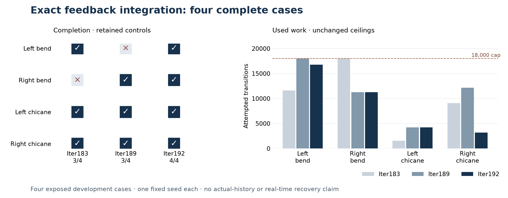

# The exact feedback proposal completes all four integrated cases

28 October 2026. **Supported:** one prospective all-four acquisition completes
every exposed development case within the unchanged 18,000-transition / 120-second
case ceilings. There is **one gain and no lost completion** against each retained
comparator, Iter189 and Iter183. This is a finite integrated qualification, not a
monitor-time intervention, held-out result or safety guarantee.

| Case | Iter183 | Iter189 | Iter192 | Returned frame | Attempts: 189 → 192 | Queries: 189 → 192 | Search seconds: 192 |
|---|---|---|---|---:|---:|---:|---:|
| Left bend | complete | incomplete | complete | 33 | 17,999 → 16,759 | 10,469 → 9,957 | 23.086 |
| Right bend | incomplete | complete | complete | 33 | 11,259 → 11,259 | 8,616 → 8,624 | 15.418 |
| Left chicane | complete | complete | complete | 38 | 4,225 → 4,225 | 3,318 → 3,321 | 9.583 |
| Right chicane | complete | complete | complete | 33 | 12,155 → 3,202 | 8,291 → 2,045 | 6.844 |

Every returned path passes both original progress checkpoints. Six feedback
requests occur across the four searches. The exact Iter191 adapter is imported
without changes; native binary, selection, sampling, target horizons, timing
eligibility, dynamics and constraints retain their frozen identities. No
allocation or metric change accompanies the proposal.

Attempted transitions total **35,445**, versus **45,638** in Iter189, a 22.3%
reduction on these four cases. Queries total **23,947**. The right bend and left
chicane use slightly more queries; cost improvements are not universal. The
complete paired records, including registrations and retained wall times, are in
[admission](proof/admission.json). Controls are retained historical acquisitions,
not contemporaneously randomized arms. Candidate all-query recording is inside
the search clock; Iter189 materialized registered masks afterward. Wall-time
differences are descriptive, not a measured speedup claim.

## Independent replay and provenance

Separate replay checks all attempted controls, physical predicates, eligibility,
proposal schedules, primary/extra selections and native identities. Every queried
background state receives full scalar mask replay, including rejected and
unselected evaluations: **9,539 distinct per-case states and 66,226,446 point-state
classifications**. All returned paths and unused registered branches are bound to
the reconstructed ancestry. Native RNG choices are source/seed/event-bound,
not independently regenerated. The same agent executed producer and separate
checker implementations; this is automated verification, not human review.

Protocol commit `f3d547eafb3d59afcae728a40c8843d7a5689289` precedes source freeze
`b11ea920717a6a95acb721f645b13bf9ec3f7c93`. Raw commit
`f64341c8bcc7976b5d17d2fa9b4ad4ad4ce902f8` precedes admission
`3c0bed93455282ace9f944d408185a1d4e2c4113`.

Producer: **76.958 s / 209,158,144 peak RSS bytes**. Checker:
**600.192 s / 353,746,944 peak RSS bytes**. All four workers exit and are reaped.
Raw data before final execution receipt is 52,016,538 bytes. No case is censored.
One acquisition, no scientific retry, no driving episode or provider spending.
An initial command using an abbreviated source hash was rejected before raw
initialization; its log is retained separately. The full-hash invocation produced
the sole acquisition.

Qualification establishes 25 new checks plus 234 unchanged regressions, without
native-runtime skips. Initial test-fixture mistakes and their pre-freeze
corrections remain visible in [qualification](QUALIFICATION.json). They changed
no planner code or scientific outcome.

## What advances

The local proposal improvement survives integrated execution. The result does not
isolate the causal benefit of branch retention, establish continuous-control
completeness, or generalize beyond these four exposed cases. Further tuning on
this population stops. [Iter193's separately preregistered test](../iter193_history_delay/PROTOCOL.md)
returns to preserved intervention histories and imposed delay. Native execution,
uncertainty, response deadlines, unseen scenes and strong alternatives remain
separate requirements.

[Protocol](PROTOCOL.md) · [Plan](PLAN.json) · [Decision](DECISION.md) ·
[Resource closure](proof/resource_closure.json).
